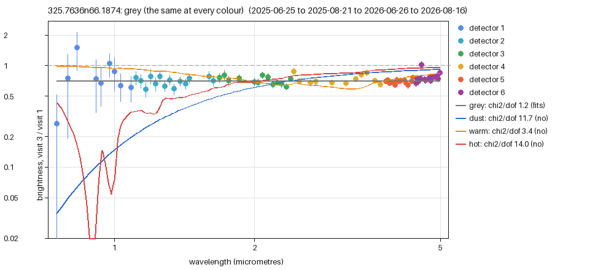
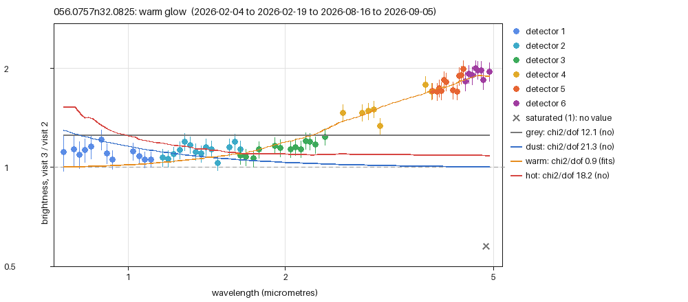
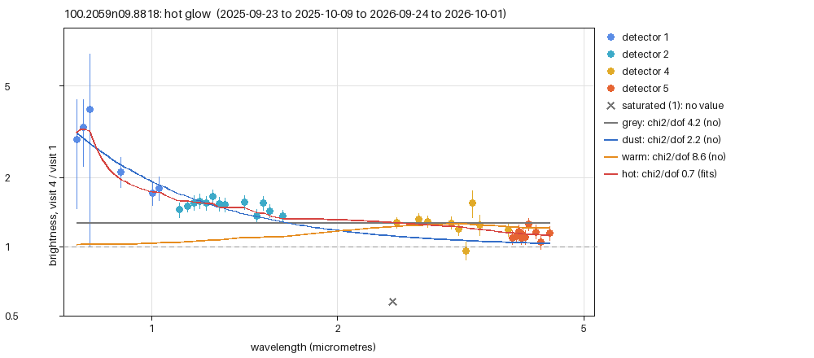
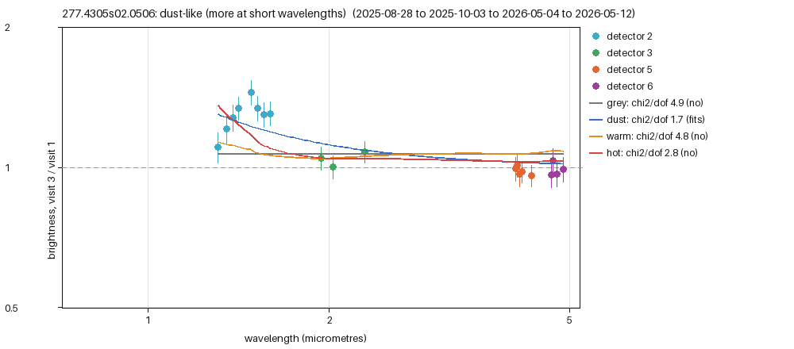
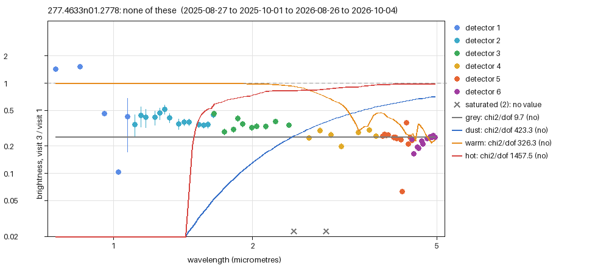
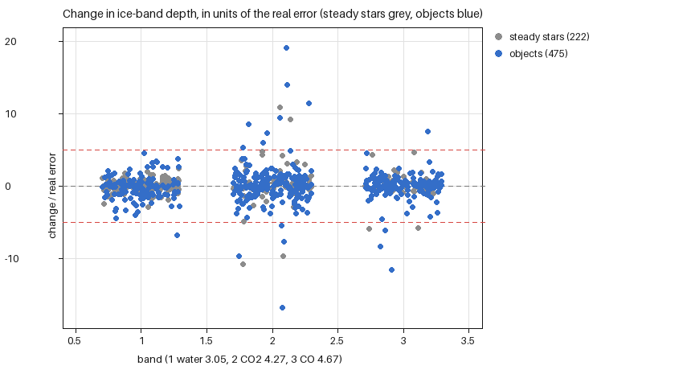
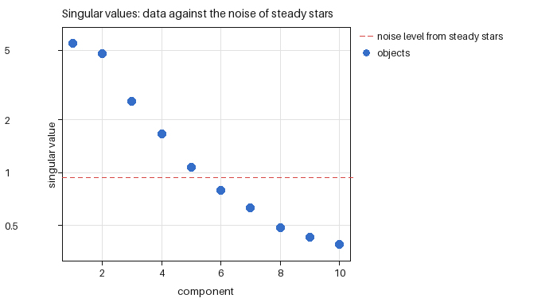
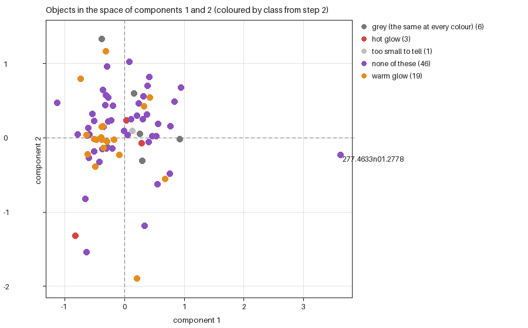

# The colour of a change: in which colours did it change, and what does that say?

Written 2026-11-14 for teammates who are not astronomers. Everything below was measured from SPHEREx cutouts already
on disk (nothing was downloaded, nothing simulated or filled in) and can be re-run with one command
(`python scripts/colour_of_change.py`, see "How to run it"). The numbers come from `docs/colour/summary.json`.

## The idea, in three sentences

Everyone, including our own search, asks of a changing object "how much brighter or fainter did it get?".
SPHEREx measures every object in 102 colours from 0.75 to 5 micrometres, so we can also ask in which colours it
changed: the same everywhere, more in the blue, more in the red, or in a way no simple recipe gives. The answer is a
description of the colours of the change, which narrows down what could have caused it but does not prove a cause.

## The method, in plain words

1. **Like with like.** Each SPHEREx exposure sees an object at its own wavelength, so a blue reading in one visit
   and a red one in the next say nothing about change. For each object and each pair of visits we take, in every
   wavelength channel (17 per detector, six detectors) that has clean readings in BOTH visits, the median of each
   visit's readings (error from the scatter of the readings and the measurement errors, never below 3 per cent), and
   divide later by earlier. That gives a spectrum of ratios: the **spectrum of the change**. Readings that are
   saturated or flagged are left out and counted; a channel with no clean reading in a visit has no value, and is
   drawn as a grey cross at the bottom of the picture, never as a number. The brightness itself is the one the
   search measures (`search._measure_exposure`: the same 15.4 arcsecond circle, flags and sky ring); nothing about
   how the search or the photometry measure was changed.
2. **Calibrating one visit against another.** In each field, for each pair of visits and each detector, the steady
   "control" stars of that field (see below) show how the whole field moved between the visits: a factor and a small
   constant (from sky subtraction). A straight line late = f x early + b is fitted to them (3-sigma clipped, needs 4
   or more stars) and removed from the object's late levels. 275 such groups were calibrated. Errors on the ratios
   were then multiplied by 1.08, the square root of the mean reduced chi-square of the steady stars' own ratio
   spectra (549 star-pairs).
3. **Four simple shapes, each fitted with errors** (to every pair; the headline pair of an object is the one with
   the largest change, chosen by the size of the change):
   - *grey*: the same factor at every colour (one number: the factor);
   - *dust*: ratio = exp(-tau x wavelength^-alpha), tau being the optical depth added (positive) or removed
     (negative) at 1 micrometre (one number). The law is Wang and Chen 2024 (ApJ Letters 964, L3, arXiv 2402.17239):
     from 993 JWST NIRSpec spectra they find the Milky Way's extinction proportional to wavelength^-alpha between 1.0
     and 5.3 micrometres with alpha = 1.98 +- 0.15. It is the one published law found that covers SPHEREx's whole
     range in one paper made from spectra, not from a few filters. Below 1 micrometre they say a power law is not a
     good description, so over 0.75 to 1.0 micrometres it is an approximation. Re-running every verdict with alpha
     1.83 and 2.13 changed 1 verdict of 111 (at 1.83) and none (at 2.13);
   - *warm glow*: light added or removed with the shape of a Planck curve between 250 and 1,500 kelvin (two numbers:
     the amount and the temperature). Later = earlier + A x shape, using the object's own earlier spectrum;
   - *hot glow*: the same between 2,500 and 10,000 kelvin.
   Each shape's fit is judged by its chi-square (a shape "fits within the errors" if p is above 0.01). The verdict is
   the shape that fits and beats the others by more than 2 on chi-square + 2 x (number of numbers); **"cannot tell"**
   if two or more fit about equally; **"none of these"** if none fits; **"too small to tell"** if the change is below
   6.3 sigma (see "Checks"). Temperature errors are the range where chi-square rises by 1; they mean nothing for a
   shape that does not fit.
   For objects no shape fits, two further descriptions are tried and reported as extra information, never as a
   class: a whole-object factor combined with dust, warm or hot glow, and a straight tilt (ratio proportional to
   wavelength^s).
4. **Ice.** For water ice (3.05 micrometres), carbon dioxide ice (4.27) and carbon monoxide ice (4.67), the depth of
   the band in each visit and the change in depth, again between the same channels (details and a reason below).
5. **Let the data sort itself**: the change spectra of all objects on a common grid, reduced with principal
   components (singular value decomposition).

**Steady stars as controls.** 147 ordinary stars from the same patches (0.7 to 140 mJy, unsaturated, unflagged,
not on a glow, 25 arcseconds from any watchlist object and each other) which the search itself found steady (change
below 2.5 sigma in every detector). They set the calibration (step 2), the error scale, the "too small" threshold and
the real error of the ice measurements. They are not guaranteed steady below the search's own detection level
(about 10 per cent), so every false alarm counted on them is an upper limit on the method's.

## Checks on objects whose behaviour is known

All with the same code, from the same cutouts; pictures in `docs/colour/known_*.png`.

| Object | What was known | What the method measures | Agrees? |
|---|---|---|---|
| **RW Aurigae** (changer-076.9564n30.4012; saturated star, ring measure in detectors 5 and 6) | brighter at short wavelengths and fainter at long ones between its visits (`docs/verification.md`; `docs/search.md`: 1.66 times in detector 1, 0.52 and 0.54 in detectors 5 and 6, Sep 2025 to Sep 2026) | Sep 2025 to Sep 2026, same channels: detector 1 **1.65** (13 channels), detector 5 **0.52** (13), detector 6 **0.56** (9), detectors 2 to 4 1.17 to 1.30 (1 channel each). Class **none of these** at 62 sigma (grey chi2/dof 58, dust 140). Sep 2025 to Mar 2026: 1.23 (D1), 0.82 (D5), 0.70 (D6) | Yes, to within 4 per cent (1.65 against 1.66, 0.52 against 0.52, 0.56 against 0.54). "None of these" is the right answer: no one of the four shapes is brighter in the blue and fainter in the red |
| **Serpens South star** (changer-277.5055s02.0620) | brightened far more at long wavelengths: 4.5 times at 4.4 to 5.0, 6.3 times at 3.8 to 4.4 micrometres (`docs/search.md`) | Aug-Oct 2025 to Mar-Apr 2026: **5.6 (3.8 to 4.4), 4.2 (4.4 to 5.0), 5.9 (2.4 to 3.8), 2.7 (1.65 to 2.4), 2.5 (1.1 to 1.65)**. The ratio climbs from the near infrared to 3 to 4 micrometres and falls a little beyond. Class **none of these** at 70 sigma (nearest: grey, chi2/dof 15.5; warm 23.8; dust 129; hot 143) | Yes in direction and size (the 5.6 and 4.2 are in the same range as 6.3 and 4.5, which came from a differently chosen pair of visits). Not any single simple shape: it brightened most at 3 to 4 micrometres, so it is neither grey nor a plain warm glow |
| **V462 Lupi**, nova (Feb 2026 to Jul-Aug 2026) | a warm infrared glow fading (`docs/novae.md`) | ratio **0.23 (detector 1), 0.24 (2), 0.12 (3), 0.05 (4, one channel), 0.06 (5), 0.08 (6)**: far more fading at 4 to 5 than at 1 to 2.4 micrometres. Class **none of these** (grey chi2/dof 75; warm 2,057; no two-part shape fits) | In direction yes: the red faded 3 to 4 times more than the blue. As a shape no: the whole nova faded, not only a warm glow |
| **V7994 Sagittarii**, nova (Mar-Apr 2026 to Aug-Sep 2026) | a warm glow fading | ratio **0.22 (1), 0.28 (2, one channel), 0.04 (4, two channels), 0.09 (5), 0.12 (6)**. **None of the four fits** (grey chi2/dof 10, warm 112), but **a whole-object fading plus a warm glow removed fits within the errors** | Yes, in the two-part form |
| **V371 Ser** (known variable, `docs/search.md`) | faded to 0.22 to 0.38 of its brightness at every wavelength from 1.1 to 5 micrometres, Sep 2025 to Sep 2026 | **0.44, 0.41, 0.33, 0.27, 0.25, 0.24** from 0.75-1.1 to 4.4-5.0 micrometres. Class **none of these** at 313 sigma; tilt: the change at 5 micrometres is 0.5 times the change at 1 | Yes in size and direction (0.24 to 0.44 against the search's 0.22 to 0.38). Not grey: it faded about twice as much at 5 as at 1 micrometre (grey chi2/dof 9.7) |
| **HH 17** in NGC 1333 (changer-052.3351n31.3094; `docs/search.md`: faded 0.84 to 0.90 at four detectors, Aug 2025 to Feb 2026) | | the same visits: factor **0.864 +- 0.007**, class **grey** (chi2/dof 1.0, p 0.40; dust chi2/dof 4.6, hot 6.3, warm 1.4 also acceptable at p 0.015 but not better); ratios 0.90 (1.1-1.65), 0.85 (1.65-2.4), 0.91 (2.4-3.8), 0.83 (3.8-4.4), 0.86 (4.4-5.0) | Yes: 0.864 inside the search's 0.84 to 0.90 |
| **Steady stars** | must come out as "no change" | 147 control stars: 134 "no clear change", 10 "none of these", 2 dust, 1 warm. The threshold was set on half of them (67 stars; 90th percentile of their own change significance, 6.3 sigma); on the other half (80 stars) **74 came out "no clear change" (92.5 per cent), 5 "none of these", 1 "dust"** | Yes, with 7.5 per cent false alarms |

**The smallest colour difference the method can see.** Taking the steady stars (549 pairs of visits) and measuring,
for each, how differently it appears to change at 5 and at 1 micrometre (the ratio of the two changes, 1.0 being the
same colour): the scatter is 0.10 in the natural logarithm for all of them (**10 per cent**) and 0.07 for those
brighter than 3 mJy (**7 per cent**). A difference between the change at 5 and 1 micrometres must therefore exceed
about **24 per cent for a bright object and 35 per cent for a faint one** to be 3 sigma. The tails are heavy: 2.5 per
cent of steady-star pairs show an apparent difference of more than a factor 1.8, so a single object's tilt of less
than that should not be trusted alone. A whole-object (grey) change of less than about 5 per cent (the scatter of
steady stars' grey factor, 0.045) cannot be seen either.

## How many objects, and what class

111 brightness-changing objects were analysed: all 111 of the watchlist's "needs eyes" (31) and "already known" (80)
changers. None was skipped: every exposure of every patch has its cutout on disk (0 missing). Movers and the set-aside
artefacts were not included. 3 are saturated stars measured by their ring (warm and hot shapes cannot be fitted to a
ring brightness, which is not a flux).

| Class of the headline pair | All 111 | Needs eyes (31) | Already known (80) |
|---|---|---|---|
| grey (same at every colour) | **7** | 3 | 4 |
| dust-like (more at short wavelengths) | **1** | 1 | 0 |
| warm glow (250 to 1,500 K) | **26** | 7 | 19 |
| hot glow (2,500 to 10,000 K) | **4** | 3 | 1 |
| cannot tell (several shapes fit equally) | **0** | 0 | 0 |
| none of these | **67** | 16 | 51 |
| too small to tell (below 6.3 sigma) | **2** | 1 | 1 |
| too narrow a range of wavelengths (under a factor 2 between longest and shortest shared channel) | **4** | 0 | 4 |

- On the steady stars the same procedure gives 134 of 147 "no clear change"; the other 13 (9 per cent) are the false
  classes to keep in mind: 10 "none of these" (6.8 per cent), 2 dust, 1 warm. On the half of the steady stars that did not set the threshold, 5 of 80 (6 per cent) came out "none of these".
- Readings left out in the headline pairs: 1,959 saturated, 5,365 flagged or otherwise unusable, against 19,393 clean;
  879 channels (summed over the 111 headline pairs) had readings in a visit but none usable, at least one saturated (drawn as crosses). No object ended in a tie ("cannot tell").
- The wording of the classes is deliberate: "its change has the colours that dust in front would give" and so on. A fit is a
  description, not a cause.
- Warm glow is the largest of the fitted classes (26). Some of that may be the shape's freedom (two numbers, a sign, and the object's own
  spectrum as the base) and some may be sky-subtraction errors, which matter more where an object is faint, looking like an added constant.
  We did not separate these. The steady stars give 1 warm in 147, so it is not a large effect.
- 14 of the 67 "none of these" objects are described within the errors by something a little more complicated (a
  tilt, or a whole-object factor with dust, warm or hot glow added or removed): 5 with grey plus warm, 2 grey plus hot, 2
  a tilt alone, and 5 more with several of them. 53 are not described by anything tried.

The full table, one line per object (class, ratios per wavelength range, plain sentence), is `docs/colour/objects.md`; the
table behind every picture, for every pair of visits, is `docs/colour/change_spectra.json` (columns listed in the file).

## Gallery: the clearest example of each class

Each picture is the ratio later / earlier against wavelength, both axes logarithmic, error bars include the 1.08 factor.
The colours are the six detectors. The coloured curves are the four fitted shapes (the label says "fits" or "no").
Grey crosses at the bottom are channels that were saturated in a visit (no value).

Grey: a star listed as variable, at 325.7636, +66.1874, 0.712 +- 0.006 at every colour, chi2/dof 1.2.


Warm glow: a star listed as variable in IC 348 (56.0757, +32.0825).


Hot glow: a star listed as variable in the field at 100.25, +9.88 (100.2059, +9.8818): ratio 2.5 at 0.75 to 1.1 micrometres falling to 1.1 at 3.8 to 4.4;
a hot spot (3,050 +- 140 K) added fits (chi2/dof 0.7, p 0.92); grey, dust and warm do not.


Dust-like: the one example, and only 20 channels (277.4305, -2.0506, Serpens South field; brightened 1.30 times at 1.1 to 1.65 micrometres and
about 1.0 beyond 3.8; "less dust in front", tau = -0.45 +- 0.04, chi2/dof 1.7, p 0.03; grey fails at chi2/dof 4.9). Not a strong case.


None of these: V371 Ser (below).


There is no example of "cannot tell": no object ended in a tie.

## The "none of these" objects

67 objects. All are in `docs/colour/objects.md`. The 16 in the needs-eyes group (those no catalogue lists as variable), with
the ratios later / earlier in six wavelength ranges (0.75-1.1, 1.1-1.65, 1.65-2.4, 2.4-3.8, 3.8-4.4, 4.4-5.0 micrometres; "-" none measured in both visits):

| object (RA, Dec) | visits compared | sigma | ratios | extra description that fits |
|---|---|---|---|---|
| 277.8238, -2.1466 (W40 young star, `docs/search.md`) | Aug-Oct 2025 / Mar-Apr 2026 | 133 | 1.31, 0.50, 0.43, 0.35, 0.51, 0.51 | none |
| 277.5055, -2.0620 (Serpens South star) | same | 70 | 0.67, 2.51, 2.68, 5.89, 5.58, 4.23 | none |
| 277.5053, -2.0302 | same | 51 | 2.82, 1.78, 0.52, 0.63, 0.66, 0.63 | none |
| 277.8322, -2.0200 | same | 40 | 0.75, 0.77, 0.78, 0.80, 0.86, 0.89 | none |
| 277.4566, +1.2566 | Mar-May 2026 / Aug-Oct 2026 | 17 | -, -, 2.38, 1.15, 1.23, 1.24 | none |
| 277.4983, +1.1996 | Aug-Oct 2025 / Mar-May 2026 | 28 | 1.15, -, -, 1.42, 1.53, 1.59 | none |
| 285.4233, -36.9756 | Sep 2025 / Sep 2026 | 26 | -, 1.12, -, -, 1.64, 1.68 | none |
| 277.8599, -2.0219 | Aug-Oct 2025 / Aug-Oct 2026 | 20 | 1.02, 1.05, -, 1.40, 1.28, 1.25 | none |
| 248.1056, -24.6172 | Aug-Sep 2025 / Feb-Mar 2026 | 15 | 1.26, 0.97, 1.04, 1.06, 1.11, 1.31 | none |
| 86.6837, +0.3009 | Sep 2025 / Sep 2026 | 15 | 1.11, 1.15, 1.02, 1.16, 1.13, 1.09 | none |
| 277.4435, -1.8585 | Mar-Apr 2026 / Aug-Oct 2026 | 14 | -, 0.91, 1.14, 1.18, 1.07, 1.17 | none |
| 277.5500, -1.7847 | Aug-Oct 2025 / Mar-Apr 2026 | 13 | 1.42, 1.06, 1.34, -, 1.15, 1.16 | none |
| 56.1429, +32.2112 | Aug 2025 / Aug-Sep 2026 | 12 | 0.16, 1.17, 1.02, 1.20, 1.16, 1.40 | none |
| 277.9168, -2.0928 | Aug-Oct 2025 / Mar-Apr 2026 | 9 | 1.05, 1.02, 1.07, 1.19, 1.13, 1.01 | none |
| 277.9276, -2.1287 | same | 8 | 0.74, 0.92, 1.05, 0.96, 0.98, 0.97 | none |
| 277.5328, -2.0421 | Aug-Oct 2025 / May 2026 | 9 | -, 1.32, -, -, 1.00, 1.00 | none |

What this says in plain words: **the W40 star** (the one `docs/search.md` calls the strongest new candidate, "halved") did
halve at 1.1 to 5 micrometres (0.35 to 0.51) but it did not change in the same way at every colour (grey chi2/dof 7.5): it
faded most at 2.4 to 3.8 micrometres (0.35) and less at 4 to 5 (0.51), and rose at 0.75 to 1.1 (1.31, in a channel range
where the star is faint). The **Serpens South star** brightened most at 3 to 4 micrometres, one of the strongest changes in its field. Several of the weak ones (ratios of 1.0 to 1.4 with sigma 8 to 15) are only just above the
6.3-sigma bar that steady stars set, and the steady stars give the same verdict for about 6 per cent of cases. What tried to
kill each "none of these": the errors were inflated by the steady stars' scatter (1.08); the calibration of each field
was removed; every other pair of visits was fitted too (and the classes of the pairs differ for some objects; they are all
in the JSON); the dust law's index was moved by its error (1 verdict in 111 changed); two-part and tilt descriptions were
tried. Those that survive "none of these" and are strong (sigma above 30: W40 star, Serpens South star, 277.5053 -2.0302,
277.8322 -2.0200) are the ones worth another telescope's time; their shapes are not simple.

The 51 "none of these" in the already-known group include RW Aurigae and V371 Ser. Of the 67, the nearest of the four shapes (lowest reduced
chi-square) is warm for 34, grey for 17, dust for 11 and hot for 5; the median of their best reduced chi-square is 3.6, i.e.
most are only moderately outside the errors.

## Ice

**Method.** For each of three ice bands (water 3.05, CO2 4.27, CO 4.67 micrometres) the depth in a visit is 1 minus the
brightness in the band's channel divided by the continuum interpolated from channels on both sides:

| band | band channels | continuum channels (centre between) |
|---|---|---|
| water ice | 3 channels with centre within 0.10 micrometres of 3.05 | 2.42 to 2.75 and 3.55 to 3.82 micrometres |
| CO2 ice | the channel within 0.02 of 4.27 | 3.95 to 4.19 and 4.35 to 4.55 |
| CO ice | the channel within 0.02 of 4.67 | 4.48 to 4.63 and 4.71 to 4.90 |

The continuum is a straight line through the weighted levels of the continuum channels (at least 2 on each side). The
change in depth is the difference between visits, using only channels measured in both. A first version used every
reading at its own wavelength inside a window, and was dropped: the visits sample different wavelengths (in Serpens South
one visit read 4.23 and 4.27 micrometres, the next 4.29 and 4.33), and the "change in depth" was only a change of which
wavelengths were read. A channel is 0.083 micrometres wide at 3 micrometres and 0.036 at 4.3 to 4.7, wider than the CO band
(about 0.02), so depths of CO are diluted, the same way in both visits.

**Does the calibration cancel?** In steady stars the depth itself is large and not trustworthy: the median "depth" in the
CO2 channel of the steady stars is 0.18 (16th to 84th percentile -0.03 to 0.75), water 0.12 (-0.005 to 0.32), CO 0.12 (-0.03 to
0.34). That is partly interstellar ice in front of the stars (which are in star-forming clouds) and partly the instrument; the
two cannot be told apart here, and the depth is not used. The change in depth between visits does cancel what is the same in
both: for steady stars (those measured to better than 0.15: 222 measurements, of 68, 35 and 22 stars in the three bands) its scatter around zero is
**0.05 (water), 0.07 (CO2), 0.09 (CO)**, which matches the stated errors (median 0.08, 0.09, 0.10). So 1.0 times the stated error is
the real error, not larger. The tails are not Gaussian: steady stars exceed 5 times that error in 0 of 118 water, 4 of 70
CO2 and 2 of 34 CO measurements (6 of 222, 2.7 per cent). 5 of those 6 survive all four attempts to break them below.



**Objects.** 103 objects have at least one pair and band that can be measured to better than 0.15 (475 measurements; 8 of
the 111 are not bright enough in any of these bands or are ring objects). **17 measurements (in 10 objects) exceed 5 times the real error**, 13 of them survive all four attempts to break them (leave out the two most helpful
readings; continuum from the blue side only and from the red side only; a parabola instead of a line). At the steady stars' rate
(2.7 per cent) one expects about 13 such measurements by chance among 475, and 5 of 6 steady-star hits also survive
the four tests. **So there is no ice change here that stands out from what steady stars do, and we do not claim one.** For the record:

| object | band | visits | depth before to after | times the real error | survive the four tests | note |
|---|---|---|---|---|---|---|
| 277.5053, -2.0302 | CO2 | 2 to 4 (Mar-Apr 2026 to Aug-Oct 2026) | 0.78 to 0.97 | +19 | yes (17 to 19) | Serpens South; also 0.95 to 0.78 (-17) between visits 1 and 2. Depth near 1: the channel has almost no light |
| 277.5055, -2.0620 (Serpens South star) | CO2 | 2 to 4 | 0.65 to 0.86 | +14 | yes | continuum unchanged (1.0 times); 0.70 to 0.86 (+11) from visit 1 to 4, where the continuum rose 5.6 times |
| 277.5053, -2.0302 | CO | 1 to 4 / 1 to 2 | 0.74 to 0.44 / 0.74 to 0.54 | -11.5 / -8.3 | yes | |
| 277.5328, -2.0421 | CO2 | 2 to 4 | 0.29 to 0.58 | +8.5 | yes | |
| 246.8145, -24.5151 (known variable) | CO | 2 to 4 | 0.28 to 0.59 | +7.6 | yes | continuum 1.5 times |
| 52.2557, +31.3395 (NGC 1333) | CO2 | 1 to 2, 1 to 3 | 0.77 to 0.85, 0.87 | +7.3, +9.4 | yes | |
| 246.8868, -24.5434 (known variable) | CO2 | 1 to 4 | 0.56 to 0.32 | -7.7 | yes (weakest -3.6) | |
| 246.7690, -24.4546 (known variable) | CO2 | 1 to 2 | 0.46 to 0.24 | -5.5 | yes | |
| 277.4983, +1.1996 | CO2, CO | | 0.97 to 0.94 (-9.6); 0.46 to 0.24 (-6.2) | | **no**: leaving out the two best readings reverses (+6.5) or removes (-1.8) it | |
| 100.1744, +9.8625 | water | 3 to 4 | 0.17 to -0.14 | -6.8 | **no**: a curved continuum removes it (-0.7) | |
| 52.2879, +31.3579 | CO2 | 2 to 3 | 0.79 to 0.87 | +5.3 | **no** (without two best: 1.6) | |

Two of the six steady-star hits are in the Serpens South patch as well (277.51, -2.05) and two in the field next to it (277.51, -1.85), so a field-wide
effect cannot be excluded for the Serpens South objects above, and the CO2 feature in SPHEREx data is one that
`docs/search.md` already noted shows in many stars of that cloud. **Not claimed.** To settle one, the 3 to 5 micrometre spectrum
at two dates from another instrument (a ground-based L and M band spectrograph, or JWST) would do.

## What the data say when left to sort itself: principal components

75 objects have measurements in all of the 10 wavelength bands that at least 80 per cent of the objects have (the 12 equal-ratio bands
from 0.75 to 5.01 micrometres; the two bands between 1.65 and 2.27 micrometres are measured for only 76 and 77 per cent of the objects
and are left out; no value was filled in). Each object's ln ratio is averaged (error-weighted) within each
band, headline pair of visits. The scatter of steady stars' band values (0.079) sets the noise level.



- **How many independent kinds of change?** **Two dominate, a third is small.** The first carries 46 per cent of the signal, the second 35, the
  third 10, the fourth 4 and the fifth 2; five are above the noise level of the steady stars (the rest are within it). Centring the
  data before the decomposition gives the same shares (47, 35, 10, 4, 2).
- **What they look like** ([picture](colour/pca_components.png)):
  - component 1: the ln ratio moves in the same direction at every wavelength beyond about 0.9 micrometres, a little more at the red end
    (loadings about -0.25 at 1 to 1.5 micrometres, -0.4 at 4 to 5): "everything brightens or fades together, a bit more in the
    red". It is the nearest thing to grey, and is the biggest kind.
  - component 2: strong at 0.75 to 1.0 micrometres (loading -0.9, then -0.3), weak and opposite in sign at 2.5 to 5: "the short
    wavelengths change on their own, in the opposite sense to the long ones": a blue-red seesaw, like RW Aurigae.
  - component 3: a bump at 1 to 1.5 micrometres (+0.57) against the two ends (-0.41 at 0.8, -0.34 at 4.6): a middle
    against the ends.
- **Map** coloured by the class of step 2: [components 1 and 2](colour/pca_1_2.png), [1 and 3](colour/pca_1_3.png), [2 and 3](colour/pca_2_3.png).
  
  The classes are mixed through the cloud: grey objects (6 of the 75) are not in one corner, and "none of these" (46) spreads over
  everything. The picture does not show clean clusters by class; the classes are not separate kinds in the
  components. The first two components together do hold most of the change in every class.
- **Objects far from everything else** (distance from the median in the space of the five components above the noise, robust z above 3.5): **one**, V371 Ser
  (277.4633, +1.2778; z 7.6), the object that faded by a factor 4, far more than any other. In the first three components alone the ranking is V371 Ser (z 7.7),
  then 277.5289 -1.9422 (class warm; 3.5), 100.1744 +9.8625 (none of these; 2.9), 277.7675 -2.1815 (none; 2.3), 100.2059 +9.8818 (hot; 2.2).
- **Does this agree with step 2?** Only partly, and not informatively. The one outlier is "none of these", as the method expects for an object that
  fades twice as much in the red as in the blue. But 46 of the 75 objects are "none of these", so an outlier would be one 61 per cent of the time;
  of the 4 below the bar, 2 are "none of these". Outliers and "none of these" do not coincide in a way that supports either.

## What was searched in the literature, and what was found

The honest summary: we do not know of this analysis having been done with SPHEREx data; we searched for the topics below and found
related work, not this. This was a short search made on 14 November 2026 (three web searches, plus one for the dust law), not a review.

- SPHEREx colour or spectral change of young stellar objects between visits: nothing directly. One 2026 A&A paper on accretion
  outbursts of young stars (aa56647-25) uses mostly WISE, with a SPHEREx section about contamination corrections.
- Ice band depth changes between SPHEREx visits: nothing. The SPHEREx Ices Investigation overview (arXiv 2603.22135) flags sources as
  variable (about 22 per cent of ice targets, from NEOWISE, Gaia and tests inside the survey) and excludes or treats them separately;
  the Cygnus X ice maps (arXiv 2603.12390) show water and CO2 ice varying from one line of sight to the next but not in time; the
  3I/ATLAS paper (arXiv 2512.07318) finds CO2 gas emission at 4.25 to 4.27 micrometres in a comet, not ice absorption.
- SPHEREx colour-dependent variability in general: arXiv 2602.07129 (SPHEREx as a frontier for infrared transients, classifying two
  FU Orionis outbursts and one nova from their SPHEREx spectra) and arXiv 2604.05332 (a catalogue of mid-infrared variables at the
  ecliptic poles, noting that SPHEREx's cadence makes variability hard to identify alone) are related; they classify by spectrum and not by the
  colour of the change between two visits. We did not read them in full.
- The two nova results of this project (`docs/novae.md`; ATel 18127 for V572 Vel) are about the dust of one object, by fitting a
  blackbody to each visit's spectrum. What is different here is that the same four-shape description is applied to every changing object, with
  steady stars to set the false-class rate, and the change in ice depth between visits.
- The dust law: Wang and Chen 2024, above. Not found: any published description of the 4.27 micrometre band behaviour in steady
  stars in SPHEREx data (we saw it in our steady stars: median depth 0.18).

What it does not establish: that the approach is new. Anyone who has compared SPHEREx visits channel by channel may have fitted shapes
to the ratios; we could not find it in what we looked at.

## The limits

- **Few visits.** 3 or 4 visits, with only 1 to 3 readings in a channel per visit: the median of two is not robust. Pairs of visits differ in
  date, the class of one pair may not be that of another (the JSON has them all), and the headline pair was chosen by its size.
- **Saturated channels** carry no value. Bright objects (the stars of interest, RW Aur and the Serpens South star among them) lose many channels in
  detectors 1 to 4. A star with saturated core measured by the ring in detectors 5 and 6 (3 objects) has a ring brightness, a fraction
  of the flux that can vary with wavelength: only grey and dust shapes were fitted to those, and the glow shapes cannot be.
- **Close neighbours are measured together.** The 15.4 arcsecond circle holds more than one star in many young clusters; the colour
  of the change is that of the group, and which member changed is unknown (the same limit as in `docs/search.md`).
- **The 15 arcsecond circle** also holds the sky around: what the 3 per cent error floor and the calibration line remove is a constant; a
  glow that changes between visits (a nebula) is not removed.
- **Channel mismatch**: within a channel the visits read slightly different wavelengths. Where an object's spectrum is steep (an ice
  edge, a nova) this adds scatter that the stated errors do not hold; "none of these" can be partly this.
- **Dust law**: a power law below 1 micrometre is an approximation (Wang and Chen 2024); the real law has silicate absorption at 9.7
  micrometres and ice bands at 3 and 4.3 that we did not include in the dust shape, so a dust-like change with an ice band in it
  can be called "none of these".
- **Controls are not perfect**: they are steady only to the search's own detection level (about 10 per cent), and in this method's
  own validation 7.5 per cent of them were called a change.
- **Not all objects are suitable**: 4 objects have channels over less than a factor 2 in wavelength and cannot be classified.
- The class is a statement about colours. It is not a statement about cause.

## What would confirm any notable case

- The W40 and Serpens South stars and the 277.5053 star: an infrared spectrum (3 to 5 micrometres) from a ground-based or space
  instrument on two dates, to see whether the ratio really rises to 3 to 4 micrometres and falls beyond, and whether the ice dips change; and
  the next SPHEREx visits (about December 2026 to January 2027) between the same channels.
- HH 17 and the other grey objects: a near-infrared light curve from another telescope; a change of the same factor at every colour is what something
  solid in front would do, and is also what an unrelated change of the whole group's brightness would do.
- RW Aurigae and the novae: published optical and infrared light curves already cover them.
- Any ice change: the same band measured with higher resolution at two dates.

## Words for the demo

What we are comfortable saying:

> SPHEREx doesn't just say that a star got brighter or fainter: it measures 102 colours at once, so we can ask in which colours it
> changed. We built that. For every object our blind search had flagged as changing, 111 of them, we compared each wavelength channel
> only with the same channel in the other visit, and described the colours of the change with the simplest recipes: the same at every
> colour, more at short wavelengths the way dust in front would do, or a warm or hot glow switching on or off.
>
> We tested it on things whose behaviour is known. For RW Aurigae we get the 1.65 times brighter in the blue and half as bright in the
> red that the search found; for the Serpens South star, brightened by a factor of 5 to 6 at 3 to 5 micrometres; for the nova V7994 Sagittarii,
> the red faded much more than the blue, as for a fading warm glow; and for the steady stars around them, 92 per cent come out as
> "no change".
>
> Of the 111, 7 changed the same at every colour, 26 have the colours of a warm glow, 4 of a hot glow, 1 the colours of dust, and for 67 none of
> these simple recipes fits, which is a result in itself: most real changes are more complicated than one recipe. The smallest difference in colour we can see is about
> a quarter: the change at 5 micrometres has to differ from the change at 1 by that much.
>
> We also looked for changes in the ice absorption bands of water, carbon dioxide and carbon monoxide. We found
> 17 apparent changes at five times the real error, but steady stars give about as many by chance, so we claim none. Each class is a
> description of the colours; it is not a proven cause.

Do not say: "discovered", "first", "new", "nobody has done this", "dust moved in front", "ice changed". Say "its change has the colours
that dust in front would give", "we do not know of this having been done with SPHEREx data; we searched for X and Y and found Z".

## How to run it

```
export SPHEREX_CACHE_DIR=<the shared cache>
.venv/bin/python scripts/colour_of_change.py            # about 2 minutes; --fast skips the per-object pictures; --force measures the cutouts again
.venv/bin/pytest tests/test_colour.py
```

In Python: `from backend import colour`; `colour.watchlist_objects()`, `colour.build_dataset(objects)`, `colour.analyse_all(colour.load_dataset(paths))`;
`colour.fit_shapes(channels)` for one ratio spectrum. The measured readings are cached under `<cache>/colour/readings/`. The watchlist database
is only read.

Files: `backend/colour.py`, `scripts/colour_of_change.py`, `tests/test_colour.py` (fitting and ratio arithmetic, on made-up inputs), `docs/colour/`
(pictures, `summary.json`, `change_spectra.json`, `objects.md`, one picture per object in `objects/`).
