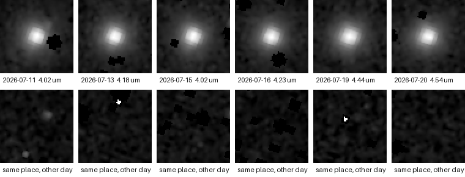
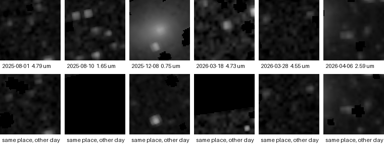
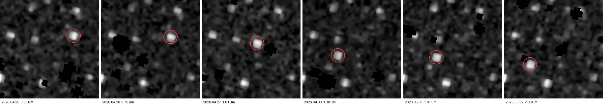
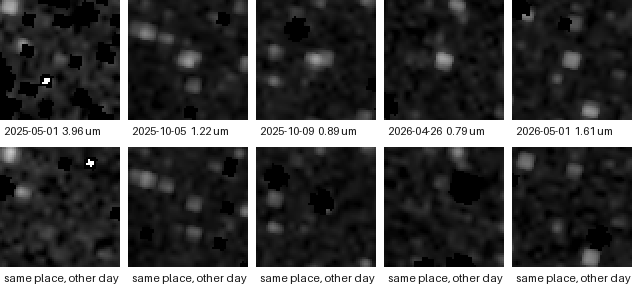

# Following a comet or asteroid through SPHEREx, and measuring its spectrum

All of this was run on real data on 14 November 2026. Orbits: NASA/JPL Solar System Dynamics (JPL Horizons).
Images: NASA/JPL-Caltech SPHEREx, NASA/IPAC IRSA. Code: `backend/follow.py`, command line
`scripts/follow_body.py`, tests `tests/test_follow.py`. Pictures and the measured points of every body are in
`docs/comets/` (one `.json` per body, with every exposure's measurement).

## What it does, in plain words

SPHEREx looks at the whole sky through a filter that changes colour across each image, so every exposure sees a
patch of sky in a different colour of infrared light (102 colours, 0.75 to 5 micrometres). One exposure of a comet
therefore gives one colour of it. A comet that crosses the survey is caught in hundreds of exposures, each in a
different colour, and put together they make a spectrum of the comet.

Why a comet is the prize: gas in its cloud (the coma) glows at colours that tell what it is made of: water at 2.7
micrometres, carbon dioxide at 4.26, carbon monoxide at 4.67. Carbon dioxide cannot be seen from the ground at all.

`follow_body("name")` does this for one named body:

1. Asks JPL Horizons where the body was, as seen from the SPHEREx spacecraft itself, every day from 1 May 2025 to
   today (564 rows), with its predicted brightness, distance from the Sun and from SPHEREx, and the angle between the
   Sun and the body (the elongation).
2. Keeps the days when the elongation is in the range SPHEREx looks at. That range was measured, not assumed: the
   exposure lists of two positions (Barnard's Star, 364 exposures, and the patch around 4 Vesta, 394 exposures) span
   81.9 to 128.4 degrees and 80.5 to 121.8 degrees from the Sun (astropy's Sun position at each exposure's time). The
   search window is 70 to 140 degrees.
3. Cuts those days into stretches over which the body moves less than 0.7 degree and asks IRSA's image search which
   exposures cover the two ends of each stretch in the stretch's time range. IRSA's image search times out for any
   search circle wider than 0.01 degree, so every search is a point. Every answer is cached, which is what makes a
   repeat free.
4. Asks Horizons for the exact position at the middle of each exposure found, and keeps the exposures whose image
   footprint (IRSA gives it as a polygon) holds that position with 0.03 degree to spare (the sky ring needs the room).
5. Reads a small cutout (0.2 degree) of each exposure, centred on the predicted position, from NASA's public S3 copy of
   the archive (the cutouts are kept apart in `<cache>/follow/cutouts/`).
6. In each cutout adds up the light in two circles, **12.3 arcsec** and **36.9 arcsec** in radius (the body's distance
   from SPHEREx turns these into kilometres at the body: 3I/ATLAS in August was 2.7 au away, so 24,000 and 72,000 km),
   with the sky level taken from a ring 86 to 148 arcsec out. The 12.3 arcsec circle is the 12 arcsec radius the
   3I/ATLAS paper used. A comet is fuzzy, so the larger circle is there too.
7. Measures the same two things at 8 empty places on a ring 100 arcsec round the body. Their scatter is the noise,
   measured the same way as the body.
8. Measures the same sky place in up to 4 exposures of other days (same detector, taken when the body was elsewhere).
   A star at that place is still there on the other days. If most of them show a source and it is at least a fifth as
   bright as what was measured, the point is marked `star_in_the_way`.
9. Writes one point per exposure: time, detector, wavelength and bandwidth, brightness with error (3 per cent added in
   quadrature as the SPHEREx Explanatory Supplement does for the calibration), status (`ok`, `saturated`, `flagged`,
   `star_in_the_way`, `off_image`, `no_sky`, `not_fetched`), predicted magnitude, distances.

**Gas bands.** For each of water (2.62 to 2.86 micrometres), carbon dioxide (4.20 to 4.31) and carbon monoxide
(4.62 to 4.74) the excess is the mean of the channels inside the band minus a straight line fitted to the channels
beside it (2.40 to 2.58 and 2.90 to 3.05; 4.02 to 4.17 and 4.38 to 4.52; 4.45 to 4.58 and 4.80 to 4.95), weighted by
the errors, with the line's own error added (enlarged when the channels scatter more than their errors say). It is
done separately for each visit (a few days of observing). A band is called

- **detected** if the excess is at least 5 times its error **and** at least 3 times the scatter of the same
  arithmetic done at other places of the spectrum (the three windows slid along it, never touching the real band)
  **and** larger than every one of those other places, with at least four of them to compare with;
- **marginal** if it is at least 3 times its error but fails those tests, or there are too few other places to
  test it;
- **not seen** otherwise.

Nothing is called a detection because it is large compared with its own error: the error of one exposure is small, and
the real scatter between exposures (the comet changes, stars, calibration) is larger. When two bands are both
detected, `flux_ratio` gives their ratio of band-integrated excess: **a ratio of fluxes, not of production rates**.

The numbers below are measurements of what the exposures show. Where the word "seen" appears it means: measured, and
compared with the same measurement at empty places or in neighbouring channels.

## Proof 1: asteroid 4 Vesta (V 6 to 8, much too bright for most of SPHEREx's range)


`python scripts/follow_body.py "4 Vesta" --strip 6`: 320 exposures contain Vesta's predicted position (8 more are too
close to an image edge), 312 were measured. **34 gave a measurement; 258 are saturated; 6 are flagged; 14 are off the
image.** Vesta is so bright that every exposure of detector 1 to 4 (0.75 to 3.8 micrometres) saturates, and
detectors 5 and 6 (3.8 to 5.0 micrometres) saturate in all 50 measurable exposures of June to August 2025 (V 6.5 to 7.4; 7 more are off the
image) and in 14 of 55 in July 2026 (V 7.7). The 34 measurements are all from 11 to 20 July 2026: 26 in detector 5 and 8 in detector 6.

What the spectrum shows (12.3 arcsec circle): 1.18 to 1.63 Jy at 3.8 to 4.6 micrometres, rising from 1.6 Jy at 4.6 to
**3.1 and 2.9 Jy at 4.96 and 5.0 micrometres**. That is what an asteroid should give at these wavelengths: sunlight it
reflects falls off with wavelength, its own heat takes over from about 4 micrometres and rises steeply. Rough check by
hand, not a calibration: a body of Vesta's size (radius 262 km) at 2.14 au from SPHEREx, as a 230 K black body, gives
about 2.5 Jy at 5 micrometres; 2.9 to 3.1 Jy corresponds to about 235 K. There is no gas band, as there should not be.



The strip: top, Vesta at its predicted place in exposures of six different days (same date and wavelength in the
caption); bottom, the same sky place in an exposure of another day, with the same brightness stretch: nothing is
there.

Against what was measured before: `docs/smallbodies.md` measured 1.44 to 1.63 Jy at 4.2 to 4.4 micrometres on 16 July
2026 in a 15.4 arcsec circle. Here, on 16 July 2026, 4.23 to 4.30 micrometres, 12.3 arcsec circle: 1.52, 1.58, 1.57
Jy. Same data, a different circle and a different code path: the numbers agree.

**A warning that the Vesta result gives for free.** The gas-band arithmetic, run on Vesta's 34 points, reports a
carbon dioxide "excess" of 119 mJy, 4.2 times its error (marginal). Vesta has no gas. The "excess" is Vesta's own
brightness changing between exposures (it rotates every 5.3 hours, and its distance changed over the 9 days). This is
why a bump of a few times its error is never called a detection here, and why the rule above also asks for the
other-places test.

What it does not show: the sunlight part (below 3.8 micrometres) because every exposure there is saturated.

## Proof 2: interstellar comet 3I/ATLAS, against the SPHEREx team's own papers


`python scripts/follow_body.py "3I/ATLAS" --strip 6` (Horizons knows it as C/2025 N1): 364 exposures contain it, 357
measured: **237 ok, 57 `star_in_the_way`, 57 flagged, 1 saturated, 5 off the image.** The fields it crossed in August
2025 are in the Milky Way's crowded Sagittarius, which is why so many points have a star in the way. The visits
(2025 August 6 to 15, December 8 to 9, December 14 to 15, 2026 March 17 to 23 and March 28 to April 6) are the five
sets of exposures with enough points. Each colour above is one visit; the shaded bands are water, carbon dioxide and
carbon monoxide.

What the SPHEREx team published (searched: "SPHEREx 3I/ATLAS spectrum Lisse carbon dioxide coma water ice arXiv").
Lisse et al., "SPHEREx Pre-Perihelion Mapping of H2O, CO2, and CO in Interstellar Object 3I/ATLAS", arXiv:2512.07318
(ApJ Letters 2026): 1 to 15 August 2025, 12 arcsec radius, sky from an annulus 1 to 3 arcmin, gas emission fluxes of
58 (H2O at 2.7 to 2.8), 8610 (12CO2 at 4.25), 70 (13CO2) and 59 mJy (CO at 4.7) "corrected for 3I's relative position
to rhel = 1 au, robs = 1 au" by assuming flux goes as rhel^-2 robs^-2; Q(H2O) 3.2e26, Q(CO2) 1.6e27, Q(CO) 1.0e26
molecules per second. Lisse et al., arXiv:2601.06759: in December 2025 "the H2O gas-emission is 40x times brighter", CO
and CO2 comae circular, CO2 coma 3 arcmin in radius; (from a news summary of the same paper, not checked in the
paper itself: CO2 up about 33 per cent, CO about 20 times, CO/CO2 about 15-fold).

What this tool gets, 12.3 arcsec circle, August 6 to 15 visit (r 3.19 au, delta 2.70 au; scale factor
r^2 delta^2 = 74):

| Band | Measured here (mean excess over the channels in the band) | Scaled to 1 au the paper's way | Published | Verdict by the rules above |
|---|---|---|---|---|
| H2O 2.62 to 2.86 | 0.592 +- 0.051 mJy (11.6 times the error), 2 channels | 44 mJy | 58 mJy | marginal: other places of the spectrum give up to 36 times |
| CO2 4.20 to 4.31 | 20.4 +- 0.5 mJy (43.6 times), 4 channels | 1510 mJy | 8610 mJy | **detected**: 9 other places, the largest 9.5 times |
| CO 4.62 to 4.74 | 0.57 +- 0.16 mJy (3.5 times), 1 channel | 42 mJy | 59 mJy | marginal |

The highest single channel at 4.26 micrometres in August (14 August, 4.261 micrometres, 54.8 +- 1.7 mJy) scales to
3670 mJy, **0.43 of the published 8610 mJy**. H2O (peak channel 1.2 mJy at 2.66 micrometres, scaled 82) and CO (0.8 mJy at
4.63, scaled 65) are within 40 and 10 per cent of the published values; carbon dioxide is 2.3 times lower. **So the
tool finds a bump at each of the three places the paper reports, with water and carbon monoxide near the published
values; but under this project's strict rule only carbon dioxide is a detection in August (water and carbon monoxide
are marginal: the channels are few, and the arithmetic gives equally large numbers at other places), and the carbon
dioxide absolute number is 2.3 times lower than published.** What was checked: moving the sky ring from 86 to 148
arcsec out to 221 to 295 arcsec changes the 4.26 micrometre flux by less than 3 per cent (so the sky ring being inside
the coma does not explain it); the circle is the paper's radius; the cutouts' flux scale is the archive's (the project
compared field stars with 2MASS, `scripts/check_flux_scale.py`). What was not checked and could explain it: the
paper's early SPHEREx processing against the archive's current one (the images here are processed version `l2b-v27`,
2026), what exactly the paper's "mJy" is (peak, band mean or best frame), its simulated-field subtraction, and its
"effective aperture" that depends on position in the field.

The change between visits (large circle, 36.9 arcsec, so the whole inner coma is in it):

| | Aug 6 to 15 | Dec 14 to 15 | Change as measured | The paper |
|---|---|---|---|---|
| CO2 4.26 | 34.6 +- 1.2 mJy | 477 +- 13 mJy | x13.8 (x2.8 after scaling by r^2 delta^2) | about x1.3 |
| CO 4.67 | 3.0 +- 0.6 mJy (marginal) | 89.9 +- 4.0 mJy (detected) | x30 (x6 after scaling) | about x20 |
| H2O 2.7 (small circle; Dec 8 to 9; marginal in both, too few other places to test) | 0.59 mJy | 25.8 +- 0.7 mJy | x44 (x8 scaled) | x40 |

The pattern is the published one: water brightens most, carbon monoxide much more than carbon dioxide. The
magnitudes are the published order but not equal (carbon dioxide rose by more here than the 33 per cent quoted, and
the carbon monoxide rise is smaller). The ratio of band-integrated excess CO2 to CO in the December 14 to 15 visit is
**4.9 +- 0.2** (a ratio of fluxes, not of production rates).

One more number, not a result: in the 2026 March 17 to 23 visit (r = 5.2 au) the carbon dioxide band is 5.2 times its
error in the large circle (2.0 +- 0.4 mJy; 3.8 times in the small one), and only one other place could be tested, so it
is marginal. I did not find a report of SPHEREx 3I/ATLAS data from March 2026 (one web search).



(The comet at its predicted place on six dates, and nothing at the same sky place on other days.)

## Pluto (and Charon), through the survey

The challenge text says Pluto was found by comparing two images in which a point of light had shifted. SPHEREx
exposures show the same thing for Pluto.



Six exposures of one fixed patch of sky (200 arcsec across, centred on the mean predicted place, one exposure a day,
the one in which Pluto stood out most), 25 April to 2 May 2026. The red ring is Horizons' predicted place of Pluto
(14 arcsec radius; Pluto is inside it every time); the stars stay where they are and the ring moves. Pluto moved
**113 arcsec** (97 arcsec in the right-ascension direction, 58 arcsec in declination) in those 7 days (16 arcsec a
day). RA 308.52308, Dec -22.89059 on 25 April (0.90 micrometre, 76 times the noise) to RA 308.55232, Dec -22.90679 on 2
May (2.00 micrometres, 130 times the noise). Between the October 2025 visit (RA 304.14) and the April 2026 visit
(RA 308.52) it moved 4.4 degrees of right ascension.



How many exposures: **229 contain Pluto, 224 were measured: 175 ok, 37 flagged, 9 with a star in the way, 3 off the
image.** (Pluto and Charon are under 1 arcsec apart on the sky, far less than one pixel, so everything here is Pluto and
Charon measured together.) Pluto is at V 14.5, so each exposure shows it at 7 to 10 mJy near 1 micrometre. The
second picture's top row is each exposure centred on Pluto; the bottom row is the same sky place on another day, same
stretch.


The spectrum (12.3 arcsec circle, all 175 measurements from the October 2025 and April to May 2026 visits and the
smaller ones): about 7 to 10 mJy at 0.8 to 1.3 micrometres, falling to 1 to 2 mJy at 2.3 and 0.5 to 1 mJy beyond 3.
**Methane ice**, which dominates Pluto's surface, absorbs at 1.7, 2.3 and 3.3 micrometres. Measured against
neighbouring channels, same rules as for gas (the dip's depth below a line through the channels beside it, the same
arithmetic at other places in the spectrum):

| Methane band | Window / beside it (micrometres) | Depth below the neighbours | Verdict |
|---|---|---|---|
| 1.7 | 1.64 to 1.74 / 1.52 to 1.61 and 1.78 to 1.88 | not measurable: one channel on the short side | no measurement |
| 2.3 | 2.26 to 2.36 / 2.12 to 2.22 and 2.42 to 2.54 | 0.83 +- 0.12 mJy of about 2.2 (7.0 times the error) | **marginal**: 7.0 times its error, but other places scatter as much (largest dip elsewhere 5.2 times, robust scatter 3.5, so 10 needed) |
| 3.3 | 3.20 to 3.40 / 2.98 to 3.14 and 3.45 to 3.62 | 0.06 +- 0.32 mJy (0.2 times) | **no dip seen** |

So: **no methane dip is established by these rules.** The curve has the broad shape of a methane-ice-rich surface
(a fall from 1 to 2 micrometres with a trough at about 2.2 to 2.35), and the 2.3 micrometre trough is 7 times its
error, but the channels scatter far more than their errors (reduced chi-squared 11 to 100: Pluto rotates every 6.4
days and changes by tens of per cent, the 12.3 arcsec circle in this crowded field catches stars, and each channel
comes from a different exposure on a different day), so a trough that size can also arise at other places (other places of the spectrum give dips of up to 5.2 times
the error and bumps of up to 7.7 times). I did not
check the published Pluto spectrum for these channels beyond the band positions the team lead gave. No gas band is
seen for Pluto: water, carbon dioxide and carbon monoxide are all "not seen" (0.0 to 1.0 times their error).

Searched: "SPHEREx Pluto spectrum methane ice 0.75-5 micron observation": no SPHEREx paper on Pluto came back. That
does not show that none exists; it is one web search.

## Limits (read before relying on any number)

- **The measuring circle.** A comet's coma is bigger than the 12.3 arcsec circle (3I/ATLAS' carbon dioxide coma
  reaches 3 arcmin), so the small circle holds only the inner part, and the 36.9 arcsec circle holds more but also more
  stars. The sky ring (86 to 148 arcsec) lies inside such a coma, so it takes some of the coma away with the sky; for
  3I/ATLAS moving it to 221 to 295 arcsec changed the 4.26 micrometre flux by less than 3 per cent, but for a brighter
  or closer comet it could matter. In kilometres at the body the circles are 12.3 x 725 x delta km and 36.9 x 725 x
  delta km (delta in au): every point in the JSON files carries `radius_small_km` and `radius_large_km`.
- **Saturation.** A body bright enough to saturate pixels in the circle is given no number (Vesta: 258 of 312
  exposures; every exposure at 0.75 to 3.8 micrometres). Nothing is made up for them.
- **Stars in the way.** The check measures the same sky place in up to 4 exposures of other days of the same
  detector. A star that is faint at the wavelength of those exposures but bright at the body's (or the reverse) is
  not caught; a body that sits on a bright star in all exposures is `star_in_the_way`, but whether the star's flux can be
  taken away, I did not try. In crowded fields (3I/ATLAS in August 2025, Pluto) this removes 4 to 17 per cent of
  the exposures.
- **Calibration features.** The six detectors meet at 1.09, 1.63, 2.42, 3.82 and 4.42 micrometres. A step in
  the calibration between two detectors would put a false bump or dip there. The carbon dioxide continuum (4.02 to
  4.52) spans the boundary between detectors 5 and 6 at 4.42; I did not test for a step there beyond the other-places
  test, and I did not check the SPHEREx Explanatory Supplement for channels with known problems.
- **Time changes between the exposures of a "spectrum".** Each channel of a spectrum comes from a different exposure
  at a different time. A rotating body (Vesta 5.3 hours, Pluto 6.4 days) or a comet that brightens or outbursts changes
  between them. The gas-band arithmetic is done within a visit (a few days) to limit this, and its other-places test
  is what shows the remaining scatter; the per-night scan (`scan_sequences`) compares channels taken within 15 minutes
  of each other.
- **Fast bodies.** A body moving faster than about 300 arcsec an hour (C/2025 R2 at its closest, 776 arcsec an hour;
  C/2025 K1, 630) moves 4 pixels during one 113-second exposure: it is smeared along its path beyond the 12.3 arcsec
  circle, and only the large circle is dependable. The exposure search looks at the two ends of every stretch of
  at most 0.7 degree, so a body that crosses an image between the two ends could be missed for such a fast body.
- **Too close to the Sun.** SPHEREx observed 80 to 128 degrees from the Sun in the lists measured; a body outside 70
  to 140 degrees is not searched for. C/2025 A6 (Lemmon) was at 4 magnitude in October and November 2025 but at
  elongation under 70 degrees: SPHEREx did not observe it then.
- **Predicted magnitudes.** The predicted magnitude is Horizons' formula; for a comet it can be off by several
  magnitudes (3I/ATLAS "15 to 26"; it was about 100 times brighter than a plain formula would say in December). It
  is only used to choose bodies to look at.
- **Pluto and Charon** are measured together. A body fainter than about V 17 gives one-exposure measurements too
  noisy to use (see Makemake and the others below).
- **Archive coverage.** Only public SPHEREx exposures: the later data are released in batches. Exposures newer than
  the archive's last release do not exist for this tool.
- **Network.** The first run of a body takes 10 to 30 minutes (hundreds of IRSA searches and cutouts); the second takes
  seconds. If JPL or IRSA cannot be reached the run stops with the reason, and nothing is filled in.

## Repeat any of it

```
.venv/bin/python scripts/follow_body.py "C/2025 R2" --strip 6
.venv/bin/python scripts/follow_body.py Pluto --strip 6 --moving 6
.venv/bin/python scripts/follow_body.py "C/2025 R2" --sequence "2025-12-25T19:@5"
.venv/bin/python scripts/comets_table.py
```

Needs the project's Python environment and the network the first time; `SPHEREX_CACHE_DIR` points to the cache (the
cutouts and answers of this feature are in its `follow/` folder: about 2 GB for everything in this document).
Tests: `pytest tests/test_follow.py` (from saved real JPL and IRSA answers and real measured points in
`tests/data/follow/`; no network).
