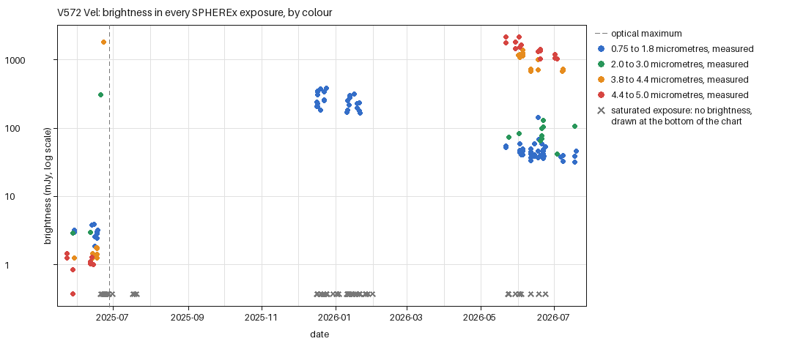
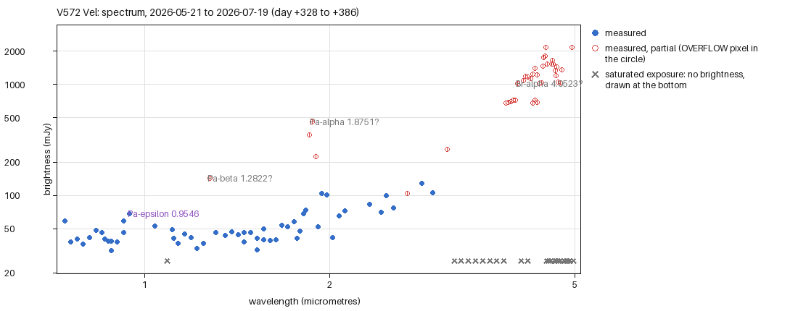
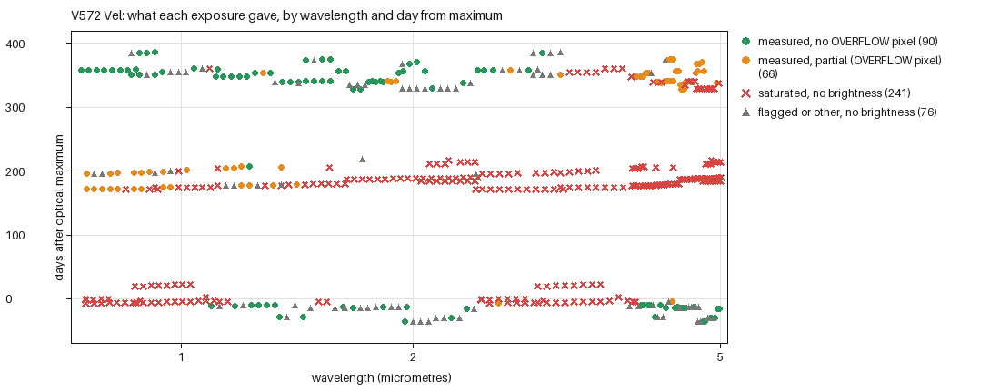
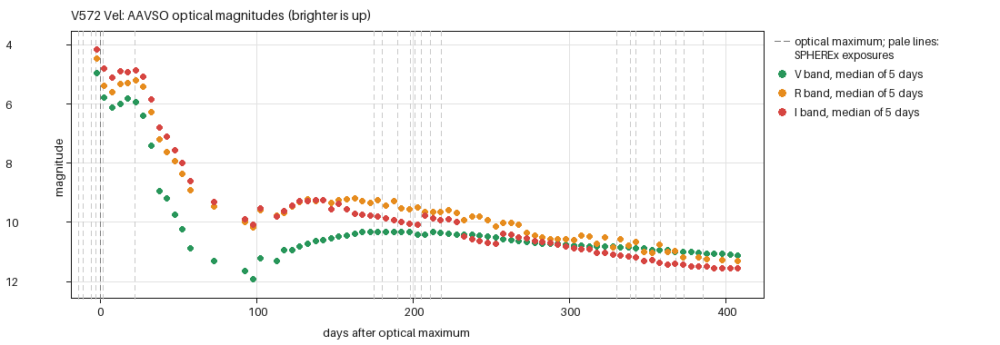
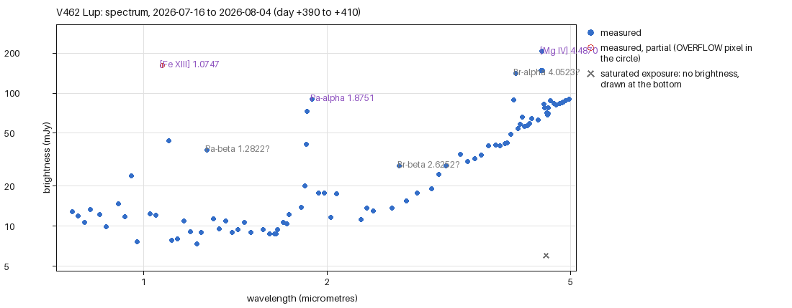
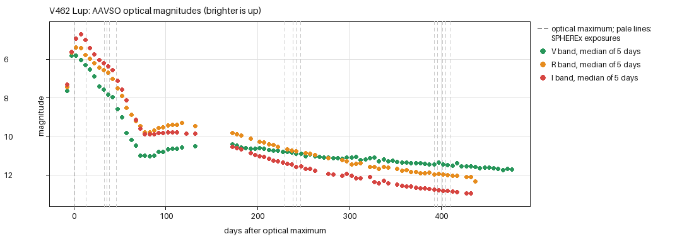

# Four novae of 2025 in SPHEREx: a warm infrared excess, and the attempts to break it

Written 2026-11-14 for teammates who are not astronomers. Everything below was measured with the
viewer's own brightness code (`backend/photometry.py`, the code behind the brightness chart and
spectrum panels) and can be re-run with one command per nova (see "How to run it"). Nothing was
simulated or filled in. The full printed output of each run is in `docs/novae/output_*.txt`.

**Read this first.** The headline result for V572 Velorum has already been reported by other people:
Astronomer's Telegram no. 18127 (29 October 2026, Banerjee, Evans, Woodward, Starrfield and Joshi,
"Detection of dust in the nova V572 Velorum from SPHEREx observations") finds a dust shell cooling from
about 1,030 K to about 480 K between the same two SPHEREx visits. Our measurement agrees with theirs
(477 to 570 K for the 2026 visit, depending on choices). So for V572 Vel this is an independent
confirmation, not a discovery, and must be presented that way. For the other three novae we found no
report in the searches listed below.

## What a nova is, and what was measured

A nova is a white dwarf (the dead core of a Sun-like star) in a close pair with a normal star. Gas from
the normal star piles up on the white dwarf until it ignites, the star brightens by a factor of tens of
thousands in days, and a shell of gas is blown off. In some novae the cooling gas makes soot-like dust,
which hides the star at visible light and glows in the infrared.

SPHEREx measures 102 infrared colours from 0.75 to 5 micrometres. For each of four bright novae of
2025 the viewer's code gave one brightness per exposure in a 15.4 arcsecond circle at the nova's
position (positions from AAVSO's variable star index):

| Nova | Erupted (optical maximum) | SPHEREx exposures (clean / saturated) | Visits after the eruption |
|---|---|---|---|
| V572 Velorum | 27 June 2025 (V 4.8) | 473 (156 / 241) | Dec 2025 to Feb 2026 (day +172 to +219), May to Jul 2026 (+328 to +386) |
| V462 Lupi | 20 June 2025 (V 5.5) | 394 (192 / 144) | Feb 2026 (+229 to +247), Jul to Aug 2026 (+390 to +410) |
| V1935 Centauri | 22 September 2025 | 432 (278 / 4) | Feb 2026 (+136 to +150), Jul to Sep 2026 (+299 to +346) |
| V7994 Sagittarii | 26 September 2025 | 319 (165 / 12) | Mar to Apr 2026 (+175 to +192), Aug to Sep 2026 (+334 to +347) |

"Clean" means a brightness was measured; "saturated" means the detector overflowed in the first seconds
of the exposure and the code gives no number (it is never filled in). "Run" below means a stretch of
dates with no gap longer than 10 days.

## The pictures

All in `docs/novae/`. Saturated exposures are drawn as grey crosses along the bottom, never at a value.
Open circles are readings with an OVERFLOW pixel in the circle (a partial reading, explained in check 2).

- V572 Vel: `v572_vel_time.png` (brightness against date, four colours), `v572_vel_spectrum_run5.png`
  (May to Jul 2026 spectrum with line candidates labelled; purple firm, grey tentative),
  `v572_vel_spectrum_run4.png` (Dec to Feb), `v572_vel_saturation.png` (what each exposure gave, by
  wavelength and day), `v572_vel_optical.png` (AAVSO).
- V462 Lup: `v462_lup_time.png`, `v462_lup_spectrum_run3.png` (Feb), `v462_lup_spectrum_run5.png`
  (Jul to Aug), `v462_lup_saturation.png`, `v462_lup_optical.png`.
- V1935 Cen: `v1935_cen_time.png`, `v1935_cen_spectrum_run2.png`, `v1935_cen_spectrum_run4.png`,
  `v1935_cen_saturation.png`, `v1935_cen_optical.png`.
- V7994 Sgr: `v7994_sgr_time.png`, `v7994_sgr_spectrum_run1.png`, `v7994_sgr_spectrum_run2.png`,
  `v7994_sgr_saturation.png`, `v7994_sgr_optical.png`.








## V572 Velorum

### What was measured

| Run | Dates (day from maximum) | What the readings are |
|---|---|---|
| 0, 1 | 23 May to 17 June 2025 (-35 to -10) | before the eruption: 1 to 4 mJy in every band (3 mJy at 1.3 to 2.3 micrometres, 1.2 to 1.4 at 3.8 to 5) |
| 2 | 18 to 30 June 2025 (-10 to +2) | the eruption: 3 clean readings (3.2 mJy at 1.3 micrometres on 18 June; 308.5 mJy at 2.579 micrometres on 20 June, day -7; 1,797 mJy at 4.324 micrometres on 23 June), 57 saturated exposures |
| 3 | 17 to 20 July 2025 (+19 to +22) | 16 exposures, all saturated |
| 4 | 16 Dec 2025 to 1 Feb 2026 (+172 to +219) | 26 clean readings, all at 0.75 to 1.63 micrometres: 250 mJy median at 0.75 to 1.1, 235 at 1.1 to 1.6; 123 of the 125 exposures at 1.64 to 5 micrometres saturated, the other 2 flagged |
| 5 | 21 May to 19 July 2026 (+328 to +386) | 0.75 to 1.65 micrometres: median 41 mJy (31 to 143); 1.65 to 2.4: 68 (41 to 461); 2.4 to 3.8: 104 (70 to 261); 3.8 to 4.4: 1,018 (683 to 1,401); 4.4 to 5.0: 1,520 (1,033 to 2,166) |

A year after the eruption the nova is about 25 times brighter at 4.3 micrometres than at 1.5 and about
37 times brighter at 4.4 to 5.0, and the 4.3 micrometre light fell by 43 to 48 per cent in 33 days (same
channels, 4 June to 7 or 8 July: 1,242 to 683, 1,401 to 725, 1,224 to 694 mJy). At 1.45 to 1.56
micrometres the same two dates differ by 18 to 21 per cent (46 to 38, 41 to 32, 50 to 40 mJy).

The 308 mJy reading on 20 June 2025 (SPHEREx, 20:14 UT, detector 4, 2.579 micrometres) is on the same
night as the SPHEREx detection reported in ATel no. 17601 (15 January 2026: the nova seen almost five
days before its optical discovery on 25 June, not seen on 17 June). The ATel quotes slightly different
exposure times and wavelengths (0.8272 and 2.5102 micrometres), so we cannot say it is the same
exposure. On 17 to 18 June, our readings of the position are 1.3 to 3.2 mJy (nothing there), matching the ATel's non-detection.

### Checks that tried to kill it

**1. Is the light the nova's?** Yes, as far as anything here can show.
- Before the eruption the same circle gave 1 to 4 mJy. After it, 41 to 1,500 mJy: 15 to 1,000 times more.
- What else is in the circle (15.4 arcsec), from the catalogues: Gaia DR3 (stars brighter than G = 17): none.
  2MASS: one source, at 13.6 arcsec, K = 14.9 (0.7 mJy). AllWISE: none. CatWISE2020: 9 faint sources, W1 15.5 to
  18, summing to 1.9 mJy at 3.4 and 1.0 mJy at 4.6 micrometres. That matches the 1 to 4 mJy measured before the
  eruption, so the pre-eruption level is the crowd of faint stars plus the progenitor, and nothing in the
  catalogues could produce the 2026 brightness. (AllWISE, taken in 2010, measured nothing here; NEOWISE
  ended in mid-2024 and cannot see the nova itself.)
- Comparison stars: 15 isolated Gaia stars (G = 11.7 to 15.4, 31 to 123 arcsec away) measured with the same
  code in the same exposures, same channels, readings with signal to noise above 10. The 2026 visit
  split in two (first half against second half, 33 days apart): detector 1 median ratio 0.99, detector 2
  0.99, detector 3 1.00, detector 4 0.98, detector 5 1.00 (3 stars at 80 arcsec or more), detector 6 1.02 (one star).
  The nova's own change over the same two halves: 0.55 at 4.27 to 4.34 micrometres, 0.80 at 1.45 to 1.56.
  Dec 2025 to May 2026 visits, detectors 1 to 3: 1.02, 0.97, 0.98 (stars) against 0.17 and 0.16 (nova).
  The instrument was steady to a few per cent; the nova was not.
- A side effect we found, which matters for how far to trust long-wavelength readings near a bright nova:
  in December and January the nova's own halo adds light to stars nearby in detectors 4 to 6 (+107 mJy at 48
  arcsec, +14 at 85, +4.5 at 123 arcsec). In May to July 2026 it is +7 mJy at 31 arcsec and nothing
  measurable beyond 60 arcsec. Comparison stars nearer than 80 arcsec are therefore reported separately in the script.
  For the nova itself this halo is in its own light, and its sky ring (86 to 123 arcsec) takes at most a few
  millijanskys of it in the 2026 visit, negligible beside 700 to 2,000 mJy.

**2. Saturation: could the "clean" readings be biased by being near the level where others saturate?**
This is the weakest point and it is stated plainly.
- In the 2026 visit, every clean reading at 3.8 to 5.0 micrometres (33 of 33) has at least one pixel marked
  OVERFLOW in the circle. The Explanatory Supplement (Table 16) says OVERFLOW alone means the pixel reached
  half of full well and its value comes from the reads before that: valid, and kept by the mission's own
  photometry, but it is a partial reading. The long-wavelength brightness rests only on such readings; there
  is no clean-pixel measurement at 4 to 5 micrometres to compare with. In the Dec to Feb visit even those do not
  exist beyond 1.6 micrometres.
- What survives without any OVERFLOW pixel: at 0.75 to 2.4 micrometres the readings have none (apart from a
  few). At 2.4 to 3.8 micrometres five readings have none: median 99 mJy, maximum 128 mJy (2.82
  micrometres, 21 June). Against the 41 mJy at 1.5 micrometres that is a factor of 2.4 to 3.1 rise by 2.8
  micrometres, where a star or hot gas would fall to about 12 mJy (a tail falling as wavelength to the power
  of minus two). So the red excess is present at 2.4 to 2.9 micrometres using only readings with no overflow
  pixel, about 8 times above a hot-star tail. That the 4 to 5 micrometre brightness then continues the rise
  smoothly is consistent, not independent proof of its size.
- The ring of unsaturated pixels around the object (the "wing", trusted in detectors 5 and 6) was compared with
  the core in the three channels that have both on two dates: the core fell to 0.55 of its earlier value, the wing to
  0.79. Same direction, different size, which is what a constant background from neighbouring stars in the ring would give;
  it does not independently confirm the 45 per cent fall. Three channels is too few to say more.
- Readings listed by wavelength and date, clean and saturated, are in `v572_vel_saturation.png` and the per-run
  counts in `output_v572_vel.txt` (section 3).

**3. Same channels on both dates.** Done in section 2 of the script: comparisons use the same detector and
channel. Between the two visits, at 0.75 to 1.6 micrometres (16 channels), the nova is 0.16 to 0.17 of
its December and January value. Dec to Feb 2025/26 readings at 1.6 to 5 micrometres are all saturated, so no same-channel
comparison exists there. The one same-channel pair from the eruption run: 4.34 micrometres on 23 June 2025 (1,797 mJy, day -4) against
1,224 and 694 mJy in June and July 2026: the long-wavelength light is still 40 to 70 per cent of its level at
optical maximum. That fact has not been checked against anything else and is worth treating with care (partial readings at both dates).

**4. Something else inside the circle?** See check 1: nothing that could account for it.

**5. Other telescopes.**
- AAVSO (5,580 observations, fetched 14 November): V = 6.0 at day +15, 7.9 at +35, 10.5 at +55, **11.8 at +95**, back to
  **10.3 at +175** (1.5 magnitudes brighter again), then a slow fade to 11.1 at +395. In I the dip is shallower: 9.3
  at +70 to 10.0 at +90. A drop of nearly 6 magnitudes in V followed by a partial recovery, with a smaller dip
  in the redder bands, is the signature of dust forming in front of a nova and later thinning. **So the
  optical light curve does show a dust dip.** (ATel 18127 says the same about the AAVSO light curve.)
- Does SPHEREx agree with AAVSO's I band (0.8 micrometres, zero point 2,416 Jy, different apertures)? On
  days +172 to +219: SPHEREx 250 mJy, AAVSO 270 mJy (ratio 0.93). On days +328 to +386: SPHEREx 40 mJy, AAVSO
  70 mJy (ratio 0.58). The ratio changes by a factor of 1.6 between visits. **Unexplained.** Possibly emission lines in the I band, the
  aperture, or colour terms; it means the near-infrared fade rate (6 times in SPHEREx, 3.9 times in I) is uncertain by that factor,
  though not the red excess.
- NEOWISE ended in mid-2024, so it can only give the pre-eruption level (and AllWISE nothing at this spot).

**6. Colour temperature.** Fitted to the continuum channels (every channel inside a line candidate left out) of
the May to July 2026 run, 2 to 5 micrometres, with errors that include 5 per cent for bandpass and fading
within the run, and the formal error scaled up where the fit is poor:

| Choice | Temperature (K) | Reduced chi-squared, blackbody / power law |
|---|---|---|
| no subtraction | 570 +- 20 | 35 / 25 |
| subtract the 1.0 to 1.8 micrometre level (44 mJy) as a constant | 477 +- 18 | 18 / 23 |
| subtract it as a hot-star tail | 533 +- 18 | 24 / 22 |
| 3.8 to 5.0 micrometres only, no subtraction | 507 +- 57 | 19 / 22 |
| subtract constant, 3.0 to 5.0 micrometres | 508 +- 43 | 18 / 21 |
| earlier third of the run (day +328 to +342), constant subtracted | 539 +- 20 | 4.4 |
| later third (day +358 to +385), constant subtracted | 497 +- 18 | 8.0 |

So the temperature is **480 to 570 K** depending on the choice, a spread of about 90 K that is larger than the quoted errors. The lead's
earlier figure of 600 to 700 K came from two points (2.2 and 4.3 micrometres) and is not supported by the
full fit. **A straight power law (brightness rising as wavelength to the power 3.9 to 5.4) fits as well as a blackbody:** both fit
poorly (reduced chi-squared 18 to 35), partly because the nova fades by up to 45 per cent during the run and partly
because the 5 per cent error is probably too small. Within 5 micrometres we are on the rising side of any blackbody this cool (it
peaks near 10 micrometres), so "warm dust at about 500 K" is a statement about colour, not a measured shape. ATel 18127 gives 480 K for
the same visit, in line with the constant-subtracted fit. We cannot check their 1,030 K for the
earlier visit: in our measurement every exposure beyond 1.6 micrometres is saturated.

**7. Line candidates** (script section 8: a channel more than 5 times the scatter of its neighbours above
them, with the scatter taken from the neighbours at or below the median and never less than 5 per cent of
them; a channel must also stand 1.25 times above them). Firm means two or more adjacent channels on more than one date; tentative
means one channel or one day.

| Wavelength (micrometres) | Brightness against neighbours | Nearest known line | Status |
|---|---|---|---|
| 0.742 | 59 against 39 | none within one channel | tentative: one channel, one day |
| 0.946 | 68 against 39 (also 0.925: 59) | Pa-epsilon 0.9546 or Pa-zeta 0.9229 | firm by the rule, but only 1.5 times the neighbours: weak |
| 1.276 | 143 against 41 (partial reading) | Pa-beta 1.2822 | tentative: one channel, one day |
| 1.855, 1.871 (one channel) | 350 and 461 against 71 | Pa-alpha 1.8751 | tentative: one channel, two days, two readings 1 day apart; 1.898 (225 against 71) is 4.5 sigma, just under the 5 sigma rule |
| 4.035 | 1,015 against 725 | Br-alpha 4.0523 | tentative: one channel, one day |
| 1.09 | saturated, neighbours measured | He I 1.0830 | cannot be tested |

Hydrogen's Pa-alpha cannot be observed from the ground, which is why SPHEREx data on it are interesting, but
here it is one channel (R about 40, so adjacent lines cannot be told apart). At 3.8 to 4.0 and 4.12 to 4.23 micrometres the channels of one date are smooth to a few per cent, which reads as continuum. A
fainter feature in the Dec to Feb run could not be tested (nothing beyond 1.6 micrometres).

### What is established, what is interpretation (V572 Vel)

Established (measured, with the checks above): in May to July 2026 the position brightened from 1 to 4 mJy before the
eruption to 41 mJy at 1.5 micrometres, about 100 at 2.4 to 2.9, about 1,000 at 3.8 to 4.4 and about 1,500
at 4.4 to 5.0 micrometres; nothing catalogued in the circle accounts for this; comparison stars steady to a few per cent; the 4.3
micrometre light fell by 43 to 48 per cent and the 1.5 micrometre light by 18 to 21 per cent in 33 days;
the optical light curve had a 6-magnitude dip and recovery. A red excess at 2.4 to 2.9 micrometres is seen
without any overflow pixel; the 4 to 5 micrometre brightness rests on partial readings.

Interpretation: that the excess is thermal emission from dust made in the nova's ejecta, at roughly 480 to 570 K, now cooling and
fading, with emission lines on top. This is the reading of the ATel too, and it fits the dust dip in
the optical, but the SPHEREx data alone give a colour, not a dust model.

## V462 Lupi (the cleaner case)

### What was measured

| Run | Dates (day from maximum) | What the readings are |
|---|---|---|
| 1 | 22 July to 5 Aug 2025 (+31 to +46) | 118 exposures, 4 clean (all partial readings: about 2,810 mJy at 3.8 to 4.4 and 2,510 at 4.4 to 5.0), 114 saturated |
| 3 | 5 to 23 Feb 2026 (+229 to +247) | 0.75 to 1.1 micrometres: 50 mJy median; 1.1 to 1.6: 38; 1.6 to 2.4: 106; 2.4 to 3.8: 256 (3 clean, 16 saturated); 3.8 to 4.4: 834 (670 to 1,450); 4.4 to 5.0: 977 (891 to 1,120). 19 saturated, 16 of them at 2.4 to 3.8 |
| 5 | 16 July to 4 Aug 2026 (+390 to +410) | 0.75 to 1.1: 12 mJy; 1.1 to 1.65: 9; 1.65 to 2.4: 14; 2.4 to 3.8: 28; 3.8 to 4.4: 57; 4.4 to 5.0: 84. 1 saturated of 122 exposures; **no OVERFLOW pixel in 91 of 92 clean readings** |

Between the two visits the same channels fell by a factor of 4 at 0.75 to 1.65 micrometres (ratio 0.23 to 0.24) and by a factor of 12
to 17 at 3.8 to 5.0 micrometres (ratio 0.06 to 0.08, 23 channels); at 1.65 to 2.4 micrometres 0.12. The long-wavelength
light fell about 3 to 4 times faster than the near-infrared, so the spectrum became redder.

### Checks

1. **The nova's light?** Pre-eruption level: no 2MASS source in the circle; AllWISE one faint (W1 17.2, 0.04 mJy);
   CatWISE 4 faint ones (0.15 mJy at 3.4). Gaia: none brighter than G = 17. The nova's brightness (9 to 84 mJy in July,
   up to 1,000 mJy in February) is 60 or more times larger. SPHEREx has no reading of this position from before the eruption (its first exposures are on day +13), so the catalogues are the only pre-eruption comparison. 13 comparison stars (G = 11.9 to 15.5): between the two
   visits, same channels, median ratios 1.00, 1.00, 1.02, 1.00, 1.04, 1.00 in detectors 1 to 6 (range 0.92 to 1.08) for stars at 80 arcsec or more; within the July visit 0.98 to 1.02.
   The instrument was steady to 2 to 4 per cent while the nova fell by 4 to 17 times. No halo contamination beyond 55 arcsec
   (largest -21 mJy at the one star 25 arcsec away, which is not trusted).
2. **Saturation.** July to August 2026 is the clean spectrum the V572 data lack: 91 of 92 clean readings have no overflow pixel, and the same
   shape appears (9 mJy at 1.5 micrometres to 84 at 4.7) without any partial reading. In February, all 37 clean readings at 3.8 to 5.0 micrometres are partial; but the July spectrum
   shows the same red shape without them, so this is not an artefact of the partial reading in the longer wavelengths.
3. **Same channels.** Done by the script (53 channels measured on both dates, see above).
4. **Anything else in the circle?** See check 1.
5. **AAVSO** (10,002 observations): V = 5.9 at maximum, 7.6 at +35, 9.5 at +55, **11.0 at +75**, 10.7 at +115, **10.5 at +175** (0.5 mag brighter), then a steady
   fade to 11.7 at +475. In I the fade is steady, 9.6 at +70 to 13.0 at +435 with no recovery; in R there is a 0.5 magnitude recovery (9.8 at +80, 9.3 at +110).
   No observations between days +135 and +175, which is 4.5 to 6 months after the eruption (a little later than
   the one to five months in which dust usually forms). **The optical light curve shows no dust dip like V572 Vel's**: nothing deeper than 0.5 mag in V and R and none in I. A 0.5
   magnitude brightening in V and R is the size of a change in the emission lines as the nova becomes nebular, and cannot be told from a minor dust
   effect. A dust dip hidden in the gap is not excluded. SPHEREx against AAVSO I: ratio 0.80 in February, 0.66 in July.
6. **Colour temperature** (continuum, 2 to 5 micrometres, same method):

   | Visit | Choices | Result |
   |---|---|---|
   | Feb 2026 | five variants | 725 to 785 K (errors 9 to 41 K); reduced chi-squared 3.3 to 4.5 for the blackbody, 3.4 to 11.5 for the power law |
   | Jul to Aug 2026 | five variants | 552 to 772 K; 572 +- 17 with the short-wavelength level subtracted as a constant; 622 and 629 (+-40) in the two halves of the run; reduced chi-squared 3.5 to 17 for the blackbody, 3.3 to 7.5 for a power law |

   The temperature fell from about 750 K to about 550 to 700 K, but in July the choice of how to remove the short-wavelength
   light moves it by 220 K, and **a power law (index 2.5 to 3.4) fits the July spectrum as well as or better than a blackbody**. In February the blackbody is the better fit. The fall in temperature is suggestive, not established.
7. **Line candidates:**

   | Wavelength (micrometres) | Against neighbours | Nearest lines | Status |
   |---|---|---|---|
   | 1.074 (two channels, two days) | 161 against 12.5 mJy | [Fe XIII] 1.0747 (a coronal line) or He I 1.0830 | firm as a feature (one partial reading); the identity is ambiguous, 0.009 micrometres is under one channel width |
   | 1.272 (Jul); 1.289 (Feb, two channels) | 37 against 9; 134 against 32 | Pa-beta 1.2822 | firm in Feb, tentative in Jul: in both visits |
   | 1.890 (3 readings, 2 days); 1.870 (Feb) | 91 against 19; 389 against 66 | Pa-alpha 1.8751 | firm in Jul; tentative in Feb (one day); at the same place in both visits |
   | 2.623 | 28 against 15 | Br-beta 2.6252 | tentative: one channel, one day, only two neighbours |
   | 4.064 | 140 against 57 | Br-alpha 4.0523 | tentative: one channel (4.029 reads 89 against about 50 but is under the 5 sigma rule) |
   | 4.469 to 4.500 (3 readings, 2 days) | 205 against 78 | [Mg IV] 4.487 | firm as a feature; [Ar VI] 4.529 is 0.04 micrometres away, so [Mg IV] is the nearer but at this resolution it is not a safe identification |

   These are candidates for lines, not identifications; coronal lines ([Fe XIII], [Mg IV]) in a nova a year after eruption would be unusual enough that a spectrum at higher resolution is needed before saying anything.

### Established and interpretation (V462 Lup)

Established: in July and August 2026 the position is 9 to 14 mJy at 0.75 to 2.4 micrometres and rises smoothly to 57 at 3.8 to 4.4 and
84 at 4.4 to 5.0, in readings with no overflow pixel; in February it was 40 mJy at 1.1 to 1.6 and 830 to 980 at 3.8 to 5.0; same-channel
fall of 4 times (near) and 12 to 17 times (long); the comparison stars did not change by more than 8 per cent; nothing catalogued at the position accounts for it.
Interpretation: warm dust at some hundreds of kelvin (a fall in temperature is suggested but not established),
or a power-law continuum we cannot tell from it. The optical light curve gives no support for dust forming, so the case rests on the infrared alone.
We found no published infrared or dust report for this nova.

## V1935 Centauri and V7994 Sagittarii

### V7994 Sgr: a second case of a long-wavelength excess

At +175 to +192 days: 1 to 3 mJy at 0.75 to 1.6 micrometres, 29 at 1.65 to 2.4 (median), 152 at 2.4 to 3.8, 1,073 at 3.8 to 4.4,
1,422 at 4.4 to 5.0 (partial readings at 3.8 to 5). At +334 to +347 days: about 0 at 0.76 to 2.4 micrometres, 16 at 2.4 to 3.8,
96.5 at 3.8 to 4.4 and 177 at 4.4 to 5.0, **with no OVERFLOW pixel in any of them**. Same channels, later divided by
earlier: 0.09 (13 channels, 3.8 to 4.4) and 0.13 (10 channels, 4.4 to 5.0). The fit of a blackbody to the continuum gave 581 to 591 K (reduced chi-squared 1.7 to 1.8,
errors about 4 to 20 K) at the first visit and 423 to 438 K (chi-squared 1.0 to 1.2) at the second: a good fit, much better than a power law (chi-squared 13 at the first visit),
and cooling by about 150 K in 5 months. (Fitted to 3.8 to 5.0 micrometres alone the power law is as good, chi-squared 1.9.) AAVSO (1,312 observations): V = 12.0 at day +15, 15.8 at +35, then nothing until +125, 15.7 and a slow brightening to 15.1 at +265 and 14.6 at +285; no coverage in the weeks where a dust dip would be, so none can be shown or excluded.
One line candidate: 1.967 micrometres (37 against 17 mJy, tentative, [Si VI] 1.9641).
Contents of the circle: Gaia stars G = 16.5 to 16.7 at 12 to 14 arcsec; 2MASS 5 sources (K sum 14.7 mJy); CatWISE 8 (W1 sum 10 mJy, W2 4 mJy): a crowded bulge-direction field. We found no published infrared or dust report for this nova.

### V1935 Cen: the contrast case, and a limit of the measurement

No long-wavelength excess is seen. At +136 to +150 days: 11 mJy at 0.75 to 1.1, 8 at 1.1 to 1.6, 2 at 1.65 to 2.4, and 0 at 3.8 to
5. At +299 to +318 days: 8, 5, 1 and about -2 mJy. Before the eruption, the values were 4.6, 2.2, -1, **-3.5 and -2.4 (negative)**
mJy. A negative brightness is not physical: the sky level the code subtracts (the median of a ring 86 to 123 arcsec out)
is brighter than the circle. In this crowded field (2MASS K sum 10.5 mJy, AllWISE W1 sum 4 mJy inside the circle, and a Gaia star
G = 15.5 at 1.4 arcsec besides the one followed) the ring is full of unresolved stars and diffuse light, and the subtraction takes away
more than the circle holds, by about 2 to 10 mJy at 2.4 to 5 micrometres. **So any excess below roughly 5 to 10 mJy at 2.4 to 5 micrometres could not be
seen in V1935 Cen or V7994 Sgr** (V7994 Sgr is at -2 to -7 mJy before the eruption), and in V1935 Cen the 2026 values at 4 to 5 micrometres (-2 mJy) are
the same as before the eruption (-2.4): no excess greater than a few millijanskys. This is a
fault or limit of `backend/photometry.py`: the clipped median of the ring does not remove diffuse and unresolved light in crowded fields. Reported, not changed.
At 0.75 to 0.95 micrometres the nova is 11, 9 and 8 mJy at the three visits, 1.1 to 1.3 times AAVSO's I band. One firm line candidate: 4.509
micrometres (13.7 against 0.1 mJy, 3 readings on 2 days; [Ar VI] 4.529 is the nearest). AAVSO (2,018 observations): V = 8.0 at +5, 13.7 at +95, a slow fade to 14.6 at +375,
**no dust dip** (but no data between +5 and +85). Only two isolated comparison stars (101 and 111 arcsec): ratios 0.97 to 1.03. This is consistent with a nova that has made little or no dust, but we cannot show it: we can only say that no excess
above about 5 mJy at 2.4 to 5 micrometres was measured.

## What was searched in the literature, exactly

Done 14 November 2026 with web search and page fetches. It is not a systematic search.

- arXiv:2602.07129 (Karambelkar, De, Hillenbrand, Sokoloski, Frostig, Dalcanton, 6 February 2026): abstract and the
  full HTML text read. It presents SPHEREx spectra of eight Galactic transients first found by NEOWISE: three known classical novae
  (PGIR19aetsqr, PGIR22agyklf, Gaia22alz = Nova Velorum 2022), a suspected missed nova (WTP24abacpo), and FU Orionis outbursts. **None of V572 Vel, V462 Lup, V1935 Cen or V7994 Sgr appears**, and it contains no discussion of a late dust excess in a nova of 2025 (it shows a strong emission feature near 4.5 micrometres in its novae).
- ATel no. 17601 (15 January 2026, Banerjee, Joshi, Evans, Woodward, Starrfield): SPHEREx detection of V572 Vel on 20 June 2025 (the nova seen about five days before optical discovery).
- **ATel no. 18127 (29 October 2026), "Detection of dust in the nova V572 Velorum from SPHEREx observations"** (Banerjee, Evans, Woodward, Starrfield, Joshi): the same two visits as ours (178 to 225 and 334 to 393 days after 20 June 2025); blackbody about 1,030 K then about 480 K; dust mass about 1e-9 then 1e-8 solar masses (carbon dust assumed); emission lines of H, He and O, possible coronal lines. Read from the ATel page; a news article (Tech Times, 30 October 2026) repeats it. **This is a prior report of this result.** ATel 18121 (28 October 2026, a period change in V572 Vel) is a different topic and was not read.
- V462 Lup: searches of ATel, arXiv and general web for "V462 Lup" with infrared, dust, SPHEREx, NEOWISE found only discovery, X-ray (ATel 17281, 17436), millimetre (ATel 17290) and optical reports. **We found no report of an infrared excess or dust in V462 Lup in the searches we made.**
- V1935 Cen and V7994 Sgr: searched for the same; only discovery, gamma-ray and campaign pages. Nothing on SPHEREx or infrared. **We found no report of this in the searches we made.**
- Not done: a search of ADS, a check of the full ATel list for each nova (only the hits above), CBETs, the AAVSO and ARAS spectra pages, or any publication of 2026 other than those named.

## What would confirm it

- For all four: SPHEREx observes every position about every six months; the next visit (about December 2026 to January 2027) should show the long-wavelength light fading further and the colour reddening or cooling. A prediction made now: V572 Vel and V462 Lup should be fainter at 4 to 5 micrometres than in this visit.
- Near-infrared photometry from the ground (J, H, K, L) in 2026 and the NEOWISE-like W1 and W2 equivalent: any telescope that observes 3 to 5 micrometres. A fit to a full spectral energy distribution with a dust model, including the peak beyond 5 micrometres, which SPHEREx cannot reach.
- Spectroscopy at higher resolution around 1.083 (He I or [Fe XIII]), 1.875 and 4.05 (hydrogen), and 4.49 (the [Mg IV] suggestion) to settle the line identities.
- For V462 Lup and V7994 Sgr: ground-based optical monitoring through the gaps (days +135 to +175, and +45 to +125), if any exists in other archives, to look for the dust dip.

## What weakens the result

1. V572 Vel is **not new**: ATel 18127 reports it. V462 Lup and V7994 Sgr we have not found reported, but the search was not systematic.
2. For V572 Vel and for V462 Lup in February, all measurements at 4 to 5 micrometres are partial (OVERFLOW) readings, and we cannot cross-check their absolute size. The red excess at 2.4 to 2.9 micrometres in V572 Vel does not need them; in V462 Lup in July nothing does.
3. SPHEREx's 0.8 micrometre brightness differs from AAVSO's I band by a ratio that changes from 0.93 to 0.58 between the two V572 Vel visits, and from 0.80 to 0.66 for V462 Lup. We do not know why.
4. The temperature depends on choices by up to 90 K (V572 Vel) and 220 K (V462 Lup in July) and the fits are poor: the nova fades during a run. A power law fits as well as a blackbody for V572 Vel and V462 Lup in July.
5. SPHEREx cannot see the peak of a 500 K blackbody (about 10 micrometres), so the "temperature" is a colour.
6. In crowded fields (V1935 Cen, V7994 Sgr) the sky subtraction gives negative brightness before the eruption. An excess near or below 5 to 10 mJy cannot be seen, and there are no usable comparison stars in V7994 Sgr's field (none isolated within 125 arcsec) and only two in V1935 Cen's. The V7994 Sgr result has no steadiness check from stars; its temperature fit is the best of the four (chi-squared near 1).
7. Line identifications at SPHEREx's resolution (R of about 40 below 3.8 micrometres and 110 above) are ambiguous, and most are one channel on one day.
8. The December and January visit of V572 Vel is saturated beyond 1.6 micrometres, so the first-epoch dust cannot be checked.

## Words for the demo

What we are comfortable saying:

> We measured four bright novae of 2025 in SPHEREx's own pictures. For three of them, V572 Velorum,
> V462 Lupi and V7994 Sagittarii, a year or half a year after the explosion the position is far brighter
> at 4 to 5 micrometres than at 1.5: for V572 Vel, about 1,000 to 1,500 millijanskys against 41, and it
> fell by almost half in a month. That is the infrared glow expected from warm dust made by the nova.
>
> For V572 Vel we found out afterwards that astronomers reported the same dust from the same SPHEREx
> pictures on 29 October (Astronomer's Telegram 18127). Our independent measurement agrees: a colour
> temperature of about 480 to 570 kelvin, against their 480. So that is a confirmation of
> an existing result, not a find.
>
> For V462 Lupi and V7994 Sagittarii we found no report of this in the searches we made. V462 Lupi has
> the cleanest spectrum: in July 2026 almost none of its readings is near saturation, and
> it rises smoothly from 9 millijanskys at 1.5 micrometres to 84 at 4.7, after having been 15 times brighter at 4 micrometres in February.
> They are candidates for dust, not confirmed: V462 Lupi's optical light curve shows no dust dip, which is
> what we would have expected if dust formed in front of it.
>
> We also tried to break the result. Thirteen to fifteen nearby stars per nova, measured in the same exposures, did not change
> by more than a few per cent. And in a crowded field, V1935 Centauri, the same code shows no excess
> and even gives negative brightness before the eruption, so we know how small a signal it cannot see.

Say "measured", "candidate", "we found no report of this in the searches we made", and for V572 Vel "reported by
Banerjee and colleagues in ATel 18127; our measurement agrees". Say "dust glow, as expected" only
together with "colour temperature", never "we measured the dust mass". If asked about the pre-discovery
detection: it is ATel 17601's; our reading of 308 mJy on 20 June 2025 is on the same night.

Do not say: "discovered", "first", "new", "unreported", or that the result is novel for V572 Vel. Do not say the dust "was found by SPHEREx" without
the telegram. Do not quote the 600 to 700 K figure (it came from two points; the fit gives 480 to 570 K).
If asked about line identifications: the hydrogen lines are candidates at SPHEREx's resolution (one channel wide), the helium
and coronal ones are not distinguishable.

## How to run it

```
export SPHEREX_CACHE_DIR=<the shared cache>
.venv/bin/python scripts/check_nova.py 156.30783 -53.52200 --name "V572 Vel" --max-jd 2460854.4 --out docs/novae
.venv/bin/python scripts/check_nova.py 227.01362 -40.14308 --name "V462 Lup" --max-jd 2460847.3 --out docs/novae
.venv/bin/python scripts/check_nova.py 219.34083 -58.79467 --name "V1935 Cen" --max-jd 2460941 --out docs/novae
.venv/bin/python scripts/check_nova.py 270.96983 -31.45739 --name "V7994 Sgr" --max-jd 2460944.6 --out docs/novae
```

`--offline` skips the catalogues, the field stars and AAVSO; `--verbose` prints every channel of the
same-channel tables. The first run for a position downloads every exposure (several minutes); the 15
comparison stars add about 2 minutes the first time and are cached. Positions are AAVSO's; maxima are the
Julian dates given in the table above.
