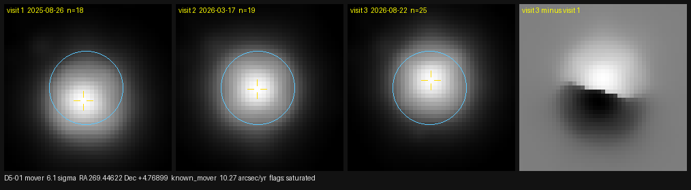
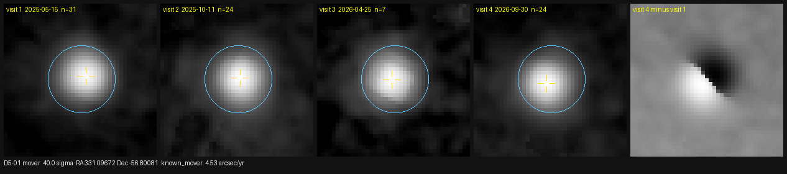
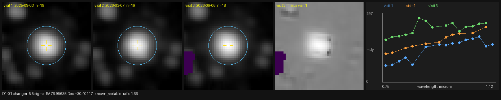
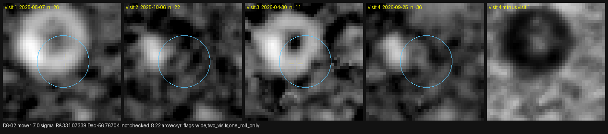

# Search mode: looking for things that move or change, with no target given

Written 2026-11-14 for teammates who are not astronomers. Everything here was measured on the
SPHEREx cutouts already in the shared cache; nothing was downloaded, simulated or injected.

## What the search does, in plain words

You give it a patch of sky (a centre and a size) and which of the six detectors to use. You do
not tell it what to look for. For each detector it:

1. **Builds one picture per visit** exactly as the viewer does (same cleaning, same rule for
   throwing away glitches), and one picture of all visits together.
2. **Finds every source** that stands out clearly (5 times the noise) in the all-visits picture
   or in one visit's picture. No catalogue is used for this.
3. **Measures each source's position in every visit** and asks: does it drift in a straight line
   by more than its own measuring error? Errors are checked against the other stars in the same
   picture, which should not move.
4. **Measures each source's brightness in every single exposure** and compares visits *at the
   same wavelength* (each SPHEREx exposure sees a star at its own colour, so only like-with-like
   comparisons mean anything). Again the errors are checked against the other stars.
5. **Tries to kill every candidate** with tests for the artefacts we know SPHEREx makes (below).
6. **Looks up what survives** in five catalogues (Gaia DR3, SIMBAD, AAVSO's variable star index,
   CatWISE2020, AllWISE), with each catalogue position moved to the date of each visit.

A detection is never taken from the fitting code's own "signal to noise": that number is not a
detection strength (on empty sky it reaches 5 at a quarter of places; see
`docs/verification.md`). Instead every brightness the search calls a detection is the same
measurement made at 300 to 600 empty places of the same picture, and the source's value is given
as "times the noise of those empty places" and "how many empty places were as bright".

### The tests that kill a candidate

| Artefact we know about | How the search catches it |
|---|---|
| Reflection ("ghost") of a very bright star: a ring fixed on the sky within one visit and somewhere else in the next | A mover must be at the place its straight line predicts in **every** visit deep enough to show it. A ghost is there in some visits and missing in others. Also: a mover must be point-like, not a ring or blob. |
| Two glitches from different exposures that land on top of each other (they survive the stacking rule as a small ring or bar) | A change must survive leaving out the two exposures that help it most. A real change is carried by most of the exposures. |
| Light from a bright neighbour, which changes when the spacecraft turns between visits | Sources where a much brighter star's own measured wing puts more than a tenth of the source's light in the measuring circle are not tested at all. Changes seen only between visits taken with the spacecraft turned the other way are flagged `follows_roll`. |
| Saturated stars, which cannot be placed to better than 1 to 2 arcsec | Their position error has a floor of 1 arcsec (detectors 5 and 6) or 2 arcsec (1 to 4), from `docs/verification.md` section 4. Their brightness is taken from a ring of unsaturated pixels, only in detectors 5 and 6, and must change by at least 25 per cent (twice the worst wobble seen on Barnard's Star, which does not vary). |
| A blended neighbour pulling the position | Flagged `blended`; reported only with caution. |
| A comparison resting on one pair of exposures (RW Aurigae showed a dip lasting days) | A change needs at least 6 shared wavelength channels, three quarters of them moving the same way, and survives leaving out any two exposures. The dates of each compared set are reported. |
| Too few stars in the picture to check the errors | Flagged `uncalibrated`. |

Each candidate ends with a verdict: **rejected** (it has an artefact's signature; the reasons
are written out and it never becomes a reported object), **caution** (it has flags a person must
look at), or **clean**.

## Recovery test, run blind

The search was given only each field's centre (where the cached cutouts are) and a 0.1 degree
(6 arcmin) field, and run in all six detectors. It was never told what the target was or how it
moves. Command (about 30 s per field, all six detectors):

```
export SPHEREX_CACHE_DIR=<the shared cache>
.venv/bin/python scripts/search_fields.py --fields fields.txt --offline --out <folder>
```

"sigma" below is the significance of the motion or change after the errors were checked against
the field's own stars; 5 is the bar.

### Barnard's Star: found, labelled known

- Found as a mover in detectors 5 and 6 (6.1 and 5.7 sigma; 8.2 combined). Measured speed 10.3
  +- 1.5 arcsec/yr (detector 5) and 10.1 +- 1.5 (detector 6), heading 348 and 351 degrees (just
  west of north). Gaia: 10.4 arcsec/yr, almost due north.
- Shift between the first and last visit (Aug 2025 to Sep 2026): measured 2.2 west, 9.9 north
  (+- 2.1) in detector 5; Gaia with parallax predicts 0.8 west, 10.3 north. The 1.4 arcsec
  east-west difference is the saturation effect described in `docs/verification.md` section 4.
- Catalogue: Gaia DR3 4472832130942575872, motion agrees. Verdict **caution** (saturated).
- In detectors 1 to 4 it is NOT reported: with the 2 arcsec floor that saturation demands, a
  one-year shift of 10 arcsec is only 3 to 4 times its error there. (Without the floor it was
  "found" at 10 to 29 sigma in those detectors, but that significance was not real.)



### WISE 0855-0714: found, labelled known (by SIMBAD, not by Gaia)

- Found as a mover in detector 5 (10.2 sigma, **clean**) and detector 6 (7.7 sigma, caution:
  `two_visits`, because visit 1 has only 3 exposures in detector 6). Combined 11.6 sigma.
- Detector 5: 7.3 +- 0.7 arcsec/yr toward 283 degrees (west, slightly north). Shift first to
  last visit (May 2025 to May 2026): measured 7.4 west, 1.7 north (+- 1.0); catalogue (SIMBAD,
  Kirkpatrick et al. 2021) 8.1 west, 0.7 north. Detector 6 (visits 2 and 3 only): 8.5 +- 1.1
  arcsec/yr.
- Is it really there in each visit? Measured at the place its motion predicts, against 422 empty
  places: detector 5, **12.7, 17.5 and 21.0 times the noise** in visits 1, 2, 3, and **no empty
  place as bright** in any visit. (The independent verification found 12.9, 17.3 and 12.5 with the
  neighbouring star fitted separately; our visit-3 value includes about 40 per cent from the
  G = 16.3 star that is less than one pixel away by then.) Detector 6, visit 1 (3 exposures):
  3.4 times the noise, i.e. marginal, as the verification also found (3.7).
- The catalogue check matters here: Gaia has nothing at this place with this motion. SIMBAD
  answered with WISEA J085510.74-071442.5 (a brown dwarf) whose motion agrees. Without SIMBAD
  it would have come out as "moved, no counterpart". All five catalogues answered.
- The measured track is pulled about 1 arcsec north by the G = 16.3 star it passes; the
  verification (which fits the star separately) gets 8.3 +- 0.4 arcsec/yr west.


### Epsilon Indi B: found in five detectors, labelled known

- Mover in detectors 2, 3, 5, 6 (**clean**, 24 to 40 sigma) and 4 (7.9 sigma, caution:
  `few_exposures`, visit 1 has 3). Not in detector 1, where it is faint and visit 1 has 4
  exposures.
- Detector 5, four visits (Apr 2025 to Oct 2026): shift measured 5.03 east, 3.68 south (+-
  0.22); Gaia with parallax predicts 5.08 east, 3.68 south. Difference 0.05 arcsec. A straight
  line through the four visits gives 4.5 arcsec/yr; the catalogue's proper motion is 4.7
  arcsec/yr, and the difference is its parallax (0.27 arcsec), which a straight line ignores.
- Catalogue: Gaia DR3 6412596012146801152 (the pair is unresolved).



### RW Aurigae: flagged as a changer, labelled known variable

- Detector 1 (0.75 to 1.12 microns), ordinary brightness: **1.66 times brighter** in Sep 2026
  than in Sep 2025, in all 13 shared wavelength channels (5.5 sigma; 5.2 sigma with the two most
  helpful exposures left out).
- Detector 5 (3.8 to 4.4 microns), ring measure (the star is saturated in 17 of 18 first-visit
  exposures): **0.52 times** as bright, all 13 channels down (7.7 sigma).
- Detector 6 (4.4 to 5.0 microns), ring measure: **0.54 times**, all 9 channels down (6.0 sigma).
- Combined 11.0 sigma. Catalogue: SIMBAD (T Tauri star, both components), AAVSO VSX (RW Aur,
  2.64 d, 9.2 to 13.6 V). These agree with the verification (ring 0.52 and 0.53; 1.28 to 2.6 in
  detector 1 depending on wavelength and on the dip of early September 2025).
- Dates: the Sep 2025 detector-1 exposures are 1 to 4 Sep 2025, during the few-day dip AAVSO
  recorded, so the factor 1.66 is partly the dip (see `docs/verification.md`).




### R Draconis (not asked for, found anyway)

- Detector 6, ring measure: 0.60 times between Dec 2025 to Jan 2026 and Apr to Jun 2026, all 16
  channels down (6.7 sigma). Known: Gaia (long-period variable), SIMBAD (Mira), VSX (246 d).
  Caution: saturated, blended, and the field has too few plain stars to check the errors
  (`uncalibrated`).

## False alarms

The most important number. Over the five fields and six detectors (30 searches, 874 sources
found, 683 tested for motion and 663 for brightness):

| Field | Objects reported (5 sigma or more) | Of which the target | False alarms (looked at by eye) | Caught by the artefact tests |
|---|---|---|---|---|
| Barnard's Star | 1 | 1 | 0 | 0 |
| Epsilon Indi B | 1 | 1 | 0 | 1 (a ghost ring, 7.0 sigma) |
| WISE 0855 | 1 | 1 | 0 | 0 |
| RW Aurigae | 1 | 1 | 0 | 0 |
| R Draconis | 1 | 1 | 0 | 0 |
| **All** | **5** | **5** | **0** | **1** |

- **No false alarm was reported** in these 30 searches. One artefact did reach 7.0 sigma: the
  reflection of Epsilon Indi A (K = 2.2, 8.5 arcmin away) in detector 6, a ring 35 arcsec across
  seen in the two April visits at different places and absent from the two October visits. It
  was rejected because at the place its "motion" predicts, visits 2 and 4 measure 1.1 and 2.1
  times the noise where 9 and 13 were expected, and because it is not point-like. Before these
  tests existed (version 1 of the search) it was reported as a 7-sigma mover with no catalogue
  counterpart: exactly the kind of "find" we must never show.
- Honest size of this number: 5 objects in 30 searches is a small sample. With 683 sources
  tested for motion and none falsely passing, the false-mover rate is below about 1 in 230 per
  source (95 per cent confidence), not zero. The fields include a ghost, saturated stars, a
  crowded young-star field and a sparse polar field, but not, for instance, a field near the
  Galactic plane.



## Status of the hunt

In progress; this section is filled in as fields are searched.
