# Search mode: looking for things that move or change, with no target given

Written 2026-11-14 for teammates who are not astronomers. The recovery test and the first hunt
used only SPHEREx cutouts already in the shared cache; four fresh fields were then read from the
public S3 copy of the archive into the search's own folder. Nothing was simulated or injected.

## What the search does, in plain words

You give it a patch of sky (a centre and a size) and which of the six detectors to use. You do
not tell it what to look for. For each detector it:

1. **Builds one picture per visit** exactly as the viewer does (same cleaning, same rule for
   throwing away glitches), and one picture of all visits together.
2. **Finds every source** that stands out clearly (5 times the noise) in the all-visits picture
   or in one visit's picture. No catalogue is used for this.
3. **Measures each source's position in every visit** and asks: does it drift in a straight line
   by more than its own measuring error? Errors are checked against the other stars in the same
   picture, which should not move.
4. **Measures each source's brightness in every single exposure** and compares visits *at the
   same wavelength* (each SPHEREx exposure sees a star at its own colour, so only like-with-like
   comparisons mean anything). Again the errors are checked against the other stars.
5. **Tries to kill every candidate** with tests for the artefacts we know SPHEREx makes (below).
6. **Looks up what survives** in five catalogues (Gaia DR3, SIMBAD, AAVSO's variable star index,
   CatWISE2020, AllWISE), with each catalogue position moved to the date of each visit.

A detection is never taken from the fitting code's own "signal to noise": that number is not a
detection strength (on empty sky it reaches 5 at a quarter of places; see
`docs/verification.md`). Instead every brightness the search calls a detection is the same
measurement made at hundreds of empty places of the same picture (235 to 579 in a 0.1-degree
picture, over a thousand in larger ones), and the source's value is given
as "times the noise of those empty places" and "how many empty places were as bright".

### The tests that kill a candidate

| Artefact we know about | How the search catches it |
|---|---|
| Reflection ("ghost") of a very bright star: a ring fixed on the sky within one visit and somewhere else in the next | A mover must be at the place its straight line predicts in **every** visit deep enough to show it. A ghost is there in some visits and missing in others. Also: a mover must be point-like, not a ring or blob. |
| Two glitches from different exposures that land on top of each other (they survive the stacking rule as a small ring or bar) | A change must survive leaving out the two exposures that help it most. A real change is carried by most of the exposures. |
| Light from a bright neighbour, which changes when the spacecraft turns between visits | Sources where a much brighter star's own measured wing puts more than a tenth of the source's light in the measuring circle are not tested at all. Changes seen only between visits taken with the spacecraft turned the other way are flagged `follows_roll`. |
| Saturated stars, which cannot be placed to better than 1 to 2 arcsec | Their position error has a floor of 1 arcsec (detectors 5 and 6) or 2 arcsec (1 to 4), from `docs/verification.md` section 4. Their brightness is taken from a ring of unsaturated pixels, only in detectors 5 and 6, and must change by at least 25 per cent (twice the worst wobble seen on Barnard's Star, which does not vary). |
| A blended neighbour pulling the position | Flagged `blended`; reported only with caution. |
| A comparison resting on one pair of exposures (RW Aurigae showed a dip lasting days) | A change needs at least 6 shared wavelength channels, three quarters of them moving the same way, and survives leaving out any two exposures. The dates of each compared set are reported. |
| Too few stars in the picture to check the errors | Flagged `uncalibrated`. |

Each candidate ends with a verdict: **rejected** (it has an artefact's signature; the reasons
are written out and it never becomes a reported object), **caution** (it has flags a person must
look at), or **clean**.

**Added on the evening of 14 November, after a second hunt: a mover must move the same way in
every colour.** In NGC 7129 the search graded a "mover" clean although it moved 8.3 arcsec a year
in detector 1, 1.3 in detector 2 and 0.4 in detectors 3 and 4. A real motion is the same at every
wavelength, so this is a blend: the star there is a listed variable, and when one of two close
stars changes brightness their shared centre shifts, most at the wavelengths where it changed
most. Movers whose detectors disagree by 5 or more (as a Gaussian equivalent) are now rejected.
The rule was written after seeing that case. It was then checked on the three real movers,
which it must not reject: their detectors disagree by 0.0 (Barnard's Star, two detectors), 0.6
(WISE 0855, two) and 0.4 (Epsilon Indi B, five), against 19.4 for the blend.

## Recovery test, run blind

The search was given only each field's centre (where the cached cutouts are) and a 0.1 degree
(6 arcmin) field, and run in all six detectors. It was never told what the target was or how it
moves. Command (19 to 47 s per field for all six detectors, from cached cutouts):

```
export SPHEREX_CACHE_DIR=<the shared cache>
.venv/bin/python scripts/search_fields.py --fields fields.txt --offline --out <folder>
```

"sigma" below is the significance of the motion or change after the errors were checked against
the field's own stars; 5 is the bar.

### Barnard's Star: found, labelled known

- Found as a mover in detectors 5 and 6 (6.1 and 5.7 sigma; 8.2 combined). Measured speed 10.3
  +- 1.5 arcsec/yr (detector 5) and 10.1 +- 1.5 (detector 6), heading 348 and 351 degrees (just
  west of north). Gaia: 10.4 arcsec/yr, almost due north.
- Shift between the first and last visit (Aug 2025 to Sep 2026): measured 2.2 west, 9.9 north
  (+- 2.1) in detector 5; Gaia with parallax predicts 0.8 west, 10.3 north. The 1.4 arcsec
  east-west difference is the saturation effect described in `docs/verification.md` section 4.
- Catalogue: Gaia DR3 4472832130942575872, motion agrees. Verdict **caution** (saturated).
- In detectors 1 to 4 it is NOT reported: with the 2 arcsec floor that saturation demands, a
  one-year shift of 10 arcsec is only 3 to 4 times its error there. (Without the floor it was
  "found" at 10 to 29 sigma in those detectors, but that significance was not real.)


### WISE 0855-0714: found, labelled known (by SIMBAD, not by Gaia)

- Found as a mover in detector 5 (10.2 sigma, **clean**) and detector 6 (7.7 sigma, caution:
  `two_visits`, because visit 1 has only 3 exposures in detector 6). Combined 11.6 sigma.
- Detector 5: 7.3 +- 0.7 arcsec/yr toward 283 degrees (west, slightly north). Shift first to
  last visit (May 2025 to May 2026): measured 7.4 west, 1.7 north (+- 1.0); catalogue (SIMBAD,
  Kirkpatrick et al. 2021) 8.1 west, 0.7 north. Detector 6 (visits 2 and 3 only): 8.5 +- 1.1
  arcsec/yr.
- Is it really there in each visit? Measured at the place its motion predicts, against 422 empty
  places: detector 5, **12.7, 17.5 and 21.0 times the noise** in visits 1, 2, 3, and **no empty
  place as bright** in any visit. (The independent verification found 12.9, 17.3 and 12.5 with the
  neighbouring star fitted separately; our visit-3 value includes about 40 per cent from the
  G = 16.3 star that is less than one pixel away by then.) Detector 6, visit 1 (3 exposures):
  3.4 times the noise, i.e. marginal, as the verification also found (3.7).
- The catalogue check matters here: Gaia has nothing at this place with this motion (only the
  G = 16.3 star, which does not move). SIMBAD answered with WISEA J085510.74-071442.5 (a brown
  dwarf) whose motion agrees, and CatWISE2020 with three entries for it (its fast motion splits
  it), each moving 7.9 to 8.0 arcsec/yr west, all agreeing with the measured shift to within 1.3
  arcsec. With Gaia alone it would have come out as "moved, no counterpart". All five
  catalogues answered.
- The measured track is pulled about 1 arcsec north by the G = 16.3 star it passes; the
  verification (which fits the star separately) gets 8.3 +- 0.4 arcsec/yr west.

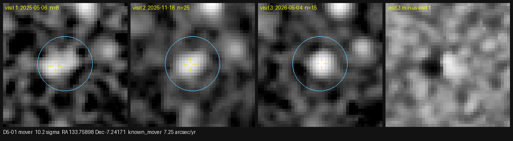

### Epsilon Indi B: found in five detectors, labelled known

- Mover in detectors 2, 3, 5, 6 (**clean**, 24 to 40 sigma) and 4 (7.9 sigma, caution:
  `few_exposures`, visit 1 has 3). Not in detector 1, where it is faint and visit 1 has 4
  exposures.
- Detector 5, four visits (Apr 2025 to Oct 2026): shift measured 5.03 east, 3.68 south (+-
  0.22); Gaia with parallax predicts 5.08 east, 3.68 south. Difference 0.05 arcsec. A straight
  line through the four visits gives 4.5 arcsec/yr; the catalogue's proper motion is 4.7
  arcsec/yr, and the difference is its parallax (0.27 arcsec), which a straight line ignores.
- Catalogue: Gaia DR3 6412596012146801152 (the pair is unresolved).


### RW Aurigae: flagged as a changer, labelled known variable

- Detector 1 (0.75 to 1.12 microns), ordinary brightness: **1.66 times brighter** in Sep 2026
  than in Sep 2025, in all 13 shared wavelength channels (5.5 sigma; 5.2 sigma with the two most
  helpful exposures left out).
- Detector 5 (3.8 to 4.4 microns), ring measure (the star is saturated in 17 of 18 first-visit
  exposures): **0.52 times** as bright, all 13 channels down (7.7 sigma).
- Detector 6 (4.4 to 5.0 microns), ring measure: **0.54 times**, all 9 channels down (6.0 sigma).
- Combined 11.0 sigma. Catalogue: SIMBAD (T Tauri star, both components), AAVSO VSX (RW Aur,
  2.64 d, 9.2 to 13.6 V). These agree with the verification (ring 0.52 and 0.53; 1.28 to 2.6 in
  detector 1 depending on wavelength and on the dip of early September 2025).
- Dates: the Sep 2025 detector-1 exposures are 1 to 4 Sep 2025, during the few-day dip AAVSO
  recorded, so the factor 1.66 is partly the dip (see `docs/verification.md`).


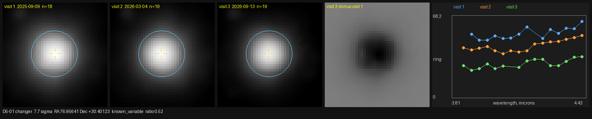

### R Draconis (not asked for, found anyway)

- Detector 6, ring measure: 0.60 times between Dec 2025 to Jan 2026 and Apr to Jun 2026, all 16
  channels down (6.7 sigma). Known: Gaia (long-period variable), SIMBAD (Mira), VSX (246 d).
  Caution: saturated, blended, and the field has too few plain stars to check the errors
  (`uncalibrated`).

## False alarms

The most important number. Over the five fields and six detectors (30 searches, 874 sources
found, 683 tested for motion and 663 for brightness):

| Field | Objects reported (5 sigma or more) | Of which the target | False alarms (looked at by eye) | Caught by the artefact tests |
|---|---|---|---|---|
| Barnard's Star | 1 | 1 | 0 | 0 |
| Epsilon Indi B | 1 | 1 | 0 | 1 (a ghost ring, 7.0 sigma) |
| WISE 0855 | 1 | 1 | 0 | 0 |
| RW Aurigae | 1 | 1 | 0 | 0 |
| R Draconis | 1 | 1 | 0 | 0 |
| **All** | **5** | **5** | **0** | **1** |

- **No false alarm was reported** in these 30 searches. One artefact did reach 7.0 sigma: the
  reflection of Epsilon Indi A (K = 2.2, 8.5 arcmin away) in detector 6: a ring about 30 arcsec
  across (fitted width 25 arcsec, against 10 for the field's stars), seen at different places in
  the two April-May visits and absent from the two September-November visits. It was rejected
  because at the place its "motion" predicts, visits 2 and 4 measure 1.2 and 2.2 times the noise
  where 9 and 13 were expected, and because it is not point-like. Before these
  tests existed (version 1 of the search) it was reported as a 7-sigma mover with no catalogue
  counterpart: exactly the kind of "find" we must never show.
- Honest size of this number: 5 objects in 30 searches is a small sample. With 683 sources
  tested for motion and none falsely passing, the false-mover rate is below about 1 in 230 per
  source (95 per cent confidence), not zero. The fields include a ghost, saturated stars, a
  crowded young-star field and a sparse polar field, but not, for instance, a field near the
  Galactic plane.


## The hunt in the fields already on disk

Every source in these pictures, not only the famous targets, was tested. Fields searched (all
from the cache, nothing downloaded):

| Field | Size | Detectors | Exposures | Why it is worth searching |
|---|---|---|---|---|
| The five challenge fields | 0.1 deg | all six | 258 to 548 per field | already here; R Draconis is 9 degrees from the north ecliptic pole and has about 90 exposures per detector |
| Barnard's Star, wider | 0.2 deg | 5 | 62 | low Galactic latitude, many stars (138 found) |
| Epsilon Indi B, wider | 0.3 deg | 5 | 86 | four visits over 17 months, the longest time span here (268 sources) |
| NGC 1333 (Perseus) | 0.2 deg | 3 | 60 | young star cluster: young stars vary |
| Serpens Main | 0.2 deg | 3 | 71 | young star cluster near the Galactic plane |
| Near the north ecliptic pole (RA 249.6, Dec +67.3) | 0.2 deg | 3 | 90 | many exposures |
| RA 240.0, Dec +30.0 | 0.2 deg | 3 | 72 | an ordinary high-latitude field, as a control |

The four 0.2-degree detector-3 fields were downloaded by the previous search session; only
detector 3 is on disk for them.

In all: 36 searches (field times detector), 1950 sources found, 352 set aside because they sit
on the glow of a much brighter star, 1578 tested for motion and 1550 for brightness. 6.7 seconds
per search on average.

### a. Known objects doing something in this data: 3 besides the targets

All three are young stars that the catalogues already list as variable. What is new is only the
measurement: how much each changed between SPHEREx's visits, at 1.6 to 2.4 microns (detector 3).
Each comparison uses the same wavelength channels in both visits, and each survives leaving out
the two exposures that help it most. None was checked in a second detector (only detector 3 is
on disk for these fields).

| Object | Place (RA, Dec) | What SPHEREx measured | Catalogue listing | Confidence |
|---|---|---|---|---|
| V371 Ser (Serpens) | 277.46372, +1.27732 | **faded to 0.34** of its brightness between 27 Aug - 1 Oct 2025 and 26 Aug - 3 Sep 2026; all 11 shared channels fainter; 7.4 sigma (6.9 without the two most helpful exposures) | SIMBAD: V* V371 Ser, Orion-type variable, 1.7 arcsec; AAVSO VSX: V0371 Ser, H = 11.7 to 14.1, period 543 d | High that the change is real. A factor 3 (1.2 magnitudes) is inside its catalogued range (2.4 magnitudes in H), so it is not unusual behaviour for this star. |
| NSV 1155 = 2MASS J03284325+3117330 (NGC 1333) | 52.18059, +31.29265 | steady from Aug 2025 to Feb 2026, then **0.75 times** as bright on 19 - 21 Aug 2026; all 13 channels fainter; 6.9 sigma (6.1) | SIMBAD: Orion-type variable, 1.1 arcsec; AAVSO VSX: NSV 1155, T Tauri star | High that the change is real; the size of the change is ordinary for a T Tauri star. |
| 2MASS J18295688+0114463 (Serpens) | 277.48710, +1.24611 | **1.17 times brighter** in Apr and Aug 2026 than in Sep 2025; all 13 channels brighter; 6.3 sigma (5.7) | SIMBAD: Orion-type variable, 0.2 arcsec; AAVSO VSX: WISEA J182956.88+011446.0, a young "dipper" star, r = 13.0 to 17.2, period 695 d | High that the change is real. 17 per cent is small for this star. |

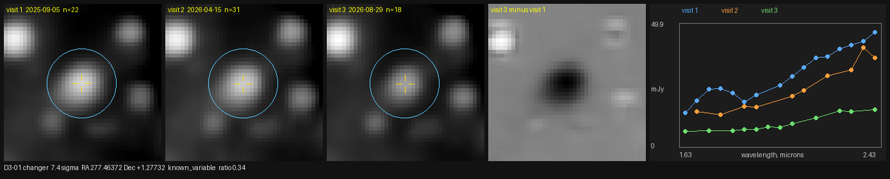
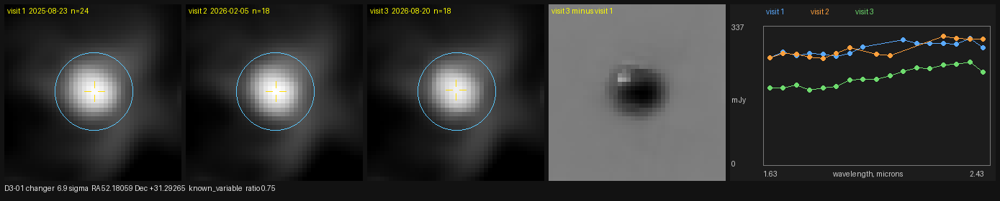
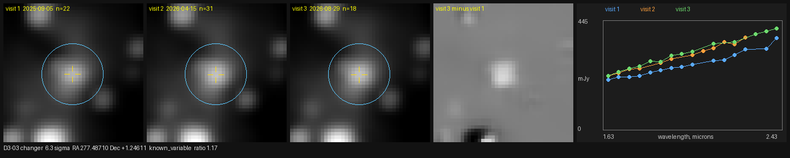

### b. Brightness changes in objects not listed as variable: none

No source whose brightness changed at 5 sigma is unlisted. "Listed" means: Gaia DR3's
variability flag or classifier, an AAVSO VSX entry of category "Variable", AllWISE's variability
flag (6 or more in the 3.4 or 4.6 micron band), or a SIMBAD type that is a variable-star type. A
SIMBAD type that is only a kind of object that often varies (a young star, an active galaxy) does
not count as listed; it would be named in the summary. All five catalogues answered for every
candidate of this hunt.

Below the bar, for the record only (none of these is a claim, and their catalogue status was not
looked up): in NGC 1333, three sources changed by 16 to 22 per cent at 3.6 to 4.8 sigma; in the R Draconis field one star at 248.22882,
+66.79144 faded to 0.66 in detector 6 at 3.9 sigma, in a field too sparse to check the errors.

### c. Movers with no catalogue counterpart: none

Three sources passed the 5-sigma motion test and every one was rejected by the artefact tests;
each was then looked at by eye and the rejection is right:

| Field, detector | Motion test | Why rejected | By eye |
|---|---|---|---|
| Epsilon Indi B, 6 | 7.0 sigma, 8.2 arcsec/yr | missing from visits 2 and 4 (1.2 and 2.2 times the noise where 9 and 13 were expected); 25 arcsec wide against 10 for a star | a ring reflected from Epsilon Indi A (8.5 arcmin away), in a different place in each April visit |
| Serpens, 3 | 7.2 sigma, 2.6 arcsec/yr | 24 arcsec wide against 9 | two stars blended north-south, next to a brighter star that changed; the blend's centre shifts |
| NGC 1333, 3 | 5.8 sigma, 1.7 arcsec/yr | 17 arcsec wide against 9 | a patch of nebula, not a star |

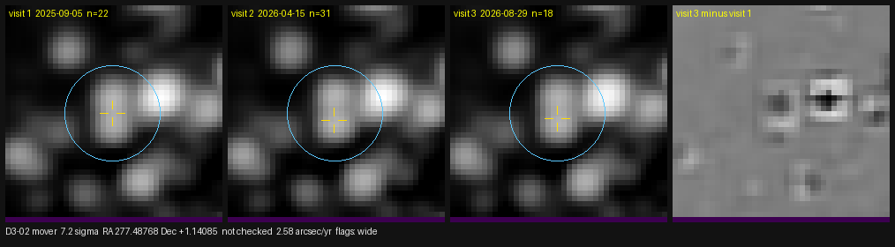
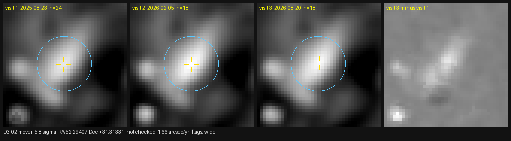

### False alarms over the whole hunt

10 objects were reported at 5 sigma or more over the 36 searches, 8 of them different: the five
targets (two of them found again in the wider fields) and the three known variables above.
**None is a false alarm.** Three more sources reached 5 sigma and were rejected by rule as
artefacts: the three movers in the table above, each confirmed by eye. With 1578 sources tested for motion and 1550 for
brightness and none passing falsely, the false-alarm rate is below about 1 in 500 sources per
test (95 per cent confidence). What that does not cover: fields unlike these (crowded Galactic
plane, bright nebulae beyond what NGC 1333 and Serpens show), and artefacts we have not met.

## The hunt in four fresh fields (read from the public S3 copy of the archive)

Chosen where this method has the best odds of finding something no catalogue lists:

- **NGC 1333 and Serpens Main, all six detectors.** Only detector 3 was on disk, and three weak
  changers (3.6 to 4.8 sigma) were already sitting in NGC 1333. Six detectors let a change be
  confirmed between the same two visits in independent detectors, which an artefact rarely
  manages. Young star clusters: their stars vary, and many are hidden from optical surveys by
  dust, so Gaia's and AAVSO's variable lists miss them.
- **Serpens South, all six detectors.** A young cluster so deeply embedded that most of its stars
  are invisible to optical surveys, which are where most variable-star listings come from; four
  visits.
- **Chamaeleon I, all six detectors.** A young cluster with the most exposures per detector among
  the candidates (about 80).
- Not chosen: the ecliptic poles, although SPHEREx looks there most. Only two detectors cover the
  exact pole points, and the coverage is so continuous that the 30-day-gap rule makes one or two
  "visits" a year long, which smears any motion. This method needs separate visits.

All at 0.2 degrees. Cutouts not already in the shared cache were read from the S3 copy into the
search's own folder (`backend/cache/search2/cutouts`, 1.1 GB for the four fields), never into
the shared `cutouts/`. Time per field, all six detectors: 3 to 3.5 minutes the first time, of
which 106 to 136 s was reading 300 to 480 cutouts from S3 (about 0.3 s each on this machine
today) and 67 to 82 s the search itself.

In all: 24 searches, 3308 sources found, 872 set aside on the glow of brighter stars, 2358 tested
for motion and 2396 for brightness. 28 objects passed: 17 listed variables, 2 candidates that
survive every test (below), 1 probable but unclaimable change, and 8 "not listed" changes seen
in one detector only or below 5 sigma in every detector, which could be neither confirmed nor
killed. Rejected at 5 sigma or more: 8 "movers" (7 not point-like, 1 an unresolved pair).

### NGC 1333 (RA 52.265, Dec +31.31), six detectors

Nine objects pass with the final code: seven listed variables (category a, below), one candidate
of category b, and one weak "not listed" change. In the first run a tenth was reported, a "mover"
that is a false alarm (an unresolved pair, below); the rule that now rejects it was written after
seeing it.

**b. HH 17 (Gaia DR3 121394192607752192), RA 52.33509, Dec +31.30940: changed, not listed as
variable.** Candidate.

- Between 19 - 26 Aug 2025 and 1 - 12 Feb 2026 it faded, in all four detectors that measure it
  well, between the same two visits: 3.8 to 4.4 microns 0.84 (4.7 sigma), 4.4 to 5.0 microns 0.86
  (5.3 sigma, all 15 channels fainter), 1.6 to 2.4 microns 0.84 (4.7 sigma), 1.1 to 1.65 microns
  0.90 (3.1 sigma). By 16 Aug - 5 Sep 2026 it was back at 1.1 to 2.4 microns (1.20 and 1.29 times
  the February value) but not at 3.8 to 5 microns (still 0.84 to 0.90 of August 2025).
- Combined over detectors 9.8 sigma. In detectors 2 and 6 the change survives leaving out the two
  most helpful exposures (5.9 and 4.9 sigma). No flags in those two detectors; in detector 3 the
  change follows the spacecraft's turn (visit 2 low, visits 1 and 3 equal).
- Catalogues (all five answered): Gaia DR3 121394192607752192 (G = 20.3) at 0.3 arcsec, no
  variability flag; SIMBAD lists it as HH 17, a young stellar object; CatWISE2020 and AllWISE
  have it (AllWISE variability flag 5 and 4 at 3.4 and 4.6 microns, below the catalogue's "likely
  variable" level of 6); nothing in AAVSO VSX. So: **not listed as variable in Gaia DR3, AAVSO
  VSX, AllWISE or SIMBAD**; SIMBAD lists it as a young star, a kind of star that commonly varies.
- Tried to kill it: a reflection would add light in some visits, so it would have to be present
  only in August 2025 and not in August 2026, taken with the spacecraft the same way round (the
  brightest star near the field, K = 3.0, is 14 arcmin from its centre); not on a brighter star's
  glow; not blended (nearest catalogued
  neighbour 9.8 arcsec away and 60 times fainter at 3.4 microns); the August 2025 to August 2026
  drop at 4 to 5 microns is between visits taken with the spacecraft the same way round, so it is
  not light that turns with the spacecraft; four detectors agree on the first step.
- What weakens it: it sits in the nebula of NGC 1333 (in detector 2 the level around it is 30 per
  cent of its own brightness, and the detector-2 difference picture shows the four-leaf pattern of
  a small change of image shape); the errors in this field had to be scaled up 1.7 to 2.4 times on
  its own stars, a sign of a difficult field; young stars of this kind usually vary, so the
  change is not surprising.
- What would confirm it: a near- or mid-infrared light curve from another telescope covering Aug
  2025 to Aug 2026, or SPHEREx's next visits.

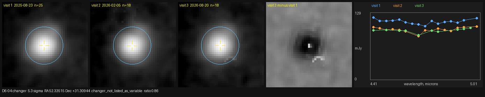
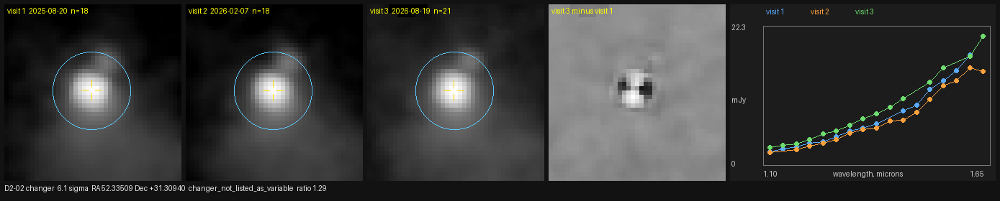

**a. Listed variables that changed** (each in several detectors): NSV 1155 (faded to 0.68 at 0.75
to 1.65 microns and 0.83 at 4.4 to 5 microns, Aug 2025 to Aug 2026, 16 sigma combined); LkHA 352
(down to 0.56 at 0.75 to 1.1 microns, up 1.18 to 1.26 at 2.4 to 4.4 microns, Aug 2025 to Feb
2026); NSV 15700; a Gaia-classified young star at 52.22749, +31.28090 (0.74 at 3.8 to 4.4
microns); and three sources listed as variable only by AllWISE's flag, at 52.21335 +31.33181
(1.40 times brighter at 4.4 to 5 microns), 52.28790 +31.35792 (1.64 times) and 52.19860 +31.40163
(1.43 times; near the frame edge).

**Not claimed:** a source at 52.25565 +31.33948 next to the radio source [RAC97] VLA 43 (SIMBAD:
young star), 16 per cent brighter, 5.4 sigma only when two detectors are combined (4.6 and 3.6),
and wider than a star in detector 3.

**Rejected:** NSV 1155 "moved" 1.3 arcsec/yr in detector 1 (6.8 sigma, 3 to 4 sigma in four more
detectors). It is two catalogued young stars 3.4 arcsec apart (NSV 1155 and HBC 341, separate in
Gaia); one faded and the centre of the pair shifted. This led to a new rule: a mover with two or
more catalogued objects within one pixel of its track, none with the measured motion, is
rejected. Also rejected: a 15.9-sigma "mover" in detector 5 that is a faint diffuse patch beside
a bright star (18 arcsec wide against 10).

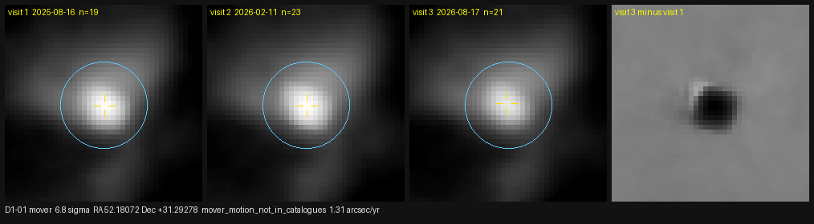

### Serpens Main (RA 277.485, Dec +1.23), six detectors

Nine objects passed. Six are listed variables, now seen in several detectors: V371 Ser fell to
0.22 to 0.38 of its brightness at every wavelength from 1.1 to 5 microns (Sep 2025 to Sep 2026);
the dipper 2MASS J18295688+0114463 rose 1.33 times at 3.8 to 5 microns; a Gaia-classified young
star rose 1.37 to 1.45 times at 3.8 to 5 microns; a source flagged by AllWISE rose 1.33 to 1.36
times; and two long-period variables changed by about 10 per cent (caution: below 5 sigma in
every single detector, and following the spacecraft's turn in one). Three are "not
listed as variable" but none is claimable: one is below 5 sigma in every detector (5.8 combined)
and in detector 5 its change follows the spacecraft's turn; two are seen in one detector only
(5.2 sigma each), with the neighbouring detector showing a blend or a blob. Two "movers" were
rejected as not point-like (24 and 26 arcsec wide).

### Serpens South (RA 277.51, Dec -2.05), six detectors

Nine objects passed. The one that matters:

**b. Embedded young star at RA 277.50547, Dec -2.06198 (SIMBAD: MSX6C G028.6477+03.8174, a young
stellar object; AllWISE: WISEA J183001.30-020343.2): brightened about 5 times, not listed as
variable.** Candidate, and the strongest change found today.

- Between 31 Aug - 3 Oct 2025 and 27 - 31 Mar 2026 it brightened, and it stayed bright through
  4 - 12 May and 28 Aug - 4 Oct 2026. Same wavelength channels compared in each detector:
  - 4.4 to 5.0 microns: 150 to 290 mJy in 2025, 760 to 1250 mJy in all three 2026 visits (4.5
    times; 9.4 sigma; 8.8 sigma with the two most helpful exposures left out).
  - 3.8 to 4.4 microns: 80 to 140 mJy, then 450 to 800 mJy (6.3 times; 7.5 sigma; 7.1).
  - 2.4 to 3.85 microns: 5 to 70 mJy in Sep 2025, about 5 times brighter in Mar 2026 and about 9
    times by Sep 2026 (6.8 sigma; 6.4).
  - 1.6 to 2.4 microns: 5.4 times (7.0 sigma), but flagged as sitting on a glow; 1.1 to 1.65
    microns: too faint to say.
- Its spectrum dips at 3.0 to 3.1, 4.24 to 4.28 and 4.65 to 4.68 microns, where ices absorb.
  Other stars in this field show the 4.24 and 4.65 micron dips too, so these may be ice in the
  dark cloud in front of all of them, or a feature of SPHEREx's calibration in those channels
  (not checked on a field without a cloud). They are not used as evidence here.
- Tried to kill it:
  - Calibration of the first visit: the other stars within 4 arcmin changed by -5 to +5 per cent
    between the same visits, and the field-wide visit-to-visit shift is 1 per cent or less. The
    two neighbours that rose 1.2 to 1.5 times (35 and 48 arcsec away) sit on its glow, which grew
    with it.
  - A reflection of a bright star: it would move between visits; this stays at one place through
    three bright visits taken with the spacecraft both ways round.
  - Saturation: 2 to 5 of about 40 to 60 exposures per detector are saturated; saturation removes
    light, it cannot create a brightening.
  - Spacecraft orientation: the September 2025 and September 2026 visits were taken the same way
    round, and the brightening holds between them in every detector.
  - One or two bad exposures: survives leaving out the two most helpful ones in detectors 4, 5 and 6
    (6.4, 7.1 and 8.8 sigma).
  - Only one detector: no, three at 5 sigma or more and a fourth at 7 sigma (on a glow).
  - Catalogues: all five answered. None lists it as variable (AllWISE's variability flag is
    "nnnn", i.e. no information; Gaia DR3 has nothing within 6 arcsec; nothing in AAVSO VSX).
    SIMBAD lists it as a young stellar object.
  - Two web searches on its catalogue names (IRAS 18274-0205, MSX6C G028.6477+03.8174) found no
    report of its variability. That is not a literature search. The outburst candidate known in
    Serpens South, IRAS 18270-0153, is a different object.
- **What limits the claim:**
  - SPHEREx's 15-arcsec measuring circle holds a compact group: CatWISE2020 lists four sources
    within 4 arcsec and SIMBAD lists IRAS 18274-0205, 6.9 arcsec away, as a multiple object.
    SPHEREx measures their sum, so which member brightened cannot be told.
  - In 2010, AllWISE measured W2 = 5.92 at 4.6 microns, roughly 0.7 Jy with the standard WISE
    zero point (typed from memory, not checked here). That is between SPHEREx's 2025 and 2026
    levels, so this is probably a star that swings widely over the years, not necessarily a
    first outburst.
  - Large swings are known in embedded young stars, so the change is remarkable in size but
    not of an unknown kind.
- What would confirm it: an infrared image from 2026 at higher resolution than SPHEREx (to see
  which member changed), and the next SPHEREx visits.

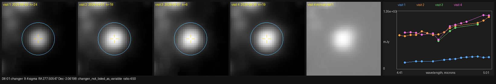
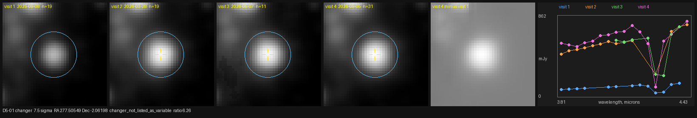
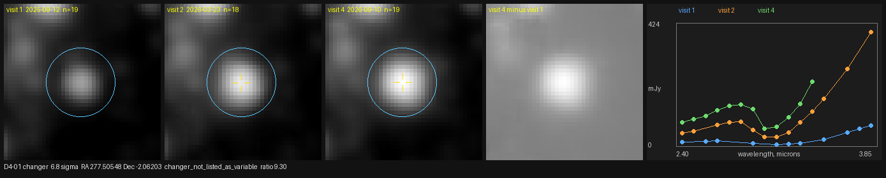

#### Checked from outside: ten years of NEOWISE, and a second brightness code

The search compares SPHEREx with itself. To test this candidate from outside, two things were
done on the evening of 14 November, both by `scripts/check_neowise.py`:

- NASA's archive was asked for every measurement the NEOWISE mission made of this position
  between 2014 and 2024: 485 single exposures within 8 arcsec, 269 of them within 1.5 arcsec on
  frames NEOWISE rates usable, in 21 visits about half a year apart.
- The SPHEREx images were measured again with the viewer's own brightness code (the one behind
  the brightness chart), which shares nothing with the search's.

| | Faintest | Brightest | Range |
|---|---|---|---|
| NEOWISE at 4.6 microns, 2014 to 2024 | 177 mJy (March 2024) | 1,603 mJy (September 2017; partly saturated) | a factor of 9 |
| NEOWISE at 3.4 microns, 2014 to 2024 | 32 mJy (March 2024) | 236 mJy (September 2017) | a factor of 7 |
| SPHEREx at 4.0 to 5.0 microns, viewer's code | 178 mJy (September 2025) | 805 mJy (September 2026) | a factor of 4.5 |
| SPHEREx at 2.8 to 3.8 microns, viewer's code | 17 mJy (September 2025) | 114 mJy (September 2026) | a factor of 7 |

Magnitudes were turned into millijanskys with the zero points of the WISE Explanatory Supplement
(section IV.4.h, Table 1: 309.540 Jy at 3.4 microns, 171.787 Jy at 4.6 microns, read on 14
November). The SPHEREx numbers are the median of each visit's exposures in that wavelength range.

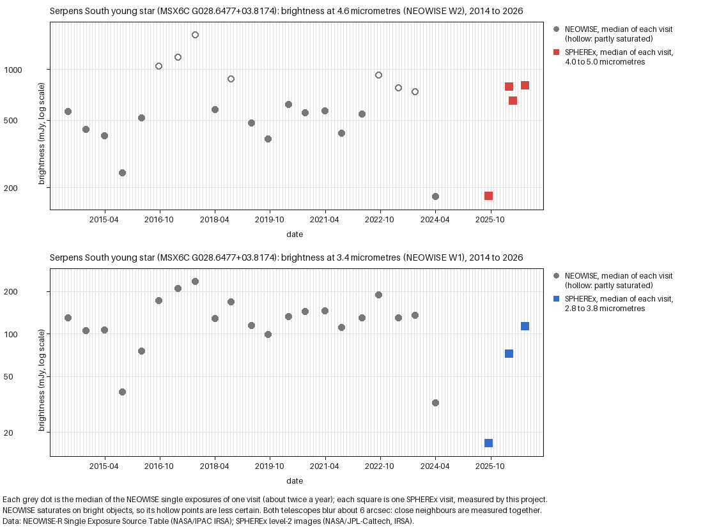

What this settles:
- **The star really does vary, and by this much.** A different telescope recorded swings of a
  factor of 7 to 9 over ten years. The brightening the search flagged is not an artefact of
  SPHEREx or of our code.
- **The two telescopes agree on how bright it is.** NEOWISE's last visit, in March 2024, found
  it at 177 mJy at 4.6 microns, fainter than in any of its 20 earlier visits (240 to 1,600 mJy,
  mostly 400 to 600). SPHEREx's first visit, in September 2025, found 178 mJy. In March, May and
  September 2026 SPHEREx has it at 793, 656 and 805 mJy, back inside NEOWISE's usual range.
- **So what SPHEREx watched is the star coming back from the deepest dip in the ten-year
  record.** The dip began between September 2023 (738 mJy) and March 2024 and lasted at least
  until September 2025. NEOWISE shows an earlier, shallower one in September 2015 (244 mJy).
- **The two codes agree.** The viewer's code gives 178 mJy rising to about 800; the search gave
  150 to 290 rising to 760 to 1,250 for the channels of detector 6 alone.

What it changes in the claim:
- This is **not a first outburst and not a new kind of behaviour**. It is a young star that
  varies strongly and has done so for at least ten years. The earlier guess in this section
  ("probably a star that swings widely") is now established.
- What stands is narrower: **none of the lists we asked records it as variable** (AAVSO's
  variable star index, Gaia DR3, SIMBAD's object type, AllWISE's variability flag), although its
  variability is plain in NEOWISE's public measurements.
- It is very likely known to specialists all the same. Surveys of how young stars vary in the
  infrared cover this cloud: one made from six years of NEOWISE data for about 5,400 young stars
  of the nearby clouds (Park and others 2021, arXiv 2107.10751), and a 38-day campaign on Serpens
  South with the Spitzer telescope (Wolk and others 2018). We did not check whether this star is
  in their tables. The service that hosts such tables (VizieR, in Strasbourg) could not be
  reached on 14 November.
- What SPHEREx adds that neither of those has: the rise seen in 102 colours from 0.75 to 5
  microns at once, including the wavelengths where ices absorb.

What it does not settle:
- NEOWISE blurs about as much as SPHEREx (6 arcsec), so it measured the same tight group. Which
  member varies is still unknown.
- NEOWISE saturates near this brightness (the share of saturated pixels reaches 0.45 in the
  brightest visits), so its brightest values are less certain than its faint ones. The faint
  states, where the agreement with SPHEREx is, are not saturated.

To repeat it: `python scripts/check_neowise.py 277.50547 -2.06198 --out chart.png` (about three
minutes the first time, because 400 SPHEREx cutouts are fetched).

The other eight objects in Serpens South:
- Three are listed as variable only by AllWISE's flag (changes of 8 to 29 per cent).
- One embedded young star 2 arcmin to the north (RA 277.50529, Dec -2.03018) fell to about 0.6
  in the two spring 2026 visits and rose to 1.3 to 1.5 times its 2025 level by September 2026
  (5.0 to 5.2 sigma in detectors 5 and 6). It also shows the carbon monoxide ice band, but its low
  state falls exactly in the visits taken the other way round, it blends with a neighbour in
  detector 3, and it is not claimed.
- Four "not listed" changes are seen in one detector only (5.2 to 5.6 sigma, one flagged as
  appearing only with the spacecraft one way round) or are below 5 sigma in every detector. None
  is claimed.

### Chamaeleon I (RA 167.4, Dec -77.0), six detectors

One object passed: VY Cha, a listed variable (SIMBAD: Orion-type variable; AAVSO VSX; AllWISE
flag), changing in five detectors (11.8 sigma combined). Three "movers" at 5.0 to 5.8 sigma were
rejected as faint diffuse blobs (17 to 23 arcsec wide against 9 to 10); by eye they are blobs
with nothing moving. Nothing else reached the bar in 962 sources.

## False alarms, all fields together

| Fields | Searches | Sources tested (motion / brightness) | Objects reported | Real and already listed | Candidates surviving every test | Unresolved (cannot confirm or kill) | False alarms found by eye |
|---|---|---|---|---|---|---|---|
| Five challenge fields, 0.1 deg | 30 | 683 / 663 | 5 | 5 | 0 | 0 | 0 |
| Wider fields and detector-3 fields (cache) | 6 | 895 / 887 | 5 (2 are targets found again) | 5 | 0 | 0 | 0 |
| Four fresh fields, six detectors | 24 | 2358 / 2396 | 28 | 17 | 2 | 9 (one probably real) | 1 in the first run (the NSV 1155 pair), now rejected by rule |

- In fields with ordinary stars the search has not produced a false alarm: every object it
  reported in the first 36 searches is a known moving star or a listed variable.
- In young star clusters it produces many more objects, most of them listed variables. Nine
  "not listed" changes there (single detector, below 5 sigma per detector, or tied to the
  spacecraft's orientation) could be young stars varying, as young stars do, or artefacts of
  nebulous, crowded pictures; nothing available here tells them apart. Count them as possible
  false alarms: the false-alarm rate for this kind of field is then between 0 and 9 in 28.
- One false alarm was reported as "clean": NSV 1155 and HBC 341, two young stars 3.4 arcsec
  apart, "moved" because one faded. A rule now rejects such cases, but it was written after
  this case was seen, so it has been tested only on the case that prompted it.
- 9 different sources reached 5 sigma and were rejected by rule, all as "movers". The 6 looked
  at by eye were all artefacts or blends (a reflection, two blends, three nebulous blobs); none
  was a real mover.

**Survivors of the whole hunt**, i.e. objects not listed as variable that change the same way
between the same two visits in at least two detectors, at least one at 5 sigma, with all five
catalogues answering: two, both candidates.
1. The embedded young star in Serpens South at RA 277.50547, Dec -2.06198, about 5 times brighter
   at 2.4 to 5 microns in 2026 than in September 2025. Confirmed from outside: ten years of
   NEOWISE measurements show the same star swinging by a factor of 9, and its last NEOWISE visit
   (March 2024, 177 mJy) matches SPHEREx's first (September 2025, 178 mJy). So the brightening is
   real, and it is the recovery from a deep dip, not a first outburst. What remains of the claim:
   no variable-star list we asked records it. Which member of the compact group changed: unknown.
2. HH 17 in NGC 1333 at RA 52.33509, Dec +31.30940, 10 to 18 per cent fainter in February 2026
   at 1.1 to 5 microns, and still fainter at 3.8 to 5 microns in August 2026. Confidence: moderate
   (nebulous surroundings, modest change).

No mover without a catalogue counterpart survived anywhere.

## What the search cannot find, and why

- **Too faint.** A source must stand 5 times above the empty-place noise in the picture of one
  visit or of all visits. The faintest sources found were 0.04 to 0.1 mJy, and 95 per cent of
  those found were brighter than 0.13 to 0.33 mJy, depending on detector and field. A mover must
  be clearly seen in at least two visits: about 0.15 to 0.2 mJy at 3.8 to 5 microns with 15 to
  25 exposures per visit (WISE 0855, 0.43 mJy, stands 12 to 21 times the noise per visit in
  detector 5). Infrared catalogues made from many years of WISE data reach fainter than this, so
  an uncatalogued mover found here would have to be unusual: very red, or in a crowded patch the
  catalogues skipped.
- **Too slow.** With three visits over one year, the smallest motion that reaches 5 sigma is
  about 1.2 arcsec/yr for sources brighter than 0.5 mJy and about 2 arcsec/yr for fainter ones.
  Saturated stars need about 7 to 8 arcsec/yr in detectors 5 and 6 (Barnard's Star, 10.4, only
  just passes) and cannot be measured in 1 to 4. A field with four visits over 17 months (Epsilon
  Indi B) does better. Ordinary stars move far less than 1 arcsec/yr: only the nearest or fastest
  objects can be found.
- **Too fast.** A source that moves more than 8 arcsec between one visit and the next (about 16
  arcsec/yr with visits six months apart) is not followed as one object; each of its places shows
  up as a source that appeared or vanished, i.e. as a brightness change. Anything that moves
  within a visit (asteroids, comets) is averaged away or removed as a glitch.
- **Too small a change.** 5 sigma needs about 8 to 13 per cent for sources brighter than 2 mJy,
  30 per cent at 0.5 to 2 mJy and about a doubling below 0.5 mJy; never less than 10 per cent (25
  per cent for the ring around a saturated star, which is only measured in detectors 5 and 6).
  Changes faster than a visit (days) are averaged within it.
- **In the wrong place.** Sources on the glow of a much brighter star are not tested (352 of
  1950 in the cached fields, 872 of 3308 in the young clusters). Movers that are not point-like
  in their own visits are rejected, and so are movers with two catalogued objects within one
  pixel of their track: a real mover blended with a star in every visit, or passing close to a
  catalogued pair, would be lost. Frame edges are flagged.
- **In nebulous, crowded young clusters** single-detector changes of 15 to 30 per cent cannot be
  told apart from artefacts by this method; only changes seen the same way in two or more
  detectors should be quoted there.
- **Where the stars are too few.** The errors are checked against the other stars in the
  picture; with fewer than 8 plain stars (the R Draconis field) that check is impossible and
  candidates are flagged `uncalibrated`.

## Words for the demo

What we are comfortable saying:

> We built a blind search: give it a patch of sky, and it looks at every source in SPHEREx's
> pictures for anything that moves or changes brightness between visits, without being told what
> is there. Given only the field centres, it found Barnard's Star, the brown dwarfs WISE 0855 and
> Epsilon Indi B moving at their catalogued speeds, and RW Aurigae changing: brighter in the far
> red and about half as bright at 4 to 5 microns.
>
> It tries hard to fool itself first. Every detection is compared with the same measurement at
> hundreds of empty places in the same picture, and every candidate is tested against the
> artefacts we found in SPHEREx data: reflections of bright stars, overlapping glitches,
> saturated stars, blends. In ordinary star fields it reported only real, known objects, and it
> threw out convincing-looking "movers" that turned out to be a reflection, blends and patches of
> nebula.
>
> Then we pointed it at four young star clusters. Most of what it flagged there are young stars
> already listed as variable. Two are not listed as variable in Gaia, AAVSO's variable star index
> or AllWISE, and passed every test we have. The strongest is a young star buried in the Serpens
> South cloud that became about five times brighter at 2.4 to 5 microns between September 2025 and
> March 2026 and stayed bright through September 2026.
>
> We then checked it against another telescope. NASA's NEOWISE mission measured the same spot
> twice a year from 2014 to 2024, and its public archive shows this star swinging by a factor of
> nine. NEOWISE's last look, in March 2024, caught it at its faintest in ten years, at exactly the
> level SPHEREx found in September 2025. So our search, knowing nothing, picked out a star that
> really is strongly variable, and SPHEREx watched it climb back out of the deepest dip in NEOWISE's
> ten years of records,
> in 102 colours at once. It is not a new kind of event, and specialists who study young stars
> have very likely seen it vary. What we can say is that none of the variable-star lists we asked
> has it, and that SPHEREx's pixels cannot tell which star of a tight group is the one changing.

Say "not listed as variable in Gaia DR3, AAVSO VSX or AllWISE", never "new", and say "it came
back from a dip", not "it erupted": NEOWISE shows the 2026 level is its usual one. If asked about the
cluster results in general: in crowded, nebulous fields some single-detector changes could not be
confirmed or ruled out, so we only quote changes seen the same way in at least two detectors.

Do not say: "discovered", "new object", "new variable", or quote the search's own sigma as
"signal to noise" of a detection. Do say "candidate" for anything unexplained, with what would
confirm it.

## How to run it

In Python (no server needed):

```python
from backend import search
result = search.search(ra, dec, fov=0.1, detectors=(1, 2, 3, 4, 5, 6))   # add offline=True to use the cache only
# result["objects"]: what passed, each with verdict, evidence and catalogue_status
# result["rejected"]: what reached 5 sigma but looks like an artefact, with reasons
# result["summary"], result["limits"]
```

Unattended, for a list of fields (one "name, ra, dec, fov" per line in a text file):

```
export SPHEREX_CACHE_DIR=<the shared cache>
.venv/bin/python scripts/search_fields.py --fields fields.txt --detectors 123456 --out scripts/out/search
.venv/bin/python scripts/search_fields.py --fields fields.txt --offline ...          # never download
.venv/bin/python scripts/search_fields.py --fields fields.txt --fetch backend.search:fetch_to_own_cache ...
.venv/bin/python scripts/search_report.py scripts/out/search                       # numbers for this page
```

Each field gets a folder with `field.json` (everything, including every source tested) and one
small picture per candidate; `summary.json` lists every object of every field. A field that
fails is recorded and the rest carry on. Results are cached in `backend/cache/search2/`
(catalogue answers and finished searches); a repeat takes seconds.

Time, all six detectors, from cutouts on disk: 19 to 47 s for a 0.1-degree field, 67 to 82 s for
0.2 degrees (one detector at 0.3 degrees: 30 s). Getting the cutouts first: about 0.3 s each
from S3 on this machine today (IRSA's service about 0.7 s), and a field has 40 to 100 exposures
per detector, so a fresh 0.2-degree field took 3 to 3.5 minutes in all.

## Pictures

Each figure is one row: the candidate in each visit (north up, east left, 80 arcsec across;
the circle is its mean place, the cross where it was measured in that visit), then last visit
minus first (white brighter, black fainter), and for a brightness change a chart of brightness
against wavelength, one line per visit. A "ring" chart shows the relative brightness of a
saturated star's ring of unsaturated pixels, not a flux.
