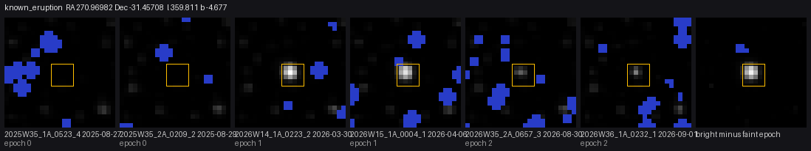
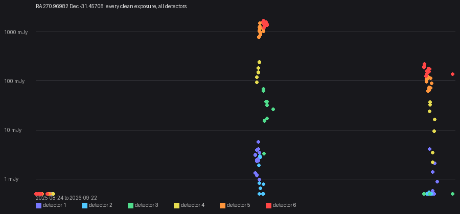

# A sweep of the Milky Way's plane for infrared sources that appeared between SPHEREx's visits

Written 2026-11-14 for teammates who are not astronomers. The three candidates' sections were rewritten on
2026-11-15 from the vetting ruling: four independent reviewers attacked each candidate and a referee ruled.
The ruling and all twelve reviews, with the reviewers' tables, scripts and pictures, are in
`docs/sweep/vetting/` (start with its `README.md`). Where this page and `docs/sweep/vetting/ruling.json`
differ, the ruling wins. Every search made for an earlier report of the three, including those made after the
ruling, and the checklist a person must still work through, are in `docs/sweep/searches-for-earlier-reports.md`.

Everything below was measured on real SPHEREx images; nothing was simulated, injected or filled in. The
sweep's tallies come from `scripts/sweep_plane.py --summary` (saved as `docs/sweep/summary.json`).

## Read this first

The sweep compared SPHEREx images of 472.6 square degrees of the Milky Way's plane between its three visits.
It recovered two known novae without being told where they were. It was left with three sources it could not
explain. After the vetting, these are the only sentences a public page may show about them:

> Candidate A, an infrared source in Sagittarius, was too faint to detect in SPHEREx images from late August
> and early September 2025 and was more than 100 times brighter by late March 2026; it is a candidate that we
> found in no catalogue or report we checked, and nobody has confirmed it yet.

> Candidate B, an infrared source in Scorpius, was too faint to detect in SPHEREx images from August and
> September 2025, had appeared by late February 2026 and was at least 250 times brighter by August 2026; it is
> a candidate that we found in no catalogue or report we checked, and nobody has confirmed it yet.

> Candidate C, an infrared source in Norma, was too faint to detect in SPHEREx images from July and August
> 2025, was at least 30 times brighter in late February and early March 2026 and had faded again by August
> 2026; its light hints at a nova hidden behind the Milky Way's dust, but it is a candidate that we found in no
> catalogue or report we checked, and nobody has confirmed it yet.

What that means:

- **Candidate** means exactly this: a real source that we found in no catalogue or report we checked.
  Nobody has confirmed it. It is not a discovery, and it must not be called new without "that we found in no
  catalogue or report we checked".
- **Nothing has been reported to anyone.** No form, account or e-mail was used. A person must first make the
  checks only a person can make, then decide whether to report. The checks are the checklist in
  `docs/sweep/searches-for-earlier-reports.md`, section (d); the ready texts (not sent) are in
  `docs/sweep/report-draft.md`.
- **No earlier report has been found.** Two rounds of searches, one for the ruling and a wider one after it,
  checked more than 30 public catalogues and alert lists per candidate, each tested on a known object, and a
  keyword search of the Astronomer's Telegrams followed. None found a report at any of the three places. Some
  sources have not been searched in full (no person has read the telegrams in full; NASA ADS has had only its
  control and one search; SIMBAD at CDS was down), so this does not prove that no one else has seen them. The
  record: `docs/sweep/searches-for-earlier-reports.md`.
- **The sweep's first write-up of the three was wrong** in several ways (its 2025 numbers for A and B were other
  stars' light, two positions were 3 arcsec off, its "counterparts" were other stars, C's bright readings were
  emission lines). See "What the sweep's first write-up got wrong". Every number about A, B and C is the reviewers', except the rerun table, which is the fixed code's own.

## The candidates at a glance

| | A | B | C |
|---|---|---|---|
| Where | Sagittarius | Scorpius | Norma |
| Position (J2000) | RA 270.80408, Dec -23.46818 | RA 253.18038, Dec -44.67697 | RA 241.70906, Dec -52.20564 |
| Same, in hours and degrees | 18:03:12.98 -23:28:05.4 | 16:52:43.29 -44:40:37.1 | 16:06:50.17 -52:12:20.3 |
| Last seen absent | 2025-09-10 | 2025-09-15 | 2025-08-19 |
| First seen | 2026-03-20 | 2026-02-26 | 2026-02-19 |
| Brightest seen, 4.4-5.0 micrometres | 2,419-2,926 mJy (late March 2026, partly saturated) | 1,006-1,089 mJy (August 2026, about 2.5 times March) | continuum about 85-110 mJy (February-March 2026) |
| Brighter than in 2025 by | more than 100 times | at least 250 times | at least 30 times (continuum) |
| Probably | a dusty eruption of unknown kind; best guess, a nova hidden behind dust | an outburst of a young star inside its birth cloud | a nova hidden behind dust |

"Probably" is the reviewers' best reading of the evidence, not a fact (see each section).

Pictures that show it best (the reviewers'; each visit side by side, the source plainly there in 2026 and
absent at its place in 2025):

- A: `docs/sweep/vetting/A/pixels/stamps_D6_D4_D2.png`
- B: `docs/sweep/vetting/B/pixels/pictures/zoom_visits_marked.png`
- C: `docs/sweep/vetting/C/pixels/stamps.png` (C has faded since February-March 2026, so late-2026 images show
  it only in two emission-line channels)

And the brightness in every clean exposure, measured again with the fixed code (below):
`docs/sweep/candidate_A_lightcurve.png`, `candidate_B_lightcurve.png`, `candidate_C_lightcurve.png`. In those
three pictures a visit in which the source was not detected is a downward arrow at its upper limit, not a point.

## What the app shows about each candidate

The app opens on Candidate B, and a row of buttons starts with Candidate A, B and C. A button shows the
candidate held at its corrected place (with no motion: none was given or measured), in detector 6
(4.4-5.0 micrometres), opening on its first visit and blinking between the visit without it ("Before") and
the first visit with it ("After"). Typing a candidate's position or name into the search box shows the same.

The page's own measure says, per visit, whether something is seen at the place ("not seen", "seen clearly",
"only just seen", and in Beginner whether it was brighter or fainter than in the visit before). Beyond that,
these are every sentence the app shows about A, B and C, quoted here word for word from
`frontend/src/finds.ts` and `frontend/src/findsInfo.ts` (`frontend/src/finds.test.ts` checks that this page
and the app agree). Every number in them is the reviewers'.

- **The allowed sentence** of each, quoted under "Read this first": in Expert over the table of visits, as
  the description of each candidate's button, and in Beginner behind the "i" of the one line under the table
  of visits, which reads: "A candidate: we found it in no catalogue or report we checked, and nobody has
  confirmed it yet."
- **Its brightness**, in Expert under the allowed sentence (never a 2025 brightness: only "not detected"):
  - A: "At 4.4–5.0 micrometres, in the reviewers' fits with the neighbouring star modelled: not detected on 24 August–10 September 2025 (below about 10–14 mJy), 2,419–2,926 mJy on 20 March–1 April 2026 (partly saturated) and 670–803 mJy on 25 August–2 September 2026."
  - B: "At 4.4–5.0 micrometres, in the reviewers' fits with the neighbouring star modelled: not detected on 2 August–15 September 2025 (3-sigma limit 2.5–4.0 mJy), 393–424 mJy in March 2026 (8–16 March, rising about 10% a day) and 1,006–1,089 mJy on 8–25 August 2026."
  - C: "Its continuum at 4–5 micrometres, in the reviewers' fits with 28 neighbours modelled: about 0 on 30 July–19 August 2025 (not detected), about 85–110 mJy on 19 February–3 March 2026, about a third of that on 9–10 April 2026 and about 3–5 mJy in July–September 2026, while its emission lines persist."
- **Under Expert's table**, first: "The number after “clear” is how many times the background scatter the spot stands at its place: how surely it is seen, not how many times brighter it got." Then, for each:
  - its neighbour. A: "The bright star about 20 arcseconds to the north-north-west, seen in every visit, is a steady neighbour, 2MASS 18031245-2327467 (437 mJy at 4.6 micrometres), not Candidate A." B: "The faint star 10 arcseconds to the north-east, seen in every visit, is a steady neighbour, 2MASS 16524412-4440318 (40 mJy at 4.6 micrometres), not Candidate B." C: "The field is crowded: the stars around it are other stars, not Candidate C; the nearest catalogued ones, 1.9 and 2.2 arcseconds away, are faint and steady."
  - when, after "This picture is detector 6 (4.4–5.0 micrometres).": A: "Over all six detectors, SPHEREx's last picture without it was taken on 10 September 2025, and its first picture with it on 20 March 2026." B: "Over all six detectors, SPHEREx's last picture without it was taken on 15 September 2025, and its first picture with it on 26 February 2026, in detector 4 (2.42 micrometres)." C: "Over all six detectors, SPHEREx's last picture without it was taken on 19 August 2025, and its first picture with it on 19 February 2026, in detector 4 (2.53 micrometres)."
  - for C only, its spoiled April visit: "Visit 3 (April 2026) is two exposures partly spoiled by cosmic-ray hits, so the page cannot say how clearly it is seen; the reviewers measured about a third of its February brightness then."
  - what it probably is. A: "Probably a dusty eruption of unknown kind, perhaps a nova hidden behind dust: its light is a smooth, very red glow. Not established." B: "Probably an outburst of a young star still inside its birth cloud: it lies in a star-forming complex, in a known group of young stars. Not established." C: "Probably a nova hidden behind dust: in February and March 2026 its light was dominated by very strong hydrogen emission lines (Brackett-alpha 438–519 mJy against a continuum of 93–103 mJy). Not established."
  - what was searched. A: "Searched on 15 November 2026, each with a control object that was found: the Transient Name Server, AAVSO VSX, ASAS-SN, CBAT, Koji Mukai's nova lists, the ZTF brokers and 942 Astronomer's Telegram titles. Also searched: six papers, OGLE and KMTNet. Not yet searched: the telegrams' full text, NASA ADS and SIMBAD, which was down that day." B: "Searched on 15 November 2026, each with a control object that was found: the Transient Name Server, CBAT, AAVSO VSX and about 40 catalogues of variable stars, young stars, masers, nebulae and X-ray sources. Also searched: Koji Mukai's nova list, ASAS-SN, VizieR, 1,217 Astronomer's Telegram titles and two papers. Not yet searched: the telegrams' full text, NASA ADS and SIMBAD, which was down that day." C: "Searched on 15 November 2026, each with a control object that was found: the Transient Name Server, AAVSO VSX, VizieR and the titles and opening lines of 847 Astronomer's Telegrams. Also searched: CBAT, Koji Mukai's nova list, ASAS-SN and three papers. Not yet searched: the telegrams' full text, NASA ADS, X-ray records and SIMBAD, which was down that day."
- **In Expert's Catalogue notes**, in place of a motion (Expert no longer says "moving 0.00″ a year": the zero
  was the button's, not a measurement). A: "Held at its corrected place: no catalogue gives it a motion, and its spring and August 2026 positions agree to 0.4 arcseconds." B: "Held at its corrected place: no catalogue gives it a motion, and its March and August 2026 positions agree to 0.3 arcseconds." C: "Held at its corrected place: no catalogue gives it a motion, and its exposures bright in emission lines in August 2026 put it at the same place as in February." Expert's position errors for the three are never shown smaller than the reviewers' 0.3 arcsec.
- **In the brightness, spectrum and patch-search tools.** These measure a fixed circle with no neighbour
  modelled, so at a candidate's place they leave out the exposures whose circle held other stars' light, and
  say: A: "At Candidate A's place, in 2025 this measuring circle (15.4 arcseconds in radius) held only light from the steady star 2MASS 18031245-2327467, 20 arcseconds away; Candidate A itself was not detected. Those exposures are left out here, so nothing below is a 2025 brightness of Candidate A." B: "At Candidate B's place, in 2025 this measuring circle (15.4 arcseconds in radius) held only light from the steady star 2MASS 16524412-4440318, 10 arcseconds away; Candidate B itself was not detected. Those exposures are left out here, so nothing below is a 2025 brightness of Candidate B." C: "At Candidate C's place, in 2025 and again from July 2026 this measuring circle (15.4 arcseconds in radius) held more light from neighbouring stars than from Candidate C, whose continuum was about 0 in 2025 and about 3–5 mJy in July–September 2026. Those exposures are left out here." Each is followed by "The values left are this circle's light, its neighbours' included; the reviewers' fits, with the neighbours modelled, are in the project's write-up, docs/sweep.md." Within 25 arcsec of a candidate the tools say that its light reaches the circle there, and the patch search never offers a change there as a candidate of its own (at B it had flagged the steady 40 mJy star 10 arcsec away as "changed brightness").
- **Beginner's "i" popovers**, in plain words for a reader of about 11: of the picture, A: "The bright star just above it is a steady neighbour, there in every visit. It is not Candidate A." B: "The faint star just up and to the left is a steady neighbour, there in every visit. It is not Candidate B." C: "The stars around it are other stars, not Candidate C." And of what it may be, A: "What it is, nobody knows yet. Its light is a smooth, very red glow, like warm dust." B: "What it is, nobody knows yet. It lies among young stars, so it may be a young star flaring up." C: "Its light hints at a nova: glowing hydrogen gas made it shine very brightly in a few colours. A nova is a blast on the surface of a small, burnt-out star." followed by "Nobody has confirmed it yet. People must still make some checks. A bigger telescope must look at its light."
- **On the Observe anomalies screen** (the bar's "Observe anomalies" in Beginner, "Anomalies" in Expert; its address is still `?watchlist=1`), under the heading "Not reported anywhere we could find", one card each: "In the constellation Sagittarius" (Scorpius, Norma), two of the app's own detector 6 pictures side by side (the last visit in which the page's measure does not see it and the visit in which it is brightest, with their dates), its neighbour under them (Beginner: the plain words of the picture's "i" above; Expert: the neighbour sentence above), in Expert the numbers below right under that, then the allowed sentence, what it probably is (Beginner: the plain words above; Expert: the "probably" line above), the one sentence the second, wider search for earlier reports (2026-11-15) allows a public page to show (Expert follows it with the "what was searched" sentence above), and its status. The search sentences, word for word:
  - A: "We checked more than 30 public catalogues and alert lists, each tested on a known object, and found no earlier report of a new or brightening object at Candidate A's position in Sagittarius; some sources, including the full text of The Astronomer's Telegram and NASA's Astrophysics Data System, have not yet been searched, so this does not prove that no one else has seen it."
  - B: "We checked more than 30 public catalogues and alert lists, each tested on a known object, and found no earlier report of a new or brightening object at Candidate B's position in Scorpius; some sources, including the full text of The Astronomer's Telegram and NASA's Astrophysics Data System, have not yet been searched, so this does not prove that no one else has seen it."
  - C: "We checked more than 30 public catalogues and alert lists, each tested on a known object, and found no earlier report of a new or brightening object at Candidate C's position in Norma (two ordinary variable stars catalogued before 2025 lie 12 and 15 arcseconds away and are different stars); some sources, including the full text of The Astronomer's Telegram and NASA's Astrophysics Data System, have not yet been searched, so this does not prove that no one else has seen it."
  - The status of all three, one field in `frontend/src/finds.ts` (`status`) to change the day a person files a report: "Not confirmed. Not yet reported to astronomers."
  - Expert adds, right under the pictures, the position in both notations, the brightness above, the rise and the dates of the last non-detection and the first detection, from `docs/sweep/summary.json`.
  - Where the patch searches' list has a row within 5 arcseconds of a candidate, whatever its group (at B's patch, a "mover" the search set aside 0.7 arcseconds from B, because its centre shifted by a different amount in each colour, which the search reads as a blend with a star that changed brightness), the row opens with "Candidate B's place, 0.7 arcseconds away. Its card is at the top of this page." and a link to the card. The steady star 10 arcseconds from B keeps its caution: "Candidate B is 10 arcseconds from here. Its light reaches this spot's measurement. So this change is most likely Candidate B's light. Its card is at the top of this page." (the last sentence only on this screen; the Viewer's Find changes tool says the first three). The distances are computed, not typed. The screen cannot read `docs/` (it is not shipped), so `scripts/export_anomalies.py` copies what it needs to `frontend/public/anomalies/sweep.json`; `python scripts/export_anomalies.py --check` says when that copy is out of date with this page or the summary. The same screen lists all 14 survivors of the sweep when its region "The Milky Way's plane" is chosen.

## Why this is the one place where a source that appeared between visits can be found

A star or planet that was always there is in deeper catalogues than SPHEREx's. A thing that *changed* is
different, and an eruption hidden behind the dust of the Milky Way's plane is invisible to optical
surveys: the dust blocks visible light and glows in the infrared. Between 2010 and August 2024 the
NEOWISE telescope watched the whole infrared sky twice a year. It stopped in August 2024. SPHEREx is now the
only telescope watching the whole infrared sky, and it has seen each part of the plane three times
(August to September 2025, February to April 2026, August to September 2026). So a source that is bright in
one SPHEREx visit and absent in another, in a place where no catalogue lists anything that bright, is the
honest route to "something nobody has reported". Most such sources are ordinary variable stars or
measurement artefacts, which is why the method is mostly about killing those.

## The method in plain words

For each *tile* (a patch of the plane about 3 by 2.5 degrees):

1. **Choose images.** SPHEREx's detector 6 sees 4.4 to 5.0 micrometres, where dust-hidden eruptions
   shine brightest. From the archive's list we take, for each visit period ("epoch": a run of
   observations with no gap longer than 30 days), the image whose centre is nearest the tile centre and a
   second image of another pointing at least a day away where there is one. Usually 6 whole detector
   images (3 epochs times 2), up to 8.
2. **Find bright point sources** in every image: the light in a circle of 2.5 pixels (15 arcseconds
   across) above the glow around it, at least 30 millijanskys (a star of magnitude 9.4 at 4.6
   micrometres) and at least 8 times the local scatter. Flagged and edge pixels are skipped; a saturated
   star (its core overflowed the detector) is kept as "bright, at least this much".
3. **Compare like with like.** Every source found in any image is measured again, at the same sky
   position, in every other image that covers it (a "forced measurement", not a catalogue match, so a faint
   counterpart is never mistaken for nothing).
4. **Keep the changes.** A source must be at least ten times brighter in one epoch than in another,
   or absent there (below three times the local noise), in *every* image of both epochs and with
   two usable images in the bright epoch. A saturated image never counts as "absent".
5. **Kill the artefacts**, in this order, counting each: a glitch or a moving body (they fail the
   second image); the image edge; a shape that is not a star (cosmic-ray hits, smears); a much brighter
   neighbour within 3 pixels; leftovers around saturated stars within 15 pixels; and the reflection of
   a very bright star ("ghost risk", see the limits).
6. **Ask every catalogue** at the survivor's position: AllWISE, CatWISE2020, 2MASS, Spitzer GLIMPSE I and
   (since 2026-11-15) GLIMPSE II, Gaia DR3, SIMBAD and the AAVSO Variable Star Index. A survivor is then (a) a
   catalogued star already bright before, which is an ordinary variable; (b) a known eruption (a nova or
   similar in SIMBAD or the Variable Star Index), which is a success of the method; or (c) a candidate: no
   catalogued star at the place. Since the vetting, "at the place" means within 1.5 arcseconds; the first run
   used 6 arcseconds, which let other stars pass as counterparts.
7. **Follow up every (b) and (c)** with the project's own tools: the brightness in every exposure of
   every detector (`photometry.lightcurve`), ten years of NEOWISE (`neowise.read_spot`), JPL's known
   asteroids and comets, a strip of small pictures, and web searches. For (c), the change must also show
   in the median of all clean 3.8 to 5 micrometre exposures (at least 5 times); otherwise it is set aside.
8. **Describe each candidate again** (added after the vetting of 2026-11-15, `describe`): the position from
   the bright-state fits, every exposure fitted with the neighbouring stars modelled, a test of whether the
   faint-state light was a neighbour's, the brightest catalogued star whose light reaches the circle, and a flag
   for bright readings that fall on an emission line. See "What the code does now".

## The proof: V7994 Sagittarii, found without being told

V7994 Sgr (RA 270.96983, Dec -31.45739) erupted in September 2025. The proof tile was centred 0.4 degrees
away, at RA 270.7, Dec -31.2, and the method knew nothing about the nova.

| Stage in the proof tile (10.7 square degrees, 6 images in 3 epochs) | Sources |
|---|---|
| Bright point sources compared (30 mJy and up) | 29,424 |
| Measurable in at least two epochs | 28,875 |
| Changed by ten times between two epochs, comparing one image per epoch | 113 |
| ... killed because the second image disagrees (glitches, movers, noise) | 98 |
| ... changed in one usable image only and killed by the neighbour or ghost checks | 13 |
| Changed in every image, two or more in the bright epoch | 2 |
| Killed by edge, shape, neighbour, saturation or ghost checks | 0 |
| **Survivors** | **2** |

The two survivors: the nova (1,289 mJy at 4.4 to 5.0 micrometres in spring 2026, absent in August 2025 at
-2 mJy, AAVSO VSX lists it as type NA 1.1 arcseconds away: **known eruption**) and a long-period variable
star in the same tile (AllWISE W2 3.1 magnitude, VSX variable: **known variable**). Nothing else in the
tile survived, so the false-alarm rate there is zero in 29,424 sources. All 98 plus 13 other two-visit
"changes" were artefacts or noise, which is why the second-image rule is the most important check: a
plain comparison of two visits would have given 113 alarms for one real object. The picture is
`docs/sweep/proof_v7994_270.9698-31.4571.png`, its brightness chart `..._lightcurve.png`: all detectors,
absent in August 2025 (-3.5 mJy at 4.4 to 5.0 micrometres), 1,422 mJy in March to April 2026, 176 mJy in
August to September 2026, matching the 1,070 to 1,420 and 96 to 177 mJy of `docs/novae.md`.




It was found a second time, in the real sweep, in tile `l000.0_b-2.5`, again blind, again as a known
eruption (1,612 mJy).

## What was swept

- **Area: all 63 planned tiles are done, 472.6 square degrees**, counted where at least two epochs are each
  covered by at least two images (the cells are 0.1 degree squares; each tile answers only for the sky nearer its
  own centre than any other planned tile's, so nothing is counted twice). The tiles are centred every 3 degrees of
  Galactic longitude from 330 through 0 to 30 degrees, on three rows of latitude (-2.5, 0 and +2.5), so the sweep
  spans latitude -3.75 to +3.75 where covered.
- **Sources compared:** 1,162,894, from 2,808,554 detections of the images (the rest lie in the overlaps
  belonging to other tiles).
- **Brightness limit actually reached:** a source of 30 mJy and at least 8 times the local scatter in
  its aperture. The typical error of one measurement is 3.4 mJy (median over the tiles; about 2 mJy at the
  10th percentile, 11 to 25 mJy at the 90th, where the 3 per cent calibration term on bright stars
  dominates), so 30 mJy is a 9 sigma source in an ordinary field; in the crowded centre fainter changes are not
  looked for. Eruptions fainter than 30 mJy at 4.6 micrometres (magnitude 9.4) are not seen.
- Disk: the sweep's cache stayed under 3.1 GB; the whole-detector images are deleted after each tile.

## The tallies, every stage (63 tiles)

| Stage | Sources |
|---|---|
| Sources compared | 1,162,894 |
| Measurable in at least two epochs | 1,151,201 |
| Changed by ten times, one image per epoch | 6,023 |
| Killed: second image disagrees or is missing (glitches, movers, noise) | 5,128 |
| Passed in one usable image only (cannot be confirmed) | 786 |
| ... all 786 then killed by the ghost, neighbour or saturation check | 786 |
| Changed in every image, two or more in the bright epoch | 109 |
| Killed: image edge | 0 |
| Killed: not a star shape | 31 |
| Killed: much brighter neighbour | 41 |
| Killed: saturated-star residue | 22 |
| Killed: reflection risk | 1 |
| **Survivors** | **14** |
| ... known variables (catalogued, already bright) | 6 |
| ... known eruptions | 2 |
| ... unexplained, before the all-exposure check | 6 |

Of the 6 unexplained survivors, 3 are shown not to be what they seemed (below) and 3 remain (A, B, C). Counting
those 3 as false alarms, the sweep's false-alarm rate after every check is 3 in 1,162,894. The 21 tiles added
at the end (the +2.5 row and l 27, 330, 339 at -2.5) produced no new survivor.

Tile by tile (`area` in square degrees; "naive" is the one-image-per-epoch changes):

| Tile | Area | Sources | Naive | Survivors |
|---|---|---|---|---|
| l000.0_b+0.0 | 6.08 | 20,753 | 109 | 0 |
| l000.0_b+2.5 | 8.33 | 25,760 | 70 | 0 |
| l000.0_b-2.5 | 8.86 | 29,154 | 69 | 1 |
| l003.0_b+0.0 | 5.84 | 19,693 | 69 | 2 |
| l003.0_b+2.5 | 5.97 | 19,295 | 63 | 0 |
| l003.0_b-2.5 | 8.94 | 28,083 | 81 | 0 |
| l006.0_b+0.0 | 6.16 | 20,768 | 64 | 1 |
| l006.0_b+2.5 | 9.15 | 25,132 | 80 | 0 |
| l006.0_b-2.5 | 5.33 | 15,549 | 61 | 0 |
| l009.0_b+0.0 | 6.64 | 20,848 | 63 | 1 |
| l009.0_b+2.5 | 4.15 | 9,714 | 32 | 0 |
| l009.0_b-2.5 | 9.39 | 23,925 | 107 | 0 |
| l012.0_b+0.0 | 5.39 | 16,876 | 52 | 0 |
| l012.0_b+2.5 | 8.72 | 19,869 | 105 | 0 |
| l012.0_b-2.5 | 6.26 | 14,863 | 72 | 0 |
| l015.0_b+0.0 | 6.46 | 18,945 | 71 | 1 |
| l015.0_b+2.5 | 8.93 | 16,027 | 111 | 0 |
| l015.0_b-2.5 | 9.15 | 19,464 | 124 | 0 |
| l018.0_b+0.0 | 3.74 | 11,735 | 68 | 1 |
| l018.0_b+2.5 | 8.34 | 16,232 | 105 | 0 |
| l018.0_b-2.5 | 11.54 | 23,174 | 167 | 0 |
| l021.0_b+0.0 | 6.71 | 21,954 | 99 | 0 |
| l021.0_b+2.5 | 8.77 | 19,833 | 158 | 0 |
| l021.0_b-2.5 | 9.29 | 18,638 | 124 | 0 |
| l024.0_b+0.0 | 7.06 | 22,915 | 107 | 2 |
| l024.0_b+2.5 | 10.59 | 19,514 | 172 | 0 |
| l024.0_b-2.5 | 5.96 | 12,543 | 76 | 0 |
| l027.0_b+0.0 | 6.97 | 20,212 | 79 | 1 |
| l027.0_b+2.5 | 11.52 | 20,280 | 196 | 0 |
| l027.0_b-2.5 | 7.94 | 13,824 | 90 | 0 |
| l030.0_b+0.0 | 7.58 | 21,739 | 86 | 0 |
| l030.0_b+2.5 | 8.78 | 15,330 | 118 | 0 |
| l030.0_b-2.5 | 10.70 | 16,980 | 118 | 0 |
| l330.0_b+0.0 | 6.10 | 17,815 | 93 | 1 |
| l330.0_b+2.5 | 7.62 | 13,174 | 102 | 0 |
| l330.0_b-2.5 | 8.61 | 15,504 | 106 | 0 |
| l333.0_b+0.0 | 6.77 | 20,296 | 105 | 1 |
| l333.0_b+2.5 | 7.54 | 15,555 | 165 | 0 |
| l333.0_b-2.5 | 9.40 | 16,123 | 122 | 0 |
| l336.0_b+0.0 | 7.02 | 21,228 | 77 | 0 |
| l336.0_b+2.5 | 5.85 | 10,974 | 69 | 0 |
| l336.0_b-2.5 | 7.78 | 15,091 | 111 | 0 |
| l339.0_b+0.0 | 6.89 | 22,431 | 127 | 0 |
| l339.0_b+2.5 | 8.62 | 14,356 | 102 | 0 |
| l339.0_b-2.5 | 8.08 | 15,228 | 97 | 0 |
| l342.0_b+0.0 | 6.60 | 19,318 | 86 | 1 |
| l342.0_b+2.5 | 9.17 | 15,226 | 119 | 0 |
| l342.0_b-2.5 | 8.18 | 15,629 | 94 | 0 |
| l345.0_b+0.0 | 6.18 | 17,458 | 69 | 0 |
| l345.0_b+2.5 | 4.85 | 9,890 | 60 | 0 |
| l345.0_b-2.5 | 8.29 | 15,632 | 109 | 0 |
| l348.0_b+0.0 | 2.32 | 7,260 | 36 | 0 |
| l348.0_b+2.5 | 8.18 | 16,501 | 118 | 0 |
| l348.0_b-2.5 | 7.42 | 15,648 | 96 | 0 |
| l351.0_b+0.0 | 5.93 | 18,764 | 83 | 0 |
| l351.0_b+2.5 | 9.19 | 20,290 | 138 | 0 |
| l351.0_b-2.5 | 5.86 | 14,283 | 71 | 0 |
| l354.0_b+0.0 | 6.92 | 24,115 | 78 | 1 |
| l354.0_b+2.5 | 8.92 | 22,736 | 93 | 0 |
| l354.0_b-2.5 | 9.35 | 26,879 | 116 | 0 |
| l357.0_b+0.0 | 5.41 | 18,999 | 74 | 0 |
| l357.0_b+2.5 | 6.61 | 21,823 | 74 | 0 |
| l357.0_b-2.5 | 7.76 | 25,047 | 67 | 0 |

Tile `l348.0_b+0.0` has only 2.3 square degrees: fewer of its images overlap the tile in two epochs.

## Known eruptions recovered (successes of the method)

| Object | Position | Bright | Evidence |
|---|---|---|---|
| V7994 Sagittarii (nova, 2025) | RA 270.96982, Dec -31.45708 | 1,289 mJy (proof tile), 1,612 mJy (sweep tile) | AAVSO VSX type NA, 1.1 arcsec away; absent in August 2025 |
| V0691 Serpentis (nova) | RA 279.74438, Dec -3.86389 | 11,766 mJy, saturated, in September 2025 | AAVSO VSX type NA, 2.7 arcsec away; faded to 173 mJy by spring 2026 |

Pictures: `docs/sweep/l000.0_b-2.5_270.9697-31.4573.png`, `docs/sweep/l027.0_b+0.0_279.7444-3.8639.png`
and their `_lightcurve.png`. In the first run a second "candidate" 24 arcseconds
(4 pixels) from V0691 Ser, the wing of that very bright nova, slipped through: the saturation-residue check
took the nova's saturated clump for the source's own core because it ignored any clump within 6 pixels. That is
fixed (a saturated clump counts as a source's own only within 2 pixels, and in an image where the source has one
of its own the clumps around it are its bloom; the reflection check ignores a bright neighbour closer than 15
pixels). The test `test_the_wing_of_a_saturated_nova_is_not_a_candidate` uses the real V0691 Ser cutouts of the six
images: the nova survives, the wing is killed as saturation residue. The seven tiles that held a survivor with a
saturated image, or a reflection kill, were rerun with the fixed rule; three survivors went away (the wing, one weak
candidate, below, and two known variables near saturated stars) and one reflection kill became a residue kill.

Six survivors are catalogued stars that were already bright (AllWISE, CatWISE or a variable type in
VSX, SIMBAD or Gaia): long-period variables and similar. They are not what the sweep is after and are counted
only (`docs/sweep/summary.json` lists their positions).

## The candidates

### How they were checked

Each candidate was attacked by four reviewers who worked independently, with their own code on the cached
SPHEREx cutouts and the public archives. Each took one question:

1. **Pixels and the instrument**: is it a real point of light at one fixed place on the sky, and is it
   measured correctly?
2. **Archives**: what was at that place before 2025?
3. **Reports**: has anyone already reported or catalogued it?
4. **Ordinary explanations**: an asteroid, a known variable star, a reflection of a bright star, a fault of
   one detector; and what it probably is.

A referee then read all twelve reports and ruled. All three remain candidates. Their files are in
`docs/sweep/vetting/` (`reviews_A.json`, `reviews_B.json`, `reviews_C.json`, `ruling.json`).

### Words used below

- **micrometre (um)**: a millionth of a metre; SPHEREx sees 0.75 to 5 micrometres, infrared light our eyes
  cannot see. **D1 to D6** are its six detectors: D1 0.75-1.1, D2 1.1-1.65, D3 1.65-2.4, D4 2.4-3.8, D5
  3.8-4.4, D6 4.4-5.0 micrometres. Each exposure sees one narrow wavelength at a given place.
- **mJy (millijansky)**: the unit of brightness used here; bigger is brighter. 1 Jy = 1,000 mJy.
- **arcsec**: a 3,600th of a degree. A SPHEREx pixel is 6.15 arcsec; its picture of a star is about 8 arcsec
  across.
- **The measuring circle**: the sweep's circle of 2.5 pixels (15.4 arcsec) radius. In a crowded field it can
  hold a neighbouring star's light. **A fit with the neighbours modelled** instead describes the source and
  every nearby star at once, each as a star-shaped spot, so each star gets its own light.
- **Saturated / OVERFLOW**: the detector filled up in the brightest pixels; the reading is then a lower limit
  or uncertain.
- **Upper limit**: "below X" means a source brighter than X would have been seen. **3-sigma**: three times
  the measurement's typical error, a standard bar for "not seen".
- **Colour temperature**: the temperature of a glowing body with the same colours. Warm dust glows at
  hundreds of kelvin. **Reddening**: dust in front makes a source look redder and cooler than it is.
- **Emission line**: light at one exact wavelength, given out by a gas such as hot hydrogen. **Brackett,
  Paschen, Pfund** are names of hydrogen's infrared lines.
- **W2, [4.5], Ks**: brightness in older surveys' bands: W2 is WISE and NEOWISE at 4.6 micrometres, [4.5] is
  Spitzer at 4.5, Ks is 2MASS and VVV at 2.2. A **magnitude** is astronomers' brightness scale: bigger numbers
  are fainter, and 1 magnitude is a factor of 2.5.
- **kiloparsec**: about 3,260 light years. The centre of the Milky Way is about 8 kiloparsecs away.
- **Nova**: a white dwarf star that erupts when gas from a companion star ignites on it. **Young star**: a
  star still inside the cloud it formed from; some flare up for months or years.

### Candidate A: RA 270.80408, Dec -23.46818 (18:03:12.98 -23:28:05.4), l 6.712, b -0.635, in Sagittarius

**Position.** The mean of three reviewers' fits, each within 0.14 arcsec of it; uncertainty about 0.3 arcsec.
The sweep's first position was 3.0 arcsec off: the light of a neighbour pulled it. Use only the position
above.

**Is it real?** Yes; four reviewers measured it independently.

- It is a point of light like a star: 8.11 arcsec across against 8.06 for a comparison star (D6, August 2026).
- It holds one place: 0.12 arcsec scatter per exposure and a drift below 0.01 arcsec a day. The March-April
  and August-September 2026 positions agree to 0.4 arcsec, although the spacecraft was turned 180 degrees and
  the source fell on different parts of the detectors.
- Paired detectors (D2 with D5, D3 with D6) see it at the same moments.
- In August-September 2025 the pointing and the bright stars around were placed as in August-September 2026,
  and nothing was at the place. That rules out an after-image, a reflection, a cosmic-ray hit and a
  calibration jump; a comparison star stays within 5 per cent.
- It lies on the ecliptic, the band where asteroids move, but it does not move, and JPL lists no known body
  within 54 arcsec (the same request found Vesta, as a check).

**Brightness at 4.4-5.0 micrometres (D6).** Three reviewers fitted it with its neighbour modelled (mJy):

| Visit | Brightness | Notes |
|---|---|---|
| 2025-08-24 to 2025-09-10 | not detected | fits give -5.5, -4.3 and -2.4 +/- 2.8 mJy, that is nothing; upper limit about 10-14 mJy (about 40 mJy with no model) |
| 2026-03-20 to 2026-04-01 | 2,419 to 2,926 | partly saturated (D6 saturated in 10 of 18 exposures, OVERFLOW in all 18), so uncertain |
| 2026-08-25 to 2026-09-02 | 670 to 803 | 19 clean exposures |
| 2026-09-22 | about 420 to 620 | |

Other detectors, same three visits (fits, mJy): D5 (3.8-4.4) -7.6 to -3.0, then 1,865 to 2,281, then 541
to 670. D3 (1.65-2.4) about 180 to 206 in spring and 20 to 59 in August 2026. The neighbouring star is
2MASS 18031245-2327467 (W2 6.49 = 437 mJy, Ks 7.40), 20 arcsec away. It is steady: 393-444 mJy in D6 in
every visit, and steady in 21 NEOWISE visits. Its light was what the sweep's first write-up took for A in
2025.

**When it started.** Between 2025-09-10 (the last 2025 exposure) and 2026-03-20 (the first 2026 exposure).
The Sun passed 0.7 degrees from it on 2025-12-22, so the start was probably hidden in daylight. No infrared
telescope watched this place between NEOWISE's last visit (March 2024) and SPHEREx's first (August 2025).

**How much brighter.** From 2025 to spring 2026: at least about 170 times on the fits, at least 60 times
without a model; the public sentence says "more than 100 times". Against older surveys at the corrected
position:

| Survey | Years | Brightest it can have been there | Factor |
|---|---|---|---|
| NEOWISE W2 (4.6 micrometres) | 21 visits, 2014-03 to 2024-03 | about 4 mJy or less in each | at least about 500 |
| Spitzer GLIMPSE II [4.5] | 2005-2006 | under 2.1 mJy | at least about 1,000 |
| VVV Ks (about 2 micrometres) | 2010-2019 | 0.57 mJy or less within 3.2 arcsec | at least about 300 (against D3) |
| 2MASS Ks | 1998 | under 8.4 mJy | |
| Spitzer MIPSGAL (24 micrometres) | 2005-2006 | under 10 mJy | |

**What is and is not at the place.**

- Nothing within 9.4 arcsec in 2MASS, AllWISE, CatWISE2020 (asked through IRSA) or Gaia DR3.
- Only faint stars within 3 arcsec: VIRAC2 (VVV) Ks 17.04 (0.10 mJy, steady over 119 epochs) at 1.5 arcsec,
  and GLIMPSE II [4.5] 14.35 (0.33 mJy) at 2.9-3.0 arcsec. Both are thousands of times fainter than A.
- SIMBAD and the AAVSO Variable Star Index: nearest object 43-44 arcsec away (an unrelated variable star).
- Two odd NEOWISE rows (one frame on 2019-08-31 at 4.6-4.7 arcsec, one flagged row on 2015-09-15 at 7.1
  arcsec): both reviewers who looked agree they are not an earlier version of A.

**Its light (spectrum).** A smooth, very red continuum, the glow of warm dust: about 880 K in spring and
780-800 K in August 2026 with no reddening, or 1,000-1,200 K if dust in front reddens it. Tentative: two
reviewers see a possible excess at 4.05 micrometres, where hydrogen's Brackett-alpha line is, in both 2026
visits (3.5 to 4.4 sigma each). It faded about 0.27 magnitudes a month from March to August and about 0.5 a
month in September. Its distance is unknown; at 3 to 12 kiloparsecs it gave out about 500 to 19,000 times
the Sun's power in March.

**What it probably is.** An unidentified dusty eruption hidden behind the Milky Way's dust. The best guess is
a heavily obscured classical nova that formed dust while the field was near the Sun. Next: a stellar merger
(two stars that collided, a "luminous red nova"). A young star's outburst is disfavoured: there is no young
star at the place before, the nearest signs of star formation are arcminutes away, and its power is at least
500 times the Sun's even at 3 kiloparsecs. Excluded: an asteroid or comet, a reflection or glare, a
calibration fault, a catalogued variable star, a Mira or OH/IR star (old dusty stars), microlensing. None of
the identification is established.

**Searched, each with a control (a known object the same search must find), 2026-11-15, 04:12-05:45 UTC:**

| Where | Control found? | Result at A |
|---|---|---|
| Transient Name Server, 60 arcsec and 1 degree, web page and CSV | yes: AT 2024pfu, and V462 Lup as AT 2025nlr | "No results found"; nearest 2025-26 entry AT 2025qzs, a cataclysmic-variable candidate 37 arcmin away |
| AAVSO Variable Star Index, 1 arcmin and 1 degree | yes: V7994 Sgr, V462 Lup | only an unrelated star 43.9 arcsec away; no nova among 5,691 objects within 1 degree |
| ASAS-SN transients; CBAT unconfirmed list (TOCP); Koji Mukai's nova lists (updated 2026-11-11) | yes | nothing within 1 degree |
| ZTF alert brokers ALeRCE, ANTARES and Fink | yes: V0691 Ser | nearest object 35.9 arcsec away, unrelated |
| Astronomer's Telegram: titles of 942 telegrams (June 2025 to 2026-11-14) and 22 keyword searches | yes: V7994 Sgr (ATel 17419) | nearest Sagittarius nova or infrared transient at least 4.6 degrees away |
| arXiv, and six papers read (including Karambelkar et al. 2026 and Li, Wang & Lin 2026, A&A 710, A83 = arXiv 2604.19551) | yes: Karambelkar et al. 2026 found | not there |
| OGLE and KMTNet event lists 2025-2026 | parser check | nothing within 1 degree |
| Gaia alerts | | cannot say: they ended 2025-01-15 |
| SIMBAD | failed: CDS down (retried 06:21 UTC, still down); the CfA copy lacks the 2025 control novae | not evidence |

The Transient Name Server searches were centred on the sweep's first position; 60 arcsec covers the corrected
one, but a person should repeat them at the corrected position on the day (see below).

**Not checked at the time of the ruling:** the Astronomer's Telegram full text (a robot check, which was not
bypassed); NASA ADS (needs a token); CBETs (subscription); VVV-WIT and the Lucas et al. 2024 VVV eruptive list;
TNS AstroNotes; PRIME and WINTER internal lists. What was searched afterwards, and what is still not searched:
`docs/sweep/searches-for-earlier-reports.md`.

**Caveats.** The spring-2026 values rest on saturated and OVERFLOW pixels (D6 10 of 18 exposures saturated,
D4 16 of 18), so 2.4-2.9 Jy is uncertain; an apparent 1.8-fold rise within the March visit is unconfirmed
(the later exposure is 34 pixels from the detector edge). All fits used a simple star shape, not SPHEREx's
own, and the reviewers' values differ by up to about 20 per cent for this reason. The distance and the dust in
front are unknown.

**What would confirm it.**

1. A near-infrared spectrum (1-2.5 micrometres, resolving power about 1,000 or more, a 4-8 m telescope; A was
   about K 11 in August 2026). Broad hydrogen, helium and oxygen lines (1,000 km/s or more) would mean a nova;
   narrow Brackett-gamma with carbon monoxide emission would mean a young star; cool-star carbon monoxide and
   water absorption would mean a merger. A is 38.5 degrees from the Sun now; this becomes practical around
   mid-February 2027 (55 degrees on February 15).
2. The next SPHEREx visit, expected about March-April 2027.
3. A professional re-measurement of the spring-2026 exposures with SPHEREx's own star shape and a
   correction for the full pixels.
4. An X-ray (Swift) or radio detection, which would point to a nova.
5. Human searches of the Astronomer's Telegram full text and NASA ADS. If either finds a report, A is
   already reported.

**What a person must do.** The checklist in `docs/sweep/searches-for-earlier-reports.md`, section (d), which
is also part one of `docs/sweep/report-draft.md`. Write each answer there, not here, so that there is one record.

### Candidate B: RA 253.18038, Dec -44.67697 (16:52:43.29 -44:40:37.1), l 341.089, b -0.416, in Scorpius

**Position.** The mean of four reviewers' fits, each within 0.15 arcsec of it; uncertainty about 0.3 arcsec.
The sweep's first position was 0.4 arcsec off.

**Is it real?** Yes; four reviewers measured it independently.

- A point of light like a star: 7.4-9.4 arcsec across against 7.4-8.5 for stars of similar brightness; nearly
  round (axis ratio 0.92-0.96).
- One place: 0.25 arcsec scatter over 93 bright exposures. March and August 2026 agree to 0.3 arcsec, although
  the detector was turned 180 degrees.
- Paired detectors see it at the same instant.
- Absent in August 2025 under exactly the same pointing as August 2026. That rules out after-images, detector
  defects and reflections of all 85 bright stars within 0.5 degrees.
- JPL lists no known body near it on any visit date (the same request found a faint asteroid elsewhere, as a
  check).
- One archive exposure (2026W10_1A_0572_4, D5) has its sky coordinates 17 arcsec off; do not use it without
  correcting them.

**Brightness at 4.4-5.0 micrometres (D6).** Three reviewers' fits with the neighbour modelled (mJy):

| Visit | Brightness | Notes |
|---|---|---|
| 2025-08-02 to 2025-09-15 | not detected | 0.28, -0.5 +/- 1.1 and -0.75 +/- 1.6 mJy; 3-sigma limit 2.5-4.0 mJy |
| 2026-02-26 to 2026-03-16 | 393 to 424 | rising about 10 per cent a day: about 283 on March 8, about 430-475 on March 15-16 |
| 2026-08-08 to 2026-08-25 | 1,006 to 1,089 | the August D5 and D6 values carry OVERFLOW pixels (6-10 per cent scatter) |

Other detectors (fits, mJy): D5 (3.8-4.4) -1.3 to 1.2 in 2025, 165 to 198 in March, 689 to 761 in August
2026. D4 (2.4-3.8) 33-45 in March and 106-177 in August (plus 7 saturated August exposures, lower limits
380-618). D3 (1.65-2.4) is uncertain, 8 to 65 depending on the reviewer and wavelength, because the source is
very red and blends with a 20 mJy neighbour there.

The neighbouring star is 2MASS 16524412-4440318 (W2 9.07 = 40 mJy, Ks 10.66), 10 arcsec to the north-east.
It is steady: 33-41 mJy in D6 in every visit and steady in 21 NEOWISE visits. Its light was what the first
write-up took for B in 2025.

**When it started.** Absent until at least 2025-09-15 22:09 UT. Present by 2026-02-26 14:18 UT (D4, 2.42
micrometres, 49.7 +/- 7.3 mJy).

**How much brighter.** At least 250 times from August 2025 to August 2026, and at least about 100 times to
March 2026. Against older surveys:

| Survey | Years | Brightest it can have been there | Factor |
|---|---|---|---|
| NEOWISE W2 | 2024-03-09 (with a faint star 3.6 arcsec away included) | 1.4 mJy or less | at least about 700 |
| Spitzer [4.5] | 2004-09-05 and 2012-11-01 | under 0.73 and under 0.67 mJy | at least about 1,400 |
| VVV Ks (about 2.2 micrometres) | 2010-2019 | inferred from the faintest stars listed nearby (Ks about 17.1), not measured at the spot | at least about 400 |

**What is and is not at the place.**

- Nothing within 2.4 arcsec in any survey. The nearest listed object is a Ks 17.13 star (VIRAC2) 2.5-2.6
  arcsec away.
- Further out, all other stars: CatWISE J165243.63-444036.8 at 3.6 arcsec; GLIMPSE G341.0882-00.4146 at
  3.7-3.8 and G341.0893-00.4165 ([4.5] 12.47) at 4.4-4.5; 2MASS J16524373-4440366 at 4.7-4.8; Gaia DR3
  5964332607636528768 at 4.9. SPHEREx positions are good to about 0.3 arcsec (checked on 7-12 control stars),
  so none of these is the source.
- SIMBAD and VSX: nearest 33-37 arcsec (a 2MASS source and an RR Lyrae star).
- Around it: a group of young stars (SPICY G341.1-0.3, nearest member 33 arcsec away), an infrared-dark cloud
  (SDC G341.128-0.422, 147 arcsec), a Hi-GAL dust clump (146 arcsec) and a methanol maser, a sign of
  forming stars (MMB G341.124-00.361, 235 arcsec).

**Its light (spectrum).** Warm dust: 567-575 K with no reddening in August 2026, 687, 763 or 859 K if dust in
front dims the 2.2 micrometre light by 2, 3 or 4 magnitudes. Tentative features: a likely water-ice dip near 3
micrometres (March); a 20-30 per cent dip at 4.25 micrometres in three exposures across both 2026 visits,
where carbon dioxide ice absorbs (the likely cause, not established; the referee's check is
`docs/sweep/vetting/referee/b_co2_check.out`); possible hydrogen Paschen-alpha and Brackett-alpha emission in
March, each in a single channel (2.25 and 1.56 times the neighbouring channels). The March spectrum is mixed
with the rise during that visit, because each detector looked on different days. Its power in August 2026:
280-1,100 times the Sun's at 3 kiloparsecs, 2,000-7,900 at 8.

**What it probably is.** Most likely an outburst of a young star still inside its birth cloud: it lies in a
star-forming complex, its light is warm dust, it shows likely ice dips and possible hydrogen emission, it was
about 2.5 times brighter at 4.4-5.0 micrometres in August than in March, and no catalogued star brighter than
Ks about 17 was there before. Alternatives: a nova behind heavy dust (against it: no strong emission-line
spectrum like the novae SPHEREx has seen) or a stellar merger. The ices could also lie in a cloud in front.
Excluded: a Solar System body, a catalogued variable, a Mira, OH/IR or R CrB star, a symbiotic star,
microlensing, an X-ray-binary jet. Nothing here is established.

**Searched, each with a control, 2026-11-15:**

| Where | Control found? | Result at B |
|---|---|---|
| Transient Name Server, 60 arcsec and 60 arcmin | yes: SN 2023ixf; V462 Lup | nothing within 60 arcsec; only 2023 Gaia alerts within 1 degree |
| CBAT TOCP (entries to 2026-11-13) | yes: V7994 Sgr | nearest entry V1662 Sco (2018), 44.6 arcmin away |
| Koji Mukai's novae list | yes: V7994 Sgr, V462 Lup | nearest 2025-26 nova 15.3 degrees away |
| AAVSO VSX (live service, and the VizieR copy of 2026-10-18) | yes: V7994 Sgr | nothing within 37 arcsec; the only nova within 1 degree is V1662 Sco |
| ASAS-SN transients | yes | nearest 44.6 arcmin |
| VizieR, all catalogues within 30 arcsec, and about 40 named catalogues within 33 arcsec (variables, young stars, masers, nebulae, X-ray) | yes, each | no variable, young-star, transient or X-ray entry |
| Astronomer's Telegram titles 16940-18156 (1,217 telegrams of 2025-26) | | none about this place; the SPHEREx telegrams are about V572 Vel |
| Karambelkar et al. 2026; Li, Wang & Lin 2026 | | other positions |
| ZTF, Rubin/LSST, KMTNet, MOA; Gaia alerts | | blind to this field (or ended January 2025): their empty answers mean nothing |
| SIMBAD | failed (CDS down; the copy lags) | not evidence |

**Not checked at the time of the ruling:** the Astronomer's Telegram full text; NASA ADS; CBETs; Lasair;
VVV-WIT, the Lucas et al. 2024 VVV eruptive list and other VVV variability tables. What was searched afterwards,
and what is still not searched: `docs/sweep/searches-for-earlier-reports.md`.

**What would confirm it.**

1. A near-infrared spectrum at resolving power 2,000 or more (B was about K 10 in 2026). Narrow
   Brackett-gamma with carbon monoxide bands at 2.29 micrometres and/or molecular hydrogen lines would mean a
   young star; broad (1,000 km/s or more) hydrogen and helium lines would mean a nova; cool-star carbon monoxide
   and water absorption, a merger. B is 33 degrees from the Sun now; practical from about late January 2027
   (57 degrees on February 1).
2. A 3-5 micrometre spectrum to confirm the ice bands.
3. The next SPHEREx visit, about February-March 2027.
4. A sub-millimetre or radio detection of a dusty envelope or outflow, which would support the young star.
5. Human searches of the Astronomer's Telegram full text and NASA ADS coming back empty.

**What a person must do.** The checklist in `docs/sweep/searches-for-earlier-reports.md`, section (d), which
is also part one of `docs/sweep/report-draft.md`. Write each answer there, not here, so that there is one record.

### Candidate C: RA 241.70906, Dec -52.20564 (16:06:50.17 -52:12:20.3), l 330.413, b -0.082, in Norma

**Position.** The mean of three reviewers' fits, each within 0.16 arcsec of it; uncertainty 0.3-0.5 arcsec.
The sweep's first position was 3.0 arcsec off, pulled by neighbours.

**Is it real?** Yes; four reviewers examined it.

- A point of light like a star: 7.5-7.7 arcsec across against 6.9-7.9 for stars.
- One place: scatter 0.14-0.22 arcsec over 47-48 exposures, while it lands across most of each detector.
- Paired detectors (D3 with D6, D2 with D5) detect it in the same exposure.
- In August 2026, with the spacecraft turned about 175 degrees, its emission-line exposures show it at the
  same place. In July-August 2025 it was absent.
- It is not a reflection of the very bright old star V345 Nor (a Mira, 607 Jy at 4.6 micrometres, 7.7 arcmin
  north): at the places where its reflections would fall the reviewers measured -0.9 to -0.3 mJy, where at
  least 60 mJy was expected, and C's spectrum, dominated by lines, is unlike the Mira's.
- Not an after-image, crosstalk or calibration jump (the field stars are normal in the same exposures); not a
  known asteroid (JPL lists none; the same request found Pallas).

**Brightness of the continuum at 4-5 micrometres.** The continuum is the smooth light between the emission
lines.

| Visit | Brightness | How measured |
|---|---|---|
| 2025-07-30 to 2025-08-19 | about 0 | forced fit with 28 neighbours modelled: D6 -0.5, D5 -0.6 mJy; a small circle gives D6 1.1 mJy |
| 2026-02-19 to 2026-03-03 | about 85 to 110 mJy | forced fit: D6 109.6, D5 112.9 |
| 2026-04-09 to 2026-04-10 | about a third of that | D3 at 2.285 micrometres 18.9 +/- 2.0 against 45.6 on February 28 in the same channel; D6 at 4.913 about 34 |
| 2026-07-28 to 2026-09-12 | about 3 to 5 mJy | while emission lines are still detected |

Forced fit with 28 neighbours modelled, the three main visits, mJy: D6 -0.5 / 109.6 / 4.6; D5 -0.6 / 112.9 /
2.6; D4 -0.9 / 91.4 / 1.5; D3 -1.0 / 47.5 / 0.0; D2 -0.9 / 3.8 / -0.8; D1 -0.2 / -0.3 / -0.4. The February-March
continuum rests on one visit in which each detector looked on different days (D4 February 21-24, D5 February
24-27, D6 February 28-March 3), so its colours and its change in time are mixed. The April data are partly
spoiled by cosmic-ray "snowballs".

**When it started.** Absent until at least 2025-08-19 22:57 UT; present from 2026-02-19 about 02:55 UT. The
start is unknown, somewhere between those dates.

**How much brighter.** At least about 30 times in its continuum within SPHEREx. Against older surveys:

| Survey | Years | Brightest it can have been there | Factor |
|---|---|---|---|
| NEOWISE (4.6 micrometres) | 23 half-year visits, 2010-02 to 2024-03 | nothing of 5 mJy or more in any | at least about 20 |
| Spitzer GLIMPSE I [4.5] | before 2007 | under 0.40 mJy | at least about 270 |
| Spitzer Deep GLIMPSE [4.5] | before 2015-07 | under 0.19 mJy | at least about 560 |
| Spitzer APOGLIMPSE [4.5] | before 2018-09 | under 0.28 mJy | at least about 380 |
| VVV Ks (2.2 micrometres) | 2010-2019 | about 0.12 mJy or less | at least about 340 |
| Spitzer MIPSGAL (24 micrometres) | 2006-04-13 | 4.4 mJy or less | |

**What is and is not at the place.**

- Nothing within 1.9 arcsec in any catalogue.
- Faint, steady VVV stars at 1.9 arcsec (Ks 17.28) and 2.2 arcsec (Ks 16.88); a Deep GLIMPSE [3.6] 15.51 star
  at 2.7 arcsec.
- A cold dust clump seen by Herschel, HIGALBM G330.4120-00.0823, 3.6-3.75 arcsec away (11.3 K, 18.6-58 times
  the Sun's mass, about 2.65-3.24 kiloparsecs away if near). It is a cloud, not the source.
- The GLIMPSE [4.5] 13.80 star the first write-up named is 6.0-6.2 arcsec away. It is not the source.
- An uncatalogued faint red optical source (DECaPS2, z about 21.3) 0.9 arcsec away may be the quiet star
  before the outburst, or an unrelated star.
- A Gaia star of the RS Canum Venaticorum type (a spotted star, 0.1 magnitude changes) 11.8-13.2 arcsec away.

**Its light (spectrum).** Strong hydrogen emission lines in February-March 2026, of order 1,000-4,000
angstroms in equivalent width (a line's strength measured against the continuum). Peak channel against the
continuum beside it:

| Line | Laboratory wavelength (micrometres) | Peak channel (mJy) | Continuum (mJy) |
|---|---|---|---|
| Paschen-alpha | 1.875 | 200-250 | 19-29 |
| Brackett-alpha | 4.05 | 438-519 | 93-103 |
| Pfund-beta or Humphreys-epsilon | 4.65 (Pfund-beta) | 311-392 | 88-102 |
| Brackett-beta | 2.63 | 204-205 | 55-68 |
| Brackett-gamma | 2.17 | 71 | 39 |
| Paschen-beta | 1.28 | 5.8 | 3.2 |

Pfund-gamma is also seen. In July-September 2026 a line at 4.488-4.492 micrometres, absent in February (85.6
against 86.2 mJy), reads 46.6-58.6 mJy against a 2-4 mJy continuum; Brackett-alpha reads 17.8 against 4.6. The
4.49 line is plausibly [Mg IV] 4.487 micrometres, a line of highly ionised magnesium seen in novae; this
identification is tentative. The project's own spectra of known novae (`docs/novae.md`) show a 4.469-4.500
micrometre feature in V462 Lup, whose identity is called "not safe" there, and one at 4.509 micrometres in
V1935 Cen. A helium line at 1.083 micrometres and features at 4.30 and 4.73-4.77 micrometres are also
tentative. The continuum's colour temperature in February-March 2026 is 1,125-1,160 K with no reddening, about
1,450 K if dust in front dims the 2.2 micrometre light by one magnitude. It faded 0.66-0.78 magnitudes a month
at 2-5 micrometres. Its power: 26-150 times the Sun's at 2.74 kiloparsecs, 225-1,250 at 8.

**What it probably is.** Probably a classical nova hidden behind dust, not the young-star flare the first
write-up suggested. For a nova: very strong hydrogen recombination lines, a line at 4.49 micrometres that
appeared later, a fast fade, and no infrared source there before (a rise of at least 6.5 magnitudes in Ks).
Against it: the cold dust clump 3.6-3.75 arcsec away keeps an embedded young star's (EXor-type) outburst
possible. An X-ray binary's outburst is not excluded. Excluded: an FU Orionis outburst, a luminous red nova, a
symbiotic star, an R CrB star or dusty giant, a Mira or OH/IR star, microlensing. Not established.

**Searched, each with a control, 2026-11-15:**

| Where | Control found? | Result at C |
|---|---|---|
| Transient Name Server, 60 arcsec and 1 degree | yes: V462 Lup | "No results found"; nothing from 2025-26 within 1 degree; nearest entry of any year AT 2022oyv, 0.37 degree away |
| AAVSO VSX, 1 arcmin and 1 degree | yes: both control novae | nearest: the spotted Gaia star 11.8-13.2 arcsec away; no nova among 7,729 objects within 1 degree |
| VizieR all-catalogue cones, 12 and 60 arcsec | yes: the VSX rows of both control novae | no variability entry |
| CBAT TOCP and Mukai's list | yes | nearest V556 Nor (2018), 1.74 degrees away |
| ASAS-SN transients | yes | nearest 0.87 degree |
| Astronomer's Telegram: titles and opening lines of 847 telegrams (17310-18156), 164 coordinate names decoded | yes: V7994 Sgr decoded to 4 arcsec | none within 5 degrees |
| Karambelkar et al. 2026; Li, Wang & Lin 2026; Li & Wang 2024 (whose search region includes C) | | nearest listed object 2.67 degrees away |
| Gaia alerts (ended), ZTF (too far south), Fink/LSST, KMTNet, MOA, OGLE EWS (microlensing only) | | blind here |
| SIMBAD | failed (CDS down; the copy lacks the 2025 novae) | not evidence |

The Transient Name Server misses some novae in our Galaxy (V7994 Sgr is not in it), so the nova lists, VSX and
the Astronomer's Telegram carry more weight here.

**Not checked at the time of the ruling:** the Astronomer's Telegram full text; NASA ADS; CBETs; MAXI and Swift
X-ray records for 2025-26 (a nova's supersoft X-ray phase); the full Li & Wang 2024 table; Lasair and ANTARES. What
was searched afterwards, and what is still not searched: `docs/sweep/searches-for-earlier-reports.md`. Reflections
of bright stars other than V345 Nor were excluded only by the turn of the spacecraft and the fixed position, not
tested in images.

**What would confirm it.**

1. A near-infrared spectrum at resolving power 1,000 or more, as soon as possible, because it is fading (its
   August 2026 continuum is about 3-5 mJy at 4-5 micrometres, so an 8 m-class telescope). Broad (1,000 km/s
   or more) hydrogen and helium lines and lines of highly ionised atoms such as [Si VI] 1.964 or [Si VII]
   2.483 micrometres would confirm a nova; narrow Brackett-gamma with carbon monoxide bands, a young star. C is
   35 degrees from the Sun now; practical from about mid-January 2027 (52 degrees on January 15).
2. A Swift X-ray observation: a supersoft X-ray source would mean a nova.
3. The next SPHEREx visit (about February 2027) to follow the 4.49 micrometre line.
4. A professional check of the line identifications.
5. Human searches of the Astronomer's Telegram full text and NASA ADS.

**What a person must do.** The checklist in `docs/sweep/searches-for-earlier-reports.md`, section (d), which
is also part one of `docs/sweep/report-draft.md`. Write each answer there, not here, so that there is one record.

### Candidate D (weak) is withdrawn: RA 250.48507, Dec -46.02356, l 338.837, b +0.158

In the first run this was a fourfold brightening (D6 14, 66, 52 mJy; D5 9, 76, 43; Aug 2025, Mar 2026, Aug 2026) of
a counterpart already at 15 mJy, against a GLIMPSE [4.5] of 13.31 (0.85 mJy). It passed only through the "absent"
rule (15 mJy is under three times its noise), not the ten-times ratio (3.6), and the bright images were partly
saturated. With the fixed saturation rule a saturated clump within 15 pixels now kills it, so it is no longer a
survivor. Its picture `docs/sweep/l339.0_b+0.0_250.4851-46.0236.png` was removed. Transient Name Server (60 arcseconds): empty.

### Looked at and set aside

| Position | Why it passed the tile and what stopped it |
|---|---|
| RA 267.49549, Dec -27.56803 (l 1.668, b -0.115) | its brightness in the tile images swung (136, 126, 23, 116, 125) but the median of all 3.8 to 5 micrometre exposures is 143, 135 and 157 mJy in D5 and 111, 96 and 118 in D6: steady. One tile image was measured on a crowded background. |
| RA 272.10809, Dec -22.28134 | the catalogued planetary nebula PN M 1-40 lies 0.7 arcseconds away; NEOWISE saw it steady (21 visits, 1.05 times); all-exposure medians 96, 86, 178 mJy in D6. A bright nebula, not a transient. |
| RA 279.73756, Dec -3.86269 | the glare of V0691 Ser, above; no longer a survivor after the fix, so its picture was removed. |
| RA 261.92881, Dec -35.29494 | 39 mJy against 1.4 in a 4-image comparison, but the all-exposure medians of D6 are 4, 15 and 2 mJy and D5 negative: 5 sigma at most, not confirmed. A methanol maser and sub-millimetre clump lie 8 arcseconds away, so it may be worth a look by someone who knows that region. |

An earlier run of the sweep, before the faint side was required to be a full measurement and not a saturated
lower limit, gave three more "candidates" and eight "known variables" in tiles l345 and l348 that rested on one
saturated-flagged image. The rule was fixed and every tile rerun; they no longer pass (commit history).

## What the sweep's first write-up got wrong

The sweep's change-finding did find three real changes. Its description of each was wrong. This is what the
referee ruled (`docs/sweep/vetting/ruling.json`, "disagreements" and "method_faults"), in plain words. Every
statement below that is marked "withdrawn" must not appear anywhere again.

**The 2025 "detections" of A and B were other stars' light.** The sweep measured inside a circle 15.4 arcsec
in radius and never modelled the stars around. In August-September 2025:

- At A, the circle held light from the star 2MASS 18031245-2327467 (W2 6.49, 437 mJy), 17 arcsec from the
  sweep's position and 20 arcsec from A. The same circle placed at 7-9 control points equally far from that
  star, in other directions, reads 122-191 mJy, which matches what the sweep called A.
- At B, the circle held light from 2MASS 16524412-4440318 (W2 9.07, 40 mJy), 10 arcsec away. The 2025
  centroids sit 0.1-0.4 arcsec from that star.
- Fits with the neighbours modelled put both candidates at about 0 in 2025.
- Withdrawn: "appears in 2025", "brightens ninefold", "rises steadily through 2025", "ratio 35", and every
  2025 brightness the sweep gave for A or B. The sweep's D3 and D4 values for A and its D3 values for B are
  not their light either.

**The rises are much larger than written.** Within SPHEREx: A more than 100 times, B at least 250 times, C at
least 30 times in its continuum. Against older surveys, from about 20 times (C against NEOWISE) to more than
1,000 times (A and B against Spitzer).

**Two positions were 3 arcsec off.** A's and C's positions were blends, pulled by neighbours; B's was 0.4
arcsec off. Every catalogue distance, the NEOWISE check and the TNS, SIMBAD and VSX searches had been centred
on them. The reviewers' bright-state fits agree within 0.16 arcsec of their mean for every candidate.
Withdrawn: the sweep's positions of A, B and C.

**The named "counterparts" are other stars.** SPHEREx positions are good to about 0.3 arcsec, checked on 7-12
control stars per field. Withdrawn:

- for B, "a thousand times its old brightness" and "a pre-existing red star erupted": the CatWISE, GLIMPSE,
  2MASS and Gaia star 3.5-4.9 arcsec away is not the source;
- for C, "a flare on a young star embedded in a dust clump" and "on a faint star": the GLIMPSE [4.5] 13.80 star
  is 6.0-6.2 arcsec from the true position, and the dust clump 3.6-3.75 arcsec (the sweep's offsets for both
  were measured from its wrong position).

**C's bright readings were emission lines.** Each SPHEREx exposure sees one narrow wavelength at a given place,
but the sweep treated each detector as one broad band. C's two bright whole images fell on emission lines, at
4.631 and 4.739 micrometres, while its continuum was about 85-110 mJy. C is probably a nova seen through dust,
not a young star's flare; its identity was read from its location without looking at its spectrum. Withdrawn:
"178 and 300 mJy" as C's brightness, "back to nearly nothing by August 2026" (emission lines are still
detected), "a flare lasting half a year" (the start is unknown), and the sweep's faint values of C as C's own
light. Per-detector medians also mix wavelengths and days: B rose about 10 per cent a day during its March
visit, so those medians are neither a spectrum nor a light curve.

**Errors of fact.** An AllWISE source near A with W2 11.6 was given as 0.4 mJy; it is 3.7-3.9 mJy (3.74 mJy
for W2 11.655 with the 171.787 Jy zero point). "GLIMPSE does not cover this longitude" was wrong: only GLIMPSE I
had been asked, and GLIMPSE II covers A's place, with 55 catalogue rows within 30 arcsec.

**Data quality at the source was not followed.** In A's spring visit D6 was saturated in 10 of 18 exposures
and carried OVERFLOW pixels in all 18, and D4 was saturated in 16 of 18, so an exact spring brightness must not
be quoted without saying so. Per-exposure sky coordinates were not checked: one exposure of B
(2026W10_1A_0572_4, D5) is 17 arcsec off.

**The "not reported" searches had no controls.** The empty Transient Name Server table was doubted rather than
tested (the reviewers showed it works: AT 2024pfu, SN 2023ixf and V462 Lup are found). SIMBAD was relied on,
although the copy reachable that day lacks the 2025 novae. The nova lists (CBAT, Mukai, VSX nova types),
ASAS-SN and the Astronomer's Telegram titles were not searched. The A&A paper the sweep said "refused" was
readable on arXiv (2604.19551). The write-up did not say which searches were shown to work. Withdrawn:
"nothing in SIMBAD, so nobody has reported it".

**No audit trail for whole images.** The whole detector images are deleted after each tile, so the tile-image
values (for example A's spring readings) cannot be checked again. They are not used.

**The old pictures.** The sweep's strip pictures and light curves of A, B and C were drawn at the wrong
positions with the blended numbers in their titles. They were removed from `docs/sweep/`; the reviewers'
pictures and the new light curves replace them.

The V7994 Sgr proof shows that the method *detects* real changes. It did not test whether it *describes* them
correctly, and it did not.

## What the code does now, and the follow-up of the three run again

The faults that could be fixed in code are fixed in `backend/sweep.py`, with tests in `tests/test_sweep.py`
built from real cutouts of A, B and C (cropped to 45 x 45 pixels, values unchanged) and the catalogues' real
answers. The 63 tiles were **not** run again; only the three candidates' follow-up was.

1. **The faint state is measured with the neighbours modelled** (`forced_fit`): the source and every star found
   near it in the same exposure are fitted together, each as a star-shaped spot of the exposure's own width.
   Beside it the old circle is kept, with two tests of whether its light is centred on the source
   (`aperture_check`): where the centroid of the light in the circle lies, and how concentrated the light is
   (the 1.5 / 2.5 pixel ratio). The faint-state limit comes from the same fit at 12 places on a ring 5 pixels
   out from the source (`blank_test`; the places are not checked to be empty, so a star on the ring counts as
   a false signal), not from the formal error. The limit is three times the robust scatter of those 12.
2. **The position is the bright-state centroid** (`centroid_fit`, `describe`): the mean of fits in exposures
   where the source is bright and not saturated, after dropping any exposure whose sky coordinates disagree by
   more than 3 arcsec. In the tile run itself a survivor is now placed by its detections in the bright images
   only (`bright_position`).
3. **The catalogue step** asks within 30 arcsec, names a star as being "at the place" only within 1.5 arcsec
   (five times the 0.3 arcsec accuracy), lists nearer stars as "other stars", and names the brightest
   catalogued star whose light reaches the circle (`circle_census`). An already bright star within 6.2 arcsec
   still makes a survivor a "known variable", because calling a known star a candidate is the worse mistake.
4. **Conversions** are done only by code (`w2_mjy`; W2 11.655 = 3.74 mJy is tested), and **GLIMPSE II** is
   asked as well as GLIMPSE I.
5. **A bright reading on one narrow wavelength** that stands 1.5 times or more above the same visit's other
   wavelengths is flagged "possibly an emission line" (`line_flag`).

**The rerun** (`scripts/sweep_plane.py --describe`, 2026-11-15 07:16 UTC; every number in
`docs/sweep/vetting/rerun.json`). It starts from the first run's positions and cached cutouts (327, 370 and 425
exposures of all six detectors) and asks the catalogues again at the new positions. ESA's Gaia service did not
answer, so Gaia DR3 came from IRSA's copy; every other catalogue answered. Did it reproduce the reviewers'
picture?

| Check | A | B | C |
|---|---|---|---|
| Bright-state position, distance from the ruling's | 0.16 arcsec (60 exposures, scatter 0.22) | 0.21 arcsec (97 exposures, scatter 0.33) | 0.18 arcsec (53 exposures, scatter 0.12) |
| How far it moved from the first run's position | 3.2 arcsec | 0.3 arcsec | 3.1 arcsec |
| First visit (2025), D6, fit with neighbours modelled | -0.7 mJy: absent | -0.7 mJy: absent | -0.1 mJy: absent |
| First visit, 3-sigma limit from the blank-sky test | 15.0 mJy | 6.0 mJy | 2.1 mJy |
| The old circle at the true place in 2025 | 62.6 mJy, light centred 2.0 pixels away, concentration 0.06 against 0.82: **a neighbour's light** | 26.1 mJy, centred 1.4 pixels away, 0.33 against 0.85: **a neighbour's light** | 3.3 mJy, not significant |
| Bright visits, D6 median of the exposures not saturated at the source | 2,538 mJy in March-April (8 not saturated, all 8 with OVERFLOW pixels, so partial reads; 10 saturated); 669 in August-September (14 of 19 with OVERFLOW pixels) | 420 in February-March; 1,003 in August (all 18 with OVERFLOW pixels) | 101 in February-March (continuum plus lines) |
| Rise, at least | 170 times | 167 times | 49 times |
| Catalogued star within 1.5 arcsec | none | none | none |
| Brightest catalogued star whose light reaches the circle | AllWISE J180312.46-232746.7, W2 6.49 = 437 mJy, 20.1 arcsec | CatWISE J165244.11-444031.9, W2 9.02 = 42 mJy, 10.0 arcsec | GLIMPSE G330.4070-00.0826, [4.5] 9.11 = 41 mJy, 20.6 arcsec |
| Tile images on an emission line | cannot tell: both bright tile images are saturated | no (0.81 and 0.90 of the continuum) | **yes**: 4.739 micrometres 1.69 times and 4.631 micrometres 2.78 times the continuum of about 100 mJy |

So yes, with four plain differences:

- **B's rise.** The fixed code gives "at least 167 times", not the ruling's "at least 250", because its blank-sky
  limit for B in 2025 (6.0 mJy; the largest of its 12 ring places was 22 mJy) is above the reviewers' 2.5-4.0 mJy.
  Both are lower bounds; the ruling's number stands, and the code's is the more cautious.
- **A's limit.** One of A's 12 ring places read 30 mJy (scatter 5.0 mJy, median 2.3), twice the code's
  15.0 mJy limit, which uses the robust scatter of the 12. Judged by that largest value, as the reviewers judged
  theirs (14 mJy, the largest of 30 places), the code would give a rise of only about 84 times, which does not
  reach "more than 100". The ruling's "more than 100 times" rests on the reviewers' fits, not on this rerun.
- **A's nearby GLIMPSE II star.** The code asks the GLIMPSE II *catalogue*, whose nearest star is 4.0 arcsec away
  ([4.5] 13.44 = 0.76 mJy). The reviewers' star 2.9-3.0 arcsec away ([4.5] 14.35 = 0.33 mJy) is in the GLIMPSE II
  *archive* table (`docs/sweep/vetting/A/archives/`), which the code does not ask. Neither is at the place.
- **C in July-September 2026.** The fit gives about 4 mJy in D6 (the ruling: about 3-5 mJy continuum), but the
  old circle there (8.2 mJy) is again mostly neighbours' light.

The new light curves (`docs/sweep/candidate_A_lightcurve.png` and the same for B and C) show every clean
exposure measured this way in which the fit is at least 3 times its own error. A visit in which the source
was not detected is drawn as a downward arrow at the code's 3-sigma limit for detector 6 (15.0, 6.0 and
2.1 mJy), never as a faint measurement: a value at or below zero is not a detection.

## What would confirm them, and who must act

None of A, B or C is confirmed, and none may be called a discovery. To go further:

1. **A person makes the checks only a person can make** (the Astronomer's Telegram full text, NASA ADS, SIMBAD
   at CDS once it is back, and the Transient Name Server and CBAT at the corrected positions on the day). Step by
   step, with the addresses, the boxes that say what counts as the same place, and a space for each answer: the
   checklist in `docs/sweep/searches-for-earlier-reports.md`, section (d), which is also part one of
   `docs/sweep/report-draft.md`.
2. **Only then, and only if those come back empty, the team decides whether to report**, after a
   professional astronomer (for example a mentor) has checked the corrected numbers. Ready texts are in part
   two of the same file. A Transient Name Server report needs an account and a reporting group and is public
   and permanent; an Astronomer's Telegram must be posted or co-authored by a registered professional.
3. **A spectrum from a larger telescope** decides what each one is (see each candidate's "What would
   confirm it"). All three are now close to the Sun in the sky; spectra become practical from about mid-January
   (C), late January (B) and mid-February 2027 (A).
4. **The next SPHEREx visits**, about February-April 2027.

## Limits

- **Bright sources only**: 30 mJy at 4.4 to 5.0 micrometres and at least 8 times the local scatter. Fainter eruptions
  are not looked for.
- **Two or three visits, one detector**: the sweep compares three epochs, 6 months apart; anything that
  rose and fell between visits, or that changed by less than ten times, is missed. Only detector 6's whole
  images are used in the sweep; the other detectors enter only in the follow-up.
- **Crowding near the Galactic centre**: sky levels are taken from a ring 14 to 20 pixels out and are
  imperfect when the field is full of stars, so a source below about 10 mJy cannot be measured
  as absent and a faint change next to a brighter star is lost.
- **Hidden by a saturated star**: a change within 3 pixels of a much brighter neighbour, or within 15 of a
  saturated clump that is not the source's own, is killed rather than examined (this also removed two catalogued
  variables and one weak candidate that sat near saturated stars).
- **Ghosts are not understood**: the check is a heuristic (a source 15 to 300 pixels from a very bright star
  must be seen at the same sky position in two images where that star sits at least 100 pixels apart on the
  detector). It killed 1 survivor in the sweep and made nearly every single-image case fail; it is not a model of
  SPHEREx's reflections, which the archive does not flag.
- **Single-image sources are lost**: 786 sources passed the two-visit rule with only one usable image in the
  bright epoch and all were killed by the ghost, neighbour or saturation check. Real eruptions near very bright stars
  are among them.
- **Gaps**: a tile counts only the sky where two epochs are each covered by two images. Each tile's
  covered part is 2 to 12 square degrees and the part not covered is not examined, so the 472.6 square degrees above
  are what was examined, not the full 63 tile areas.
- **Catalogue searches are positions only**: since the vetting the catalogues are asked within 30 arcseconds of
  the bright-state position and a star counts as "at the place" only within 1.5 arcseconds. A star moving fast
  across the sky could still be missed, and a faint star nearer than 1.5 arcseconds cannot be told apart.
- **A simple star shape**: the fits use a round Gaussian of each exposure's listed width, not SPHEREx's own
  star shape, so totals can differ from the reviewers' by up to about 20 per cent.
- **Name searches prove nothing by being empty.**

## How to run and resume

```
SPHEREX_CACHE_DIR="backend/cache/sweep" python scripts/sweep_plane.py            # all remaining tiles, skips finished ones (none are left)
SPHEREX_CACHE_DIR="backend/cache/sweep" python scripts/sweep_plane.py --shard 0/3 # three of these in parallel: 0/3, 1/3, 2/3
SPHEREX_CACHE_DIR="backend/cache/sweep" python scripts/sweep_plane.py --summary   # the tallies so far
SPHEREX_CACHE_DIR="backend/cache/sweep" python scripts/sweep_plane.py --proof     # the V7994 Sgr proof tile
SPHEREX_CACHE_DIR="backend/cache/sweep" python scripts/sweep_plane.py --describe  # only the three candidates' follow-up
SPHEREX_CACHE_DIR="backend/cache/sweep" python scripts/sweep_plane.py --summary --write   # docs/sweep/summary.json
```

Each tile downloads six whole detector images (about 100 MB each, about 20 seconds each from NASA's
public S3 bucket), measures them (about 1 to 3 minutes), asks the catalogues, and deletes the images. The
whole run, three at a time, takes about 12 minutes per three tiles. The script stops when less than 14 GB of disk
is free or its cache passes 6 GB. A tile that is finished has a file in
`<cache>/sweep_work/tiles/`; delete a file to redo that tile.
