# Independent check of the three demo results

Checked on 2026-11-14 by a separate session that did not write the backend. Everything below was
re-measured from the cached SPHEREx cutouts with separate code (`scripts/verify_*.py`), on the
individual exposures rather than on the stacked frames, and compared with outside catalogues and
with ground-based observers (AAVSO). Nothing was simulated, interpolated or tuned. No SPHEREx data
were downloaded: all cutouts needed were already in the cache.

| # | Claim | Verdict | In one line |
|---|---|---|---|
| 1 | WISE 0855 is detected and seen moving | **Confirmed, with caveats** | Real, moving as catalogued, and it is not the Gaia star. But detector 6 alone is weak in the first visit, and a quarter of the "detection" in the third visit is the star. |
| 2 | RW Aurigae changed brightness | **Confirmed, with caveats** | The changes are real and AAVSO agrees. But "2.5 times" compares a dip of a few days with a normal state; year on year it is about 1.7 times. The fading at 4 to 5 microns has no outside check. |
| 3 | R Draconis fades and recovers on its cycle | **Confirmed, with caveats** | The ring measure follows the AAVSO cycle and stays flat for a star that does not vary. It is a relative measure only, and "fading through mid-2025" is barely visible. |
| 4 | (optional) Barnard's Star 1.45 arcsec off in visit 1 | **An effect of saturation; root cause open** | Not the prediction and not the image alignment. The star's position is only good to about 1 arcsec because its centre is saturated; the fit's stated error is far too small. |

Terms used below: *times the noise* is the measured brightness divided by its uncertainty (astronomers
write S/N); above about 5 is a safe detection. *mJy* is a unit of brightness. *arcsec* is an angle;
one SPHEREx pixel is 6.15 arcsec.

---

## 1. WISE 0855-0714

**Verdict: confirmed, with caveats.** A source is at the predicted place in all three visits, it is
WISE 0855 and not the Gaia star, and it moves by the catalogued amount. Three things in the claim
need correcting: detector 6 on its own does not detect it in the first visit, the brightness quoted
for the third visit includes the star, and the quoted positions are pulled toward the star.

### How it was checked

In every exposure two point sources were fitted at the same time, at two known places: where
WISE 0855 should be on that date, and where the Gaia star (DR3 5756956644387831296) is. That gives
each one its own brightness even where the stacked picture shows a single blob. The same fit was
then run at about 125 empty places in the same exposures to learn the true noise.

### Evidence

Brightness at the predicted place, with the star fitted separately:

| Visit | Detector 6 (4.4 to 5.0 microns) | times the noise | Detector 5 (3.8 to 4.4 microns) | times the noise | Star is this far away |
|---|---|---|---|---|---|
| 1: 2025-05-05/06 | 3 exposures: 0.28 +- 0.08 mJy | **3.7** | 8 exposures: 0.33 +- 0.03 mJy | 12.9 | 11.4 arcsec |
| 2: 2025-10-31 to 12-13 | 21 exposures: 0.47 +- 0.03 mJy | 17.5 | 25 exposures: 0.25 +- 0.01 mJy | 17.3 | 8.1 arcsec |
| 3: 2026-04-21 to 05-14 | 21 exposures: 0.46 +- 0.03 mJy | 14.2 | 15 exposures: 0.29 +- 0.02 mJy | 12.5 | 4.3 arcsec |

- **Visit 1 in detector 6 is fainter for a reason.** Its three exposures all fall at 4.86 to 5.0
  microns, where the source is fainter anyway (0.27 to 0.35 mJy with all visits combined, see
  the wavelength chart). So 0.28 is what is expected there; the weakness is the three exposures.
- **Noise is as stated.** At the empty places the same fit scatters by 0.07, 0.02 and 0.02 mJy in
  detector 6 (visits 1, 2, 3), matching the uncertainties above. None of about 125 empty places
  is as bright as the target in any visit or detector. The brightest empty place in detector 6,
  visit 1, reaches 0.23 mJy against the target's 0.28: that visit is marginal in detector 6.
- **It is not the Gaia star.** The star is measured separately at its own place: 0.15 +- 0.03 mJy in
  detector 6, about a third of the moving source. The catalogues say the same: W2 magnitude 13.92
  for WISE 0855 (CatWISE2020) against 15.05 (AllWISE) or 15.22 (CatWISE2020) for the star, a
  factor 2.8 to 3.3. SPHEREx gives a factor 3.1.
- **Its colour is that of a very cold object, not a star.** Below 3.8 microns there is nothing
  certain at the predicted place: 16 wavelength bins from 0.75 to 3.8 microns are each within
  0.02 mJy of zero (average 0.004 +- 0.003 mJy in detectors 1 to 3; 0.014 +- 0.004 in detector
  4, a hint at most), while the star is at 0.2 to 1.1 mJy there. From 3.8 microns the source
  rises steeply: 0.10 mJy at 3.9, 0.53 at 4.35, 0.57 at 4.6, then down to 0.27 at 4.95. Averaged
  over 4.06 to 5.0 microns it is 0.43 mJy. Its catalogue value (CatWISE2020, 4.0 to 5.3 microns)
  is 0.46 mJy, or 0.40 after the 13 per cent by which this method reads low on field stars.
- **It moves, by the right amount.** With the star's light removed, the source is within 0.4
  arcsec of the prediction in every visit (uncertainty 0.2 to 0.4 arcsec). Between visit 1 and
  visit 3 (0.986 years) it moved 8.4 +- 0.4 arcsec west and 0.7 +- 0.4 north; the catalogue
  motion with parallax predicts 8.0 west and 0.65 north. As a rate: 8.3 +- 0.4 arcsec per year
  west (catalogue 8.12).
- **The place it left is empty.** Where it was in May 2025, detector 5 measured 0.32 +- 0.03 mJy
  then and -0.02 +- 0.02 a year later. Where it is in 2026, detector 5 measured 0.03 +- 0.03 in
  May 2025 and 0.30 +- 0.02 in 2026. A single source that does not move fits both visits far
  worse (chi-square, the usual measure of misfit, is worse by 180 in detector 5 and by 46 in
  detector 6; differences this large are decisive).
- **The measurement method is sound.** For 17 isolated field stars the same fit gives 0.87 times
  the AllWISE catalogue brightness, bright and faint stars alike. Bright star positions agree
  with Gaia to 0.1 arcsec on average (0.2 to 0.3 per exposure).

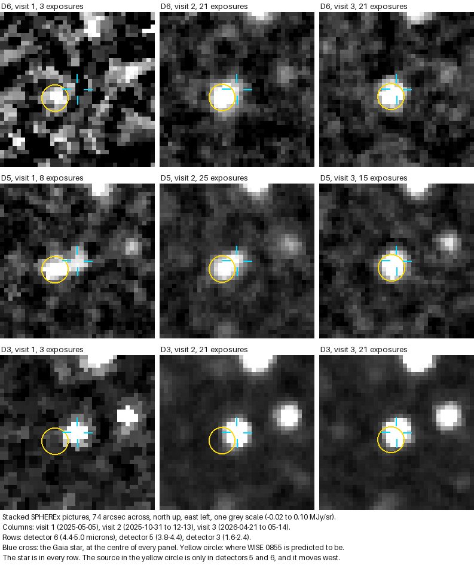

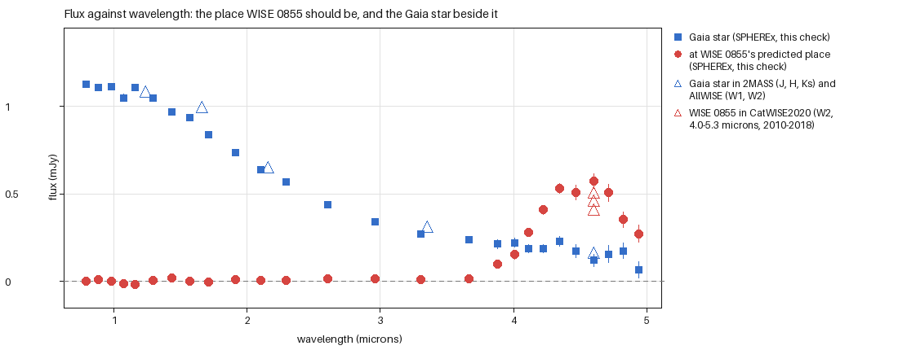

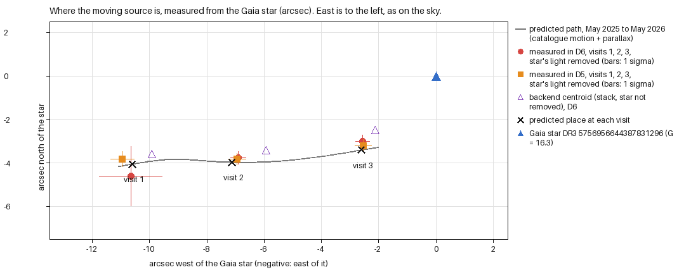

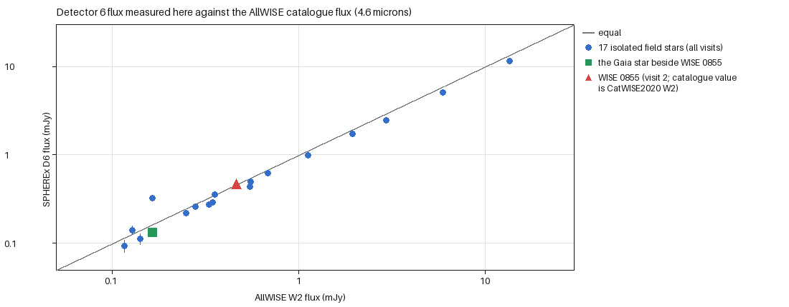

### How much of the light is the star

- Visit 1: none that matters. The two are 11.4 arcsec apart and the star is not even seen in three
  detector-6 exposures (-0.01 +- 0.07 mJy).
- Visit 2: they are 8.1 arcsec apart and can still be measured separately. The star is 0.15 mJy
  beside 0.47.
- Visit 3: they are 4.3 arcsec apart, less than one pixel, and form one blob. **In detector 6 the
  star is 22 to 25 per cent of that blob and WISE 0855 the rest. In detector 5 the star is 42
  per cent.**

### What the backend's numbers mean

The backend's own fit was re-run and gives exactly what was claimed: offsets (-0.7, +0.5),
(-1.2, +0.5), (-0.6, +0.9) arcsec and "S/N" 5.0, 18.6, 27.4.

- The offsets all point toward the star: the fit window takes in the star's light. With the star
  removed they shrink to 0.4 arcsec or less.
- The "S/N" of the backend is the height of a fitted bump divided by the roughness left over. It
  is not a detection strength. The same fit at empty places returns "S/N" of 5 or more in 3 of 78
  cases (visit 1) and in about 20 of 78 (visits 2 and 3). What makes the detection credible is the
  position: at no empty place was the fit both that strong and that close to where it was aimed.
- The 27.4 in visit 3 includes the star, which adds about a fifth to the blob there.

### What remains unverified

- Detector 6, visit 1, on its own: 3.7 times the noise from three exposures. Without detector 5
  it would not count as a detection.
- Absolute brightness is good to about 15 per cent (our values run 13 per cent below AllWISE for
  field stars; no correction was applied).
- The prediction comes from one source (SIMBAD, from Kirkpatrick et al. 2021). CatWISE2020 lists
  the object three times (its fast motion splits it); their 2015 positions are 0.4 to 1.2 arcsec
  from where this motion puts it then. That catalogue has no single clean position for it, so
  this is a rough outside check only. The SPHEREx positions themselves agree to 0.4 arcsec.
- A faint catalogued source (CatWISE J085502.09-071434.5, not detected at 4.6 microns) lies 3
  arcsec from the visit-3 place. It can add a few per cent at most.
- Catalogue magnitudes were turned into mJy with the standard WISE and 2MASS zero points, typed
  from memory of those surveys' documentation. The comparisons above that matter are ratios and
  do not depend on them.

### Wording for the demo

> SPHEREx detects WISE 0855-0714, one of the coldest known brown dwarfs, in its two
> longest-wavelength detectors (3.8 to 5.0 microns) and at no shorter wavelength. In three visits
> between May 2025 and May 2026 a source of about 0.5 mJy sits within half an arcsecond of the
> catalogued position, and it moves 8.4 +- 0.4 arcsec west in a year (catalogue: 8.0). A faint
> ordinary star lies 4 to 11 arcsec away; by the third visit the two overlap in SPHEREx's 6-arcsec
> pixels and the star supplies about a quarter of the light at 4.4 to 5 microns. The first visit
> has only three exposures in detector 6, where the source is marginal (3.7 times the noise);
> detector 5 has eight and shows it at 13 times the noise.

Do not say "S/N 5, 19 and 27" and do not say "within 1.3 arcsec": the first set is not a detection
strength and the third value includes the star.

---

## 2. RW Aurigae

**Verdict: confirmed, with caveats.** The star was brighter in the far red and fainter at 4 to 5
microns in September 2026 than in September 2025. Comparison stars in the same exposures did not
change, and AAVSO observers saw the optical brightening. The figure "2.5 times" is true of the
exposures compared, but those from 2025 were taken during a dip that lasted a few days.

### Evidence

- **Counts.** Own photometry (3-pixel circle): 330 exposures with a wavelength, 123 give a
  brightness, 169 are saturated, 38 are flagged. The backend, with a 2.5-pixel circle: 131 of 326.
- **Comparison stars stay put.** Four stars 90 to 190 arcsec away, measured in the same
  exposures and compared at the same wavelength (within 1.2 per cent): visit 3 divided by visit 1
  is 0.98 to 1.00 in every detector (296 pairs; two thirds of them within 3 to 5 per cent of 1).
  So the instrument did not drift.
- **RW Aur, visit 3 divided by visit 1, same wavelength:**

  | Wavelength | Pairs | Ratio |
  |---|---|---|
  | 0.75 to 0.84 microns (the claim) | 4 | 2.0 to 2.6 (2.52, 2.58, 2.20, 2.01) |
  | 0.84 to 0.90 | 1 | 1.56 |
  | 0.90 to 1.12 | 7 | 1.28 to 1.65, middle value 1.31 |
  | 1.1 to 2.4 (detectors 2, 3) | 2 | 1.28, 1.17 |
  | 3.8 to 4.4 (detector 5) | 2 measured, 39 from the ring | 0.50 and 0.51; ring 0.52 |
  | 4.4 to 5.0 (detector 6) | 3 measured, 37 from the ring | 0.45 to 0.51; ring 0.53 |

- **The 0.75 to 0.84 micron result rests on four pairs of single exposures**, taken on 2 September
  2025 (two at 00:45 and two at 23:30 UT) and 8 September 2026.
- **AAVSO, same dates** (11,510 observations by 55 observers, from AAVSO's VSX interface):
  - Month against month, September 2025 to September 2026: V band 12.49 to 11.95 (1.64 times
    brighter), R 11.76 to 11.18 (1.71 times), I 10.94 to 10.37 (1.68 times). The I band is
    centred near 0.80 microns, the same light as the claim.
  - Night by night around our 2025 exposures: I = 10.84 on 29 August, **11.24 on 31 August**,
    10.79 on 4 September. The star dipped by 0.4 magnitude for a few days and SPHEREx observed
    0.75 to 0.84 microns on 2 September, on the way out of the dip.
  - Turning the four SPHEREx ratios into an I magnitude (anchored to AAVSO's I = 10.29 on 9
    September 2026, a day after our exposures, so good to about 0.1 magnitude): 11.29 and 11.32
    at 00:45 on 2 September, 11.14 and 11.05 at 23:30. These fall between AAVSO's 11.24 (two
    days before) and 10.79 (two days after). **SPHEREx and AAVSO are consistent date for date.**
- **At 4 to 5 microns** the star is saturated in 33 of 37 first-visit exposures of detectors 5 and
  6, so only five direct pairs exist (0.45 to 0.51). The ring of unsaturated pixels gives the
  same answer from 76 pairs (0.52 and 0.53), and in the exposures that have both, ring and
  measured brightness keep the same proportion to within 8 per cent (detector 5) and 16 per cent
  (detector 6). The middle visit is in between (0.6 to 0.8 of the first).

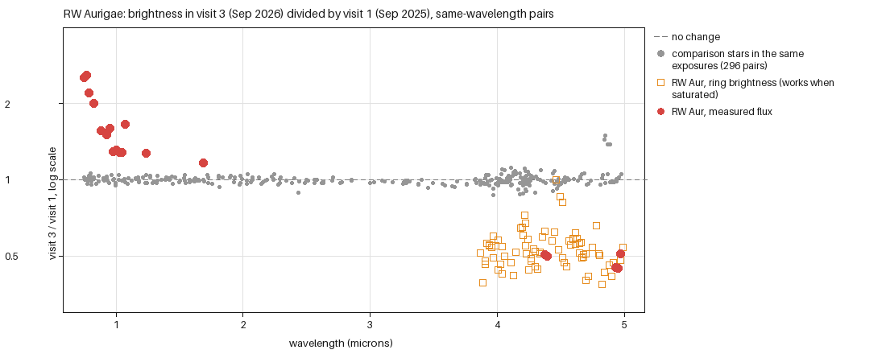

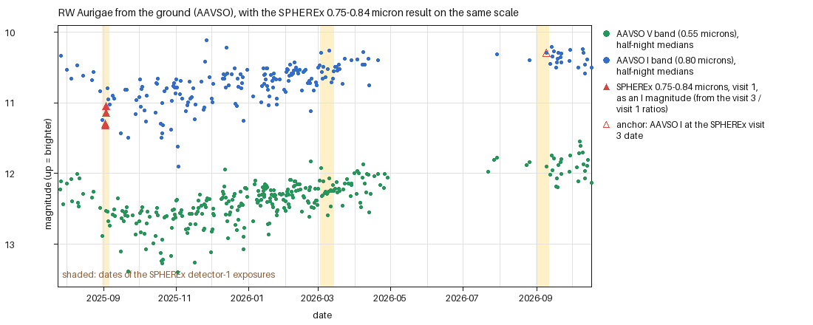

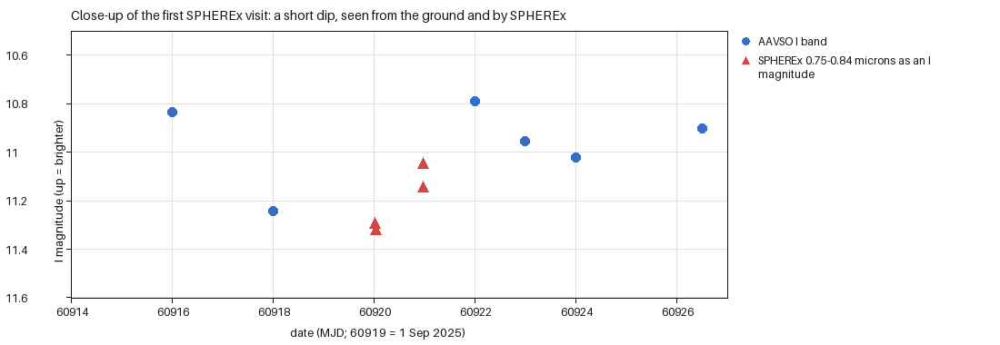

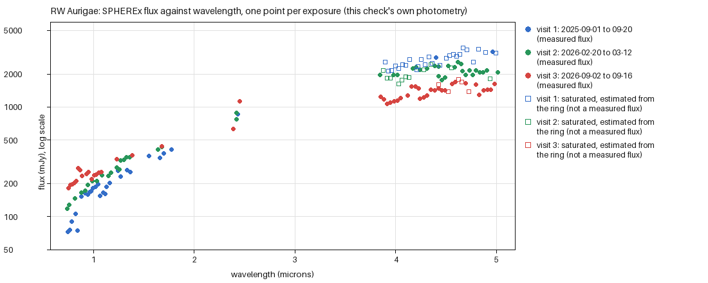

### What remains unverified

- **The fading at 3.9 to 5 microns has no outside check.** AAVSO has no data at these wavelengths
  and no other source was found for these dates. It rests on SPHEREx alone (comparison stars
  constant; two detectors, observed on different days, agree).
- The size of the far-red brightening depends on the days compared. Within the same visit the
  exposures at 0.9 to 1.1 microns were mostly taken on 3 and 4 September 2025, after the dip,
  and show 1.3 times.
- One first-visit exposure (0.839 microns, 2 September 2025) reads 74 mJy, 30 per cent below the
  exposure taken two minutes earlier at 0.820 microns. It carries no flag and the comparison
  stars in it are normal. Unexplained; it is not among the four pairs above, but the backend's
  fifth pair (ratio 2.85) uses it.
- A direct comparison of SPHEREx brightness with AAVSO's I band on nearly the same night agrees
  to 7 to 14 per cent in visit 3 and 23 per cent in visit 2 (where the star changed by 0.3
  magnitude within the day). This used an I-band zero point typed from memory and is a sanity
  check, not evidence.
- RW Aur is two stars 1.5 arcsec apart. SPHEREx and the AAVSO observers both measure the sum, so
  nothing here says which of the two changed.

### Wording for the demo

> RW Aurigae changed between SPHEREx's visits. In September 2026 it was about twice as bright at
> 0.75 to 0.84 microns as on 2 September 2025 (2.0 to 2.6 times in four same-wavelength pairs) and
> about half as bright at 3.9 to 5 microns, while comparison stars in the same exposures stayed
> constant to a few per cent. Ground-based AAVSO observers recorded the same optical brightening:
> 1.7 times between the two Septembers in the I band. They also show that our September 2025
> exposures at these wavelengths fell in a dip lasting a few days, which is why our factor is
> larger. The fading at 4 to 5 microns has no ground-based check. RW Aurigae is a close pair
> that SPHEREx measures as one.

Do not say "brightened 2.5 times in a year" without the dip.

---

## 3. R Draconis

**Verdict: confirmed, with caveats.** The star is saturated in every exposure, and the ring
measure is the only handle on it. That measure passes its control test and follows the cycle
recorded by AAVSO observers, with the delay expected at infrared wavelengths. It is a relative
measure, sampled on few dates, and one part of the claim is weak.

### Can the ring measure be trusted?

Yes, to about 5 per cent (12 at worst), in detectors 5 and 6. The same code and the same ring
(9.5 to 12.5 pixels from the star, sky taken 20 to 26 pixels out) were applied to Barnard's Star,
which is also saturated and does not vary:

| | Dates measured | Spread between dates | Largest departure |
|---|---|---|---|
| Barnard's Star (control) | 29 date groups, Aug 2025 to Sep 2026 | 0.05 magnitude (5 per cent) | 0.12 magnitude (12 per cent) |
| R Draconis | 43 date groups, May 2025 to Jun 2026 | 0.30 magnitude | range 0.62 to 1.18 magnitude (1.8 to 3.0 times) |

Single exposures scatter by 3 to 10 per cent about the solution for both stars. A second ring
(6.5 to 9.5 pixels) gives the same range for R Draconis in detector 6.

### Evidence

- **Saturation.** Own photometry: 479 exposures with a wavelength (of 548 cached), all 479
  saturated. The backend counts 496, all saturated. The ring is usable in 148 exposures of
  detectors 5 and 6 (backend: 137).
- **AAVSO** (1,051 observations by 61 observers, 1,015 of them by eye or in the V band; AAVSO
  lists a period of 246.12 days): brightest near 11 May 2025 (magnitude 7.4), faintest near
  6 October 2025 (12.4), brightest near 26 December 2025 (7.0), faintest near 4 June 2026 (12.7).
- **SPHEREx ring brightness** (each wavelength group relative to its own mean):
  - 16 May to 1 July 2025: the brightest of the three visits, 0.2 to 0.6 magnitude above each
    group's average.
  - 18 November 2025 to 13 January 2026: 0.2 to 0.5 magnitude fainter than that, and rising by
    up to 0.2 magnitude within the visit.
  - 22 April to 23 June 2026: fading steadily, faintest in late May and June 2026.
- **The two agree.** Date for date, the SPHEREx values follow the AAVSO curve with correlation
  +0.93 to +0.99 when the infrared is allowed to trail the visible by 20 to 40 days (+0.46 to
  +0.88 with no delay). The infrared changes by 0.10 to 0.18 magnitude for each visual magnitude.
  With only three visits this test has little freedom: what it shows is that the order of the
  three visits is right, and that the trends inside the second and third visits go the right way.
  A delay of that kind and a much smaller swing are what is generally expected of this type of
  star in the infrared (general knowledge, not checked here).

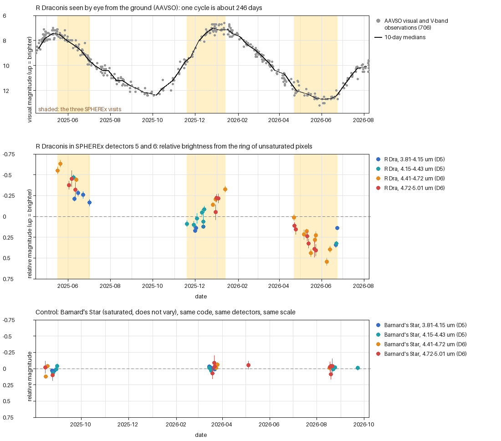

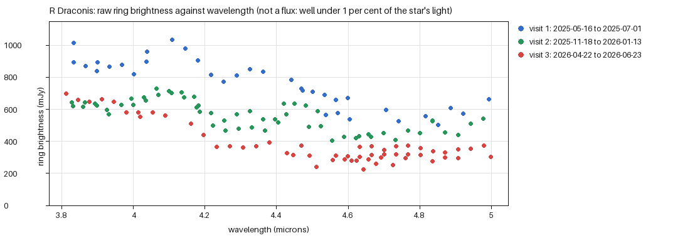

### What remains unverified

- **No brightness in physical units.** The ring holds well under 1 per cent of the star's light.
  Only changes mean anything.
- **"Fading through mid-2025" is weak.** Within the first visit the changes are 0.1 to 0.2
  magnitude, about the size of the method's own scatter, and not steady: the last date of each
  wavelength group is the faintest, nothing more. The visible light was dropping fast then (7.4
  to 10.3), but the infrared trails it.
- **Sparse dates.** Detector 5 saw the star on 6, 11 and 3 separate days in the three visits;
  detector 6 on 7, 7 and 12. The third visit of detector 5 is three days in June 2026.
- **The amount depends on wavelength.** The swing is 1.8 times at 3.8 to 4.15 microns and 3.0
  times at 4.4 to 4.7. Near minimum the star's spectrum changes shape (a dip appears at 4.15 to
  4.4 microns), so wavelength groups were solved separately. One number for "how much it varies"
  would be wrong.
- The delay of 20 to 40 days comes from 8 to 14 dates per group, tried in 5-day steps. It is
  a best match, not a measurement with an uncertainty.
- Detectors 1 to 4 were not examined (the backend already distrusts them).

### Wording for the demo

> R Draconis saturates SPHEREx in every exposure, so we cannot give its brightness. Instead we
> measure the light in a ring of unsaturated pixels around it, in the two longest-wavelength
> detectors. Over three visits that light rises and falls by a factor of about 2 to 3, in step
> with the 246-day cycle that AAVSO observers record by eye and trailing it by a few weeks:
> brightest in May and June 2025, lower and rising from November 2025 to January 2026, faintest
> in May and June 2026. The same measurement on Barnard's Star, which does not vary, stays flat
> to about 5 per cent.

Say "relative brightness", never "flux". Leave out "fading through mid-2025".

---

## 4. Optional: Barnard's Star, 1.45 arcsec east in the first visit

**Verdict: it is an effect of saturation, and about the size of error to expect for this star. Why
August 2025 behaves differently from 2026 is not established.**

All offsets below are east-west, measured minus predicted, in arcsec, for visits 1, 2, 3.

| Measurement | Detector 5 | Detector 2 |
|---|---|---|
| Backend's stack and fit, as it is (reproduces the claim) | +1.45, -0.07, +0.01 | +1.25, -0.15, +0.16 |
| The same, with the saturated pixels blanked first | +0.64, +0.23, -0.25 | +0.05, +1.85, no fit |
| This check's fit of the unsaturated pixels only | -0.5, +0.9, -0.6 | -0.6, +1.8, -0.6 |
| Ordinary field stars in the same exposures | 0.0, 0.0, 0.0 (+- 0.1) | 0.0, +0.1, -0.1 (+- 0.1) |
| Uncertainty the backend's fit reports for itself | 0.04, 0.03, 0.03 | 0.11, 0.05, 0.04 |

- **It is not the prediction and not the image alignment.** Six ordinary field stars in the same
  exposures sit on their Gaia positions in every visit, in both detectors. Visit 3 is at the same
  time of year as visit 1 and agrees with the same prediction.
- **It is not a few exposures.** Exposure by exposure, the backend's fit swings from -1.7 to +3.8
  arcsec east in visit 1 (spread 1.75 arcsec) against 0.3 arcsec in visits 2 and 3. The swing
  repeats with the exposure's place in each run of four consecutive exposures: on average -1.2,
  +1.2, +2.4, +3.2 arcsec for the first to the fourth.
- **It is not where the star lands on the detector.** The same pattern appears in runs at
  different wavelengths (different places on the detector), and detector 2, which looks at the
  sky through the same telescope in the same exposures, shows the same pattern (-1.1, +1.5,
  +3.1, +3.7).
- **The saturated core is what the fit follows.** Near the star a typical exposure has 15 to 18
  pixels lost to saturation in detector 5 and 39 to 48 in detector 2. The backend's mask keeps
  all of them in detector 5 and nearly all in detector 2, because they still hold numbers. With
  those pixels blanked in temporary copies and the backend's code otherwise unchanged, the
  visit-1 offset drops from 1.45 to 0.64 arcsec (detector 5) and from 1.25 to 0.05 (detector 2).
- **But the unsaturated light alone is no better overall.** Blanking moves visit 2 of detector 2
  to +1.85 arcsec, and a second method that uses only unsaturated pixels disagrees with the
  first by up to 1.1 arcsec. Both show offsets that change sign when the detector is turned by
  180 degrees (visit 2), which points to a lopsided outer star image, not to motion.
- **So the honest statement is about uncertainty.** With 15 to 50 pixels missing from its centre,
  this star cannot be placed to better than about 1 arcsec in detector 5 or 2 arcsec in detector
  2, whichever pixels are used. A 1.45 arcsec disagreement is within that. The uncertainty the
  fit reports for itself (0.03 to 0.11 arcsec) is 10 to 40 times too small for this star.
- Not established: why the saturated pixels of August 2025 are lopsided in a pattern that repeats
  through each run of four exposures, while those of 2026 are not. These pixels overflowed within
  the first seconds of the exposure (that is what OVERFLOW together with SUR_ERROR means), so
  whatever value they hold reflects the start of the exposure, not its average. One possibility
  is that the star's image had not yet settled when those exposures began. That was not tested.
- Limit of this check: the second wings-only method could only be tested on RW Aurigae (same
  detector, core left out on purpose), where it lands within 0.6 arcsec of an ordinary fit on
  average but scatters by 0.9 arcsec per exposure, because that star's outer light is far fainter.

Wording for the demo:

> Barnard's Star saturates SPHEREx in every detector, so its position is good to about one
> arcsecond, a sixth of a pixel. Its measured position agrees with Gaia's proper motion and
> parallax to within 1.5 arcsec east-west and 0.3 arcsec north-south in all three visits
> (detector 5). Unsaturated field stars in the same frames agree with Gaia to 0.1 arcsec.

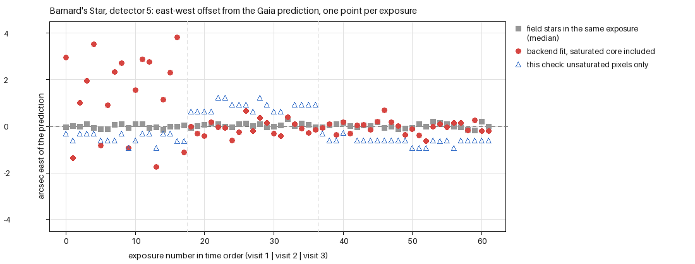

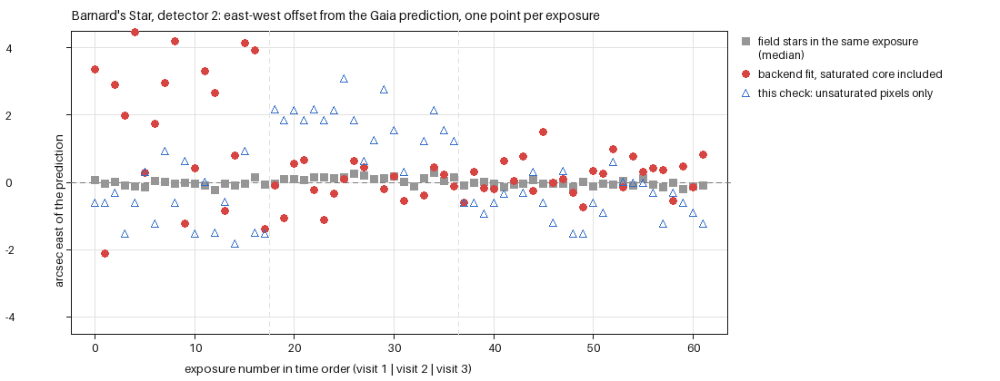

---

## Backend findings (reported, not changed)

1. **The centroid fit uses saturated core pixels, and understates its error.**
   `pipeline.prepare_cutout` keeps pixels flagged SUR_ERROR where BLOOM is also set (by design,
   for display), and `fit_source` leaves out only pixels with no value. In detectors 5 and 2
   (the two examined) the saturated core of Barnard's Star still holds numbers, so all or nearly
   all of it enters the fit, although the docstring says a saturated star "is located from its
   unsaturated wings". This produces the 1.45 arcsec offset of section 4. Leaving out the pixels
   that `photometry.saturated_pixels` marks would follow the docstring, but section 4 shows it
   does not make the position right either. What is wrong in every case is `err_arcsec`: 0.03 to
   0.11 arcsec for a star whose position is only good to 1 or 2 arcsec.
2. **`fit_source`'s `snr` is not a detection strength.** At places with no catalogued source within
   16 arcsec it returns 5 or more in about a quarter of cases in a 21-exposure stack (section 1).
   Shown in the interface as "S/N" it will mislead. A forced measurement at the expected place,
   divided by the scatter of the same measurement at empty places, gives a number that means
   what it says.
3. **Blended neighbours pull the centroid.** For WISE 0855 the marker sits 0.7 to 1.2 arcsec toward
   the Gaia star, and the third visit's `snr` includes the star's light.
4. **Light-curve points are single exposures.** For a star that changes within days (RW Aurigae),
   a ratio between two visits depends on the day each wavelength happened to be observed. The
   chart is right; a headline number taken from it needs the dates.
5. Small: the notes say the star image is "about 7.4 arcsec" wide; the detector 6 headers say
   `PSF_FWHM` 9.04.

No error was found in the predicted positions (own calculation agrees with
`astrometry.position_at` to 0.015 arcsec), the wavelength bins, the saturation rule or the
photometry itself.

## Outside sources

| Source | Used for | Result |
|---|---|---|
| VizieR, CfA mirror: AllWISE (II/328), 2MASS (II/246), Gaia DR3 (I/355) | catalogue values near WISE 0855 and RW Aur | reached |
| VizieR, CfA mirror: CatWISE2020 (II/365), unWISE (II/363) | faint sources near WISE 0855 | answered with no rows |
| VizieR Strasbourg, IUCAA and NAOJ mirrors | the same | no usable answer in 15 minutes of trying (errors not recorded); stopped |
| IRSA catalogue TAP (`catwise_2020`) | the same | timed out four times at 90 s; stopped |
| IRSA Gator (`catwise_2020`) | CatWISE2020 near WISE 0855 | reached (206 rows; two requests in all) |
| NOIRLab Data Lab TAP | CatWISE2020 | connection refused |
| AAVSO, www.aavso.org | light curves | refuses scripts (challenge page); not pursued |
| AAVSO VSX interface, vsx.aavso.org | RW Aur (11,512 rows), R Dra (1,051 rows), periods | reached |
| ASAS-SN, ZTF | RW Aur | not attempted: AAVSO covered the dates |

The SPHEREx image archive was not contacted. All requests used a generic client name and carried
no project details.

## How to re-run

```
export SPHEREX_CACHE_DIR=<the cache that holds the cutouts>
.venv/bin/python scripts/verify_wise0855.py     # claim 1, about 4 minutes
.venv/bin/python scripts/verify_rwaur.py        # claim 2, about 1 minute
.venv/bin/python scripts/verify_rdra.py         # claim 3, about 1 minute
.venv/bin/python scripts/verify_barnard.py 5    # section 4 (also: 2), about 2 minutes each
```

Each prints its numbers, writes them to `scripts/out/verify/*.json` and redraws the figures in
`docs/verification/`. Catalogue and AAVSO answers are kept in `scripts/out/verify/` after the
first run. `scripts/verify_common.py`, `verify_fit.py` and `verify_plot.py` are shared helpers.
